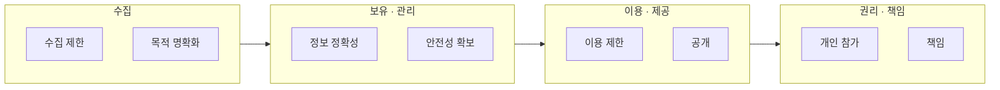

# 개인정보 프라이버시 8원칙

---

## I. 각국 개인정보 법의 공통 뿌리, OECD 프라이버시 8원칙의 개요

### 가. 정의

- OECD가 1980년 「프라이버시 보호와 개인정보의 국가 간 이동에 관한 가이드라인」에서 제시한 **개인정보 처리의 8가지 기본 원칙** (2013년 개정)

### 나. 특징

| 구분 | 내용 |
| --- | --- |
| 등장 배경 | 국경 간 데이터 이동 증가와 각국 규제 차이 조정 필요 |
| 성격 | 법적 구속력 없는 권고 (Soft Law) |
| 영향 | EU 지침·GDPR, 국내 [[개인정보보호법]] 제3조(보호 원칙)의 토대 |
| 범위 | 수집부터 이용·관리·권리 보장·책임까지 전 과정 |

---

## II. 8원칙 구조 및 내용

### 가. 처리 단계별 구조

- 수집 → 관리 → 이용 → 권리 보장 흐름에 원칙을 배치하고, 책임 원칙이 전체 준수를 담보

### 나. 원칙별 내용

| 구분 | 요소 | 설명 |
| --- | --- | --- |
| 수집 | 수집 제한 (Collection Limitation) | 적법·공정한 수단으로, 필요 시 정보주체 인지·동의하에 수집 |
| | 목적 명확화 (Purpose Specification) | 수집 시점까지 목적을 명시하고 이후 이용은 그 목적에 한정 |
| 관리 | 정보 정확성 (Data Quality) | 목적에 필요한 범위에서 정확·완전·최신 유지 |
| | 안전성 확보 (Security Safeguards) | 분실·무단 접근·변조·공개에 대한 보호조치 |
| 이용 | 이용 제한 (Use Limitation) | 동의 또는 법적 근거 없이 목적 외 이용·제공 금지 |
| | 공개 (Openness) | 처리 방침, 관리자 신원·소재 공개 |
| 권리 | 개인 참가 (Individual Participation) | 열람·이의 제기·정정·삭제 요구 보장 |
| 책임 | 책임 (Accountability) | 관리자가 원칙 준수에 책임, CPO·내부관리계획 등으로 이행 |

---

## III. 비교 및 동향

### 가. OECD 8원칙 vs GDPR vs 개인정보보호법

| 비교 항목 | OECD 8원칙 | EU GDPR | 개인정보보호법 |
| --- | --- | --- | --- |
| 성격 | 권고 | 직접 적용 규정, 과징금 (최대 매출 4%) | 법률, 과징금 (전체 매출 3% 이하) |
| 정보주체 권리 | 열람·정정·삭제 | 삭제권(잊힐 권리), 이동권, 처리 제한권 | 열람·정정·삭제·처리정지, 전송요구권 |
| 책임성 수단 | 원칙 수준 | DPO, DPIA, PbD(제25조) | CPO, [[개인정보 영향평가]], [[ISMS-P]] |
| 국외 이전 | 자유로운 이동과 보호 조화 | 적정성 결정, SCC | 동의, 인증, 적정성 인정 등 이전 요건 |

### 나. 동향

- **책임성 강화**: 원칙 준수를 입증하는 책임(Accountability)을 중심으로 각국 법이 수렴
- **AI 대응**: OECD AI 원칙(2019, 2024 개정)과 연계해 AI 학습 데이터의 목적 제한·투명성 논의
- **PET 활용**: [[차분 프라이버시]]·[[합성 데이터]]·[[영지식증명]] 등으로 원칙을 기술적으로 구현

---

### 🔗 연관 토픽

- **소속 도메인**: [[00_보안_MOC|🛡️ 보안]]
- **세부 분류**: `2. 현대 암호학 & 키 관리 · 전자서명`
- **핵심 연관 토픽**:
  - [[개인정보보호법]]
  - [[개인정보보호 중심 설계|개인정보보호 중심 설계(Privacy by Design)]]
  - [[개인정보 영향평가|개인정보 영향평가(Privacy Impact Assessment)]]
  - [[CBPR|CBPR (국경 간 프라이버시 규칙) 개인정보 전송 관련 최신 글로벌 이슈]]
  - [[ISMS-P]]
