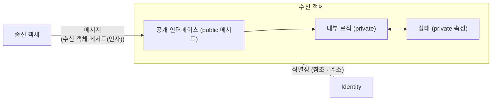

# 객체 (Object)

---

## I. 상태와 행위를 가진 실행 단위, 객체의 개요

### 가. 정의

- 현실의 개체를 모델링하여 **상태(속성)와 행위(메서드)를 하나로 묶고 고유한 식별성(Identity)을 갖는** [[객체지향]] 프로그램의 기본 단위

### 나. 특징

| 구분 | 내용 |
| --- | --- |
| 등장 배경 | 데이터와 함수가 분리된 구조적 프로그래밍의 유지보수 한계 |
| 자율성 | 자신의 상태를 스스로 관리하고 메시지에 응답 |
| 협력 | 객체 간 메시지 교환으로 기능 수행 |
| 재사용 | 독립 단위로 [[모듈화]]·재사용 용이 |

---

## II. 구조 및 구성요소

### 가. 객체 구조와 메시지 처리

- 송신 객체가 보낸 메시지를 공개 인터페이스로 받아 내부 로직이 은닉된 상태를 조작하고 결과를 반환

### 나. 구성요소

| 구분 | 요소 | 설명 |
| --- | --- | --- |
| 3요소 | 상태 (State) | 속성값의 집합, 행위에 따라 변화 |
| | 행위 (Behavior) | 메시지에 반응해 수행하는 메서드 |
| | 식별성 (Identity) | 상태가 같아도 서로 구별되는 고유성 |
| 상호작용 | 메시지 | 수신 객체·메서드명·인자로 구성된 요청 |
| 구조화 원리 | [[캡슐화]] | 데이터와 메서드를 한 단위로 묶어 [[응집도]] 향상 |
| | [[정보은닉]] | 내부 구현을 감추고 인터페이스만 공개 |
| 확장 원리 | [[상속성]] | 상위 클래스의 속성·행위 물려받기 |
| | [[다형성]] | 같은 메시지에 객체별로 다른 동작 |

---

## III. 비교 및 동향

### 가. 객체 vs 클래스

| 비교 항목 | 객체 (Object) | [[클래스]] (Class) |
| --- | --- | --- |
| 개념 | 클래스로부터 생성된 실체 ([[인스턴스]]) | 객체 생성을 위한 틀, 추상 데이터 타입 |
| 존재 위치 | 실행 시 힙 메모리 | 코드·메타데이터 (메서드 영역) |
| 상태 | 인스턴스마다 고유 상태 보유 | 구조·행위 정의 (static 멤버 제외) |
| 생명주기 | new로 생성, GC·명시적 해제로 소멸 | 로딩 후 프로그램 실행 동안 유지 |
| 식별 | 참조(주소)로 구별 | 타입 이름으로 구별 |

### 나. 동향

- [[DDD (Domain Driven Design)|DDD]]에서 식별성을 가진 엔티티, 식별성 없는 값 객체(Value Object), 일관성 경계인 애그리거트로 객체 역할을 세분화
- 동시성 안전을 위해 불변 객체·Record 타입 활용 확대

---

### 🔗 연관 토픽

- **소속 도메인**: [[00_소프트웨어공학_MOC|🏗️ 소프트웨어공학]]
- **세부 분류**: `3. 요구사항 공학 & UML 객체지향 분석/설계`
- **핵심 연관 토픽**:
  - [[클래스]]
  - [[인스턴스]]
  - [[객체지향]]
  - [[캡슐화|캡슐화 (encapsulation)]]
  - [[다형성|다형성 (Polymorphism)]]
