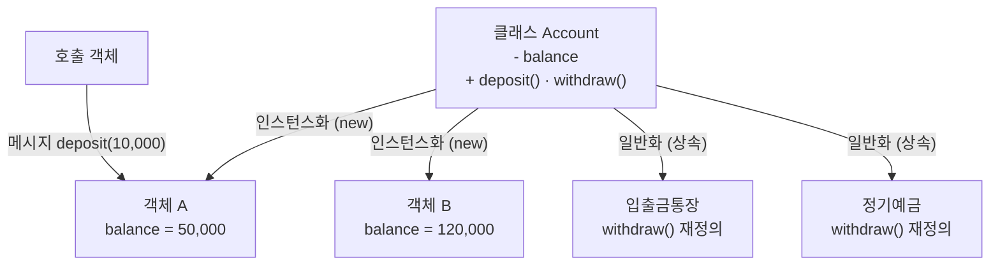

# 객체지향 (Object-Orientation)

---

## I. 객체의 협력으로 시스템을 구성, 객체지향의 개요

### 가. 정의

- 현실의 개체를 **상태와 행위를 가진 객체로 모델링하고, 객체 간 메시지 교환으로 시스템을 구성**하는 소프트웨어 개발 패러다임

### 나. 특징

| 구분 | 내용 |
| --- | --- |
| 등장 배경 | 대규모 시스템 복잡도 증가, 절차지향의 재사용·유지보수 한계 |
| 의미적 간극 축소 | 현실 개념과 SW 구조를 가깝게 대응 |
| 변경 국소화 | [[캡슐화]]·[[정보은닉]]으로 변경 영향을 객체 내부로 한정 |
| 재사용 · 확장 | [[상속성\|상속]]·[[다형성]]·합성으로 재사용과 확장 |

---

## II. 구성요소 및 핵심 원리

### 가. 클래스·객체·메시지 관계

- 클래스로 독립 상태를 가진 객체를 만들고, 메시지로 협력하며, 상속과 재정의로 같은 메시지에 다른 동작 제공

### 나. 구성요소 및 원리

| 구분 | 요소 | 설명 |
| --- | --- | --- |
| 구성요소 | [[클래스]] | 속성과 메서드를 정의한 객체의 틀 (추상 데이터 타입) |
| | [[객체]] · [[인스턴스]] | 클래스로 생성된 실체, 고유 상태와 식별성 보유 |
| | 메시지 · 메서드 | 객체 간 요청 수단과 이를 처리하는 연산 |
| 핵심 원리 | [[추상화]] | 본질적 특성만 추출해 모델링 |
| | [[캡슐화]] | 데이터와 연산을 한 단위로 결합 |
| | [[정보은닉]] | 접근 제어자로 내부 구현 은폐 |
| | [[상속성]] | 상위 클래스의 속성·메서드 재사용·확장 (IS-A) |
| | [[다형성]] | 오버로딩(정적 바인딩), 오버라이딩(동적 바인딩) |
| 설계 원칙 | [[객체지향 설계 원리\|SOLID]] | SRP·OCP·LSP·ISP·DIP |

---

## III. 비교 및 동향

### 가. 절차지향 vs 객체지향

| 비교 항목 | 절차지향 (POP) | 객체지향 (OOP) |
| --- | --- | --- |
| 중심 | 함수·처리 순서 | 데이터와 행위를 가진 객체 |
| 데이터 접근 | 전역 데이터 공유, 부작용 위험 | 인터페이스를 통한 제어된 접근 |
| 재사용 | 함수 단위, 수정 파급 큼 | 상속·다형성·합성 |
| 설계 방식 | 하향식 기능 분해 | 객체 식별과 협력 설계 |
| 초기 비용 | 낮음 | 추상화·관계 설계로 높음 |
| 대표 언어 | C, Pascal, Fortran | Java, C++, C#, Kotlin |

### 나. 동향

- [[DDD (Domain Driven Design)|DDD]]의 풍부한 도메인 모델로 [[MSA (Micro Service Architecture)|MSA]] 서비스 경계(Bounded Context) 설계
- 불변 객체·Record·람다를 수용한 객체지향·함수형 멀티 패러다임 언어 확산

---

### 🔗 연관 토픽

- **소속 도메인**: [[00_소프트웨어공학_MOC|🏗️ 소프트웨어공학]]
- **세부 분류**: `3. 요구사항 공학 & UML 객체지향 분석/설계`
- **핵심 연관 토픽**:
  - [[객체지향 프로그래밍 특징]]
  - [[객체지향 설계 원리]]
  - [[클래스]]
  - [[추상화|추상화 (Abstraction)]]
  - [[캡슐화|캡슐화 (encapsulation)]]
