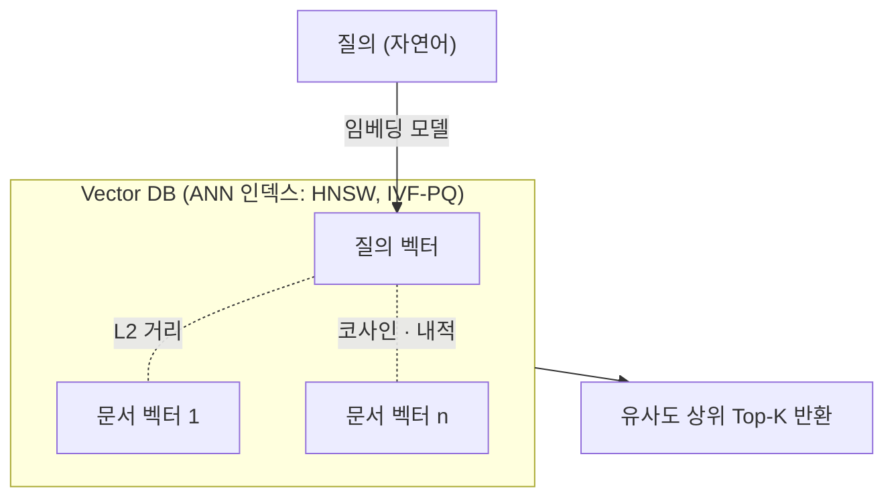

# 거리 공식 (Distance Metric) / 거리 함수

---

## I. 벡터 간 유사도 측정 척도, 거리 공식의 개요

### 가. 정의

- 벡터 공간 위의 두 데이터 포인트 사이의 **상이성(Dissimilarity) 또는 [[유사도]](Similarity)를 수치로 산출**하는 수학적 함수

### 나. 필요성 및 특징

| 구분 | 내용 |
| --- | --- |
| 필요성 | KNN·K-Means 등 거리 기반 학습, 텍스트·이미지 임베딩의 의미 검색([[RAG (Retrieval Augmented Generation) 검색 증강 생성 AI\|RAG]]) 품질 확보 |
| 거리 공리 | 비음성 $d(x,y) \ge 0$, 동일성 $d(x,y)=0 \Leftrightarrow x=y$, 대칭성, 삼각 부등식을 만족해야 엄밀한 거리(Metric) |
| 척도 선택 | 데이터 유형(연속형·범주형·이진)과 목적(분류·군집·검색)에 따라 선택 |
| 전처리 | 변수 단위가 다르면 정규화·표준화 선행 필요 |

- 코사인 유사도는 삼각 부등식을 만족하지 않아 엄밀한 의미의 거리는 아니며, $1-\cos\theta$를 코사인 거리로 사용

---

## II. 동작 구조 및 주요 척도

### 가. 벡터 검색에서의 거리 계산

- 질의 임베딩과 저장 벡터 간 거리를 계산하되, 전수 비교(Exact KNN) 대신 HNSW 등 ANN 인덱스로 후보를 좁혀 ms 단위로 검색

### 나. 주요 척도

| 분류 | 척도 | 산식 · 설명 |
| --- | --- | --- |
| 기하학적 | 유클리드 거리 (L2) | $d=\sqrt{\sum (x_i-y_i)^2}$, 두 점 간 직선 거리, K-Means·KNN 기본 |
| | 맨해튼 거리 (L1) | $d=\sum \lvert x_i-y_i \rvert$, 격자 경로 거리, 제곱하지 않아 [[이상치]] 영향이 L2보다 작음 |
| | 민코프스키 거리 | $d=(\sum \lvert x_i-y_i \rvert^p)^{1/p}$, $p=1$이면 L1, $p=2$면 L2 |
| | 체비셰프 거리 (L∞) | $d=\max_i \lvert x_i-y_i \rvert$, 차원별 차이 중 최댓값 (체스보드 거리) |
| 방향 기반 | 코사인 유사도 | $\cos\theta=\frac{A\cdot B}{\lVert A\rVert \lVert B\rVert}$, 크기와 무관하게 방향만 비교, 텍스트 임베딩에 적합 |
| | 내적 (Dot Product) | $A\cdot B$, 크기와 방향을 함께 반영, 정규화 벡터에서는 코사인과 순위 동일 |
| 통계적 | 마할라노비스 거리 | $d=\sqrt{(x-\mu)^T S^{-1}(x-\mu)}$, 공분산으로 변수 간 상관·척도 차이 보정, 이상 탐지 |
| 범주·이진 | 해밍 거리 | 같은 길이의 문자열·비트열에서 서로 다른 자리 수 |
| | 자카드 거리 | $1-\frac{\lvert A\cap B \rvert}{\lvert A\cup B \rvert}$, 집합 간 겹침 정도 |

---

## III. 비교 및 동향

### 가. 유클리드 거리 vs 코사인 유사도

| 비교 항목 | 유클리드 거리 (L2) | 코사인 유사도 |
| --- | --- | --- |
| 측정 대상 | 위치 차이 (크기 포함) | 방향 차이 (각도) |
| 크기 민감도 | 민감 (문서 길이·빈도에 영향) | 둔감 |
| 고차원 | 거리 집중 현상(차원의 저주)으로 변별력 저하 | 상대적으로 의미 보존에 유리 |
| 활용 | 좌표·센서·이미지 특징, 군집화 | 문서 검색, 추천(협업 필터링), RAG |

### 나. 동향

- **내적 기반 고속화**: 최근 임베딩 모델은 L2 정규화 벡터를 반환하므로 나눗셈·제곱근 없는 내적으로 코사인과 같은 순위를 얻어 지연시간 단축
- **이진 양자화 + 해밍 거리**: Float32 임베딩을 비트로 압축하고 XOR·popcount로 거리를 계산해 메모리와 연산량을 크게 절감한 뒤 상위 후보만 정밀 재순위화
- **Matryoshka 임베딩 (MRL)**: 중요한 정보를 앞쪽 차원에 몰아 학습해, 차원을 잘라 쓰면서도 검색 품질 유지

---

### 🔗 연관 토픽

- **소속 도메인**: [[00_인공지능_MOC|🤖 인공지능]]
- **세부 분류**: `1. 수학 · 통계학 & 데이터 전처리`
- **핵심 연관 토픽**:
  - [[유사도|유사도(Similarity)]]
  - [[이상치]]
  - [[상관 관계 분석|상관 관계 분석 (Correlation Analysis)]]
  - [[RAG (Retrieval Augmented Generation) 검색 증강 생성 AI|RAG]]
  - [[초거대 언어 모델|초거대 언어 모델(Large Language Model)]]
