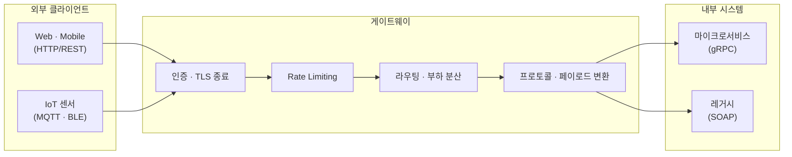

# 게이트웨이 (Gateway)

---

## I. 이기종 네트워크의 관문, 게이트웨이의 개요

### 가. 정의

- 서로 다른 프로토콜·주소 체계·데이터 형식을 쓰는 네트워크 사이에서 **프로토콜과 데이터를 변환해 통신을 중계하는 연결 지점**(하드웨어 또는 소프트웨어)

### 나. 특징 및 필요성

| 구분 | 내용 |
| --- | --- |
| 프로토콜 변환 | 상이한 아키텍처 간 연동 (예: TCP/IP ↔ SNA, MQTT ↔ HTTP) |
| 전 계층 동작 | 필요 시 L3~L7까지 해석·변환 (라우터는 L3까지) |
| 단일 진입점 | 외부 트래픽을 한 곳에서 받아 인증·통제·라우팅 |
| 기본 게이트웨이 | 호스트가 자기 서브넷 밖으로 나갈 때 패킷을 넘기는 첫 [[라우터]] 주소 |
| 확산 배경 | [[MSA (Micro Service Architecture)\|MSA]]의 API 진입점, IoT 기기와 인터넷 간 연동 수요 |

---

## II. 구조 및 핵심 기능

### 가. API·IoT 게이트웨이 처리 흐름

- 이기종 요청을 단일 진입점에서 받아 인증·트래픽 제어·변환을 거쳐 내부 백엔드로 전달

### 나. 핵심 기능

| 구분 | 요소 | 설명 |
| --- | --- | --- |
| 변환 | 프로토콜 변환 | REST ↔ gRPC, HTTP/1.1 ↔ HTTP/2, MQTT ↔ HTTP |
| | 페이로드 변환 | [[XML]] ↔ [[JSON]] 등 데이터 형식 변환 |
| 연결 | 메시지 라우팅 | URI·헤더 기반 엔드포인트 선택 |
| | 로드 밸런싱 | Round Robin, Least Connection으로 [[HA(High Availability)\|가용성]] 확보 |
| 보안 | 인증·인가 | OAuth 2.0, JWT, API Key 검증, TLS 종료 |
| | 트래픽 제어 | Rate Limiting·Throttling으로 과부하 방지, [[QoS]] 확보 |
| [[신뢰성]] | 서킷 브레이커 | 장애 서비스 호출 차단, Fallback 처리로 연쇄 장애 방지 |
| 관찰성 | 로깅·트레이싱 | 메트릭 수집, 분산 트레이싱(Zipkin, Jaeger) |

---

## III. 비교 및 동향

### 가. 게이트웨이 vs 라우터

| 비교 항목 | 게이트웨이 | [[라우터]] |
| --- | --- | --- |
| 목적 | 이기종 프로토콜 변환·연동 | IP망 내 최적 경로로 패킷 전달 |
| 동작 계층 | 전 계층 (주로 L4~L7) | L3 ([[네트워크 계층]]) |
| 처리 단위 | 메시지, 데이터 형식 | 패킷 |
| 주요 기능 | 변환, API 라우팅, 인증 | 라우팅, 포워딩 |
| 구현 예 | [[API Gateway]](Kong, NGINX), IoT 게이트웨이, SWG | 라우터, L3 [[스위치 (Layer 3 Switch)\|스위치]] |

### 나. 동향

- **eBPF 기반 게이트웨이**: [[커널]]에서 패킷을 처리해 사용자 공간 전환 오버헤드 감소 (예: Cilium)
- **Service Mesh 연계**: North-South는 API Gateway, East-West는 Service Mesh(Envoy)가 담당하며 Ingress Gateway로 통합 운영
- **클라우드 보안 게이트웨이**: SWG가 [[SASE(Secure Access Service Edge)|SASE]]의 구성요소로 흡수되어 [[제로 트러스트 보안모델|Zero Trust]] 정책 적용

---

### 🔗 연관 토픽

- **소속 도메인**: [[00_네트워크_MOC|🌐 네트워크]]
- **세부 분류**: `1. OSI 7계층 & 데이터링크 계층 (L1/L2)`
- **핵심 연관 토픽**:
  - [[라우터]]
  - [[프로토콜]]
  - [[스위치 (Layer 3 Switch)]]
  - [[API Gateway]]
  - [[MQTT (Message Queuing Telemetry Transport)]]
