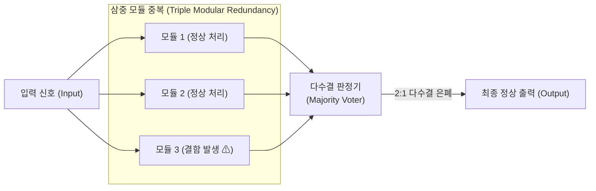

# 결함허용 컴퓨터 (Fault Tolerant System, FTS)

---

## I. 시스템 중단 없는 연속 가동 보장, 결함허용 컴퓨터의 개요

### 가. 정의

- 하드웨어 부품의 고장이나 소프트웨어 오류 등 시스템 내부 결함(Fault)이 발생하더라도 **서비스 중단이나 데이터 유실 없이 정상적인 동작을 지속하도록 설계된 컴퓨터 시스템**

### 나. 특징 및 필요성

| 구분 | 내용 |
| --- | --- |
| 무중단성 (Zero Downtime) | 결함 감지 및 절체 과정에서 서비스 중단 시간(Downtime)을 0으로 유지 |
| 결함 은폐 (Fault Masking) | 다중화와 보팅(Voting) 메커니즘을 통해 오류가 외부 시스템 출력으로 전달되는 것을 즉각 차단 |
| 다중 중복성 (Redundancy) | 하드웨어, 소프트웨어, 데이터, 시간 차원의 중복 설계를 결합하여 단일 장애점(SPOF) 제거 |
| 핵심 적용 분야 | 금융 계정계, 항공우주 제어, 자율주행 등 인명과 직결되는 미션 크리티컬(Mission Critical) 환경 |

---

## II. 개념도 및 핵심 구성요소

### 가. 개념도 (삼중 모듈 중복, TMR 방식)

- 동일한 작업을 수행하는 3개의 독립 모듈을 병렬로 구동하고, 다수결 판정기(Voter)를 통해 단일 모듈에 결함이 발생하더라도 나머지 정상 모듈의 결과로 오류를 즉각 은폐

### 나. 핵심 기술 요소 및 중복 기법

| 구분 | 요소 | 설명 |
| --- | --- | --- |
| 하드웨어 중복 | TMR (Triple Modular) | 3개 모듈의 결과를 보터(Voter)가 다수결로 판정하여 1개 모듈 고장을 실시간 은폐 |
| | Pair-and-Spare | 2개 쌍(Pair)이 상호 비교하며 동작하다가 불일치 시 예비(Spare) 쌍으로 즉각 전환 |
| 소프트웨어 중복 | N-Version Programming | 동일한 요구사항을 서로 다른 개발팀·언어로 독립 구현하여 설계 결함 회피 |
| | Recovery Blocks | 체크포인트 설정 후 실행 결과가 허용 검증을 통과하지 못하면 대체 블록으로 재시도 |
| 데이터 중복 | [[RAID]] | 디스크 결함에 대비하여 미러링(RAID 1) 및 패리티(RAID 5/6)로 데이터 손실 방지 |
| | Checkpointing | 시스템 상태(Memory, 레지스터)를 비휘발성 저장소에 주기적으로 스냅샷 저장 |
| 시간 중복 | Instruction Retry | 과도 현상(Transient Fault)으로 인한 연산 오류 시 동일 명령어를 재실행 |
| 복구 전략 | Fail-Soft (Graceful) | 심각한 결함 발생 시 중요도가 낮은 부가 기능을 중단하고 핵심 필수 기능만 유지 |

---

## III. 고가용성(HA) 비교 및 동향

### 가. FTS vs HA

| 비교 항목 | FTS (Fault Tolerant System) | HA (High Availability System) |
| --- | --- | --- |
| 시스템 목표 | 결함 발생 시 완전 무중단 (Zero Downtime) | 장애 발생 시 신속한 복구 (최소 다운타임) |
| 결함 처리 방식 | 하드웨어 레벨의 실시간 결함 은폐 (Masking) | 핫스탠바이 등 장애 감지 후 자동 절체 (Failover) |
| 하드웨어 비용 | 매우 높음 (전용 다중화 버스, 보터, 복제 CPU) | 상대적 낮음 (범용 상용 서버 클러스터 구성) |
| 절체 지연 시간 | 지연 없음 (0초, 인스트럭션 레벨 동기화) | 수 초 ~ 수 분 소요 (상태 감지 및 서비스 재기동) |
| 주 활용 분야 | 금융 거래 코어, 원자력 제어, 항공 관제 | 엔터프라이즈 ERP, 전자상거래 웹 서비스 |

### 나. 동향

- **클라우드 네이티브 Self-Healing**: [[컨테이너]] 오케스트레이션(Kubernetes) 환경에서 파드(Pod) 장애를 감지하고 자동으로 재배포·치유하는 소프트웨어 정의 내결함성 확산
- **카오스 엔지니어링(Chaos Engineering)**: 프로덕션 환경에 인위적인 네트워크 지연, 인스턴스 종료 등의 결함을 주입하여 시스템의 결함 허용 탄력성을 사전 검증하는 기법 도입
- **자율주행용 차량 안전 아키텍처(ISO 26262 ASIL-D)**: 차량용 전자 제어기(ECU)에서 듀얼 코어 록스텝(Lockstep) 프로세서를 적용하여 단일 반도체 칩 수준의 FTS 구현

---

### 🔗 연관 토픽

- **소속 도메인**: [[00_컴퓨터구조_MOC|💻 컴퓨터구조]]
- **세부 분류**: `5. 핵심 알고리즘 & 계산 복잡도 (Algorithms)`
- **핵심 연관 토픽**:
  - [[HA(High Availability)]]
  - [[RAID]]
  - [[클라우드 네이티브]]
  - [[컨테이너|컨테이너 (Container)]]
  - [[ISO 26262]]
