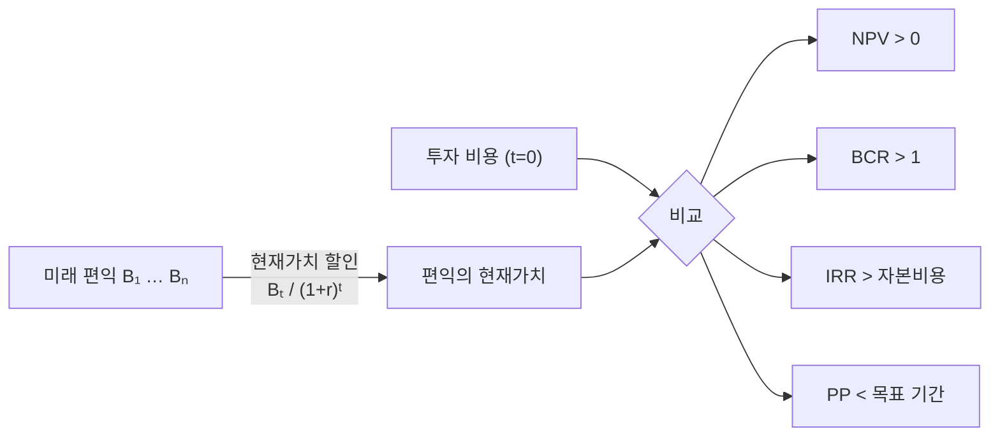

# 경제성 분석 기법 (NPV, IRR, BCR, PP, ROI)

---

## I. IT 투자의 타당성 검증, 경제성 분석 기법의 개요

### 가. 정의

- 정보화 사업·IT 프로젝트의 **예상 비용과 기대 편익을 계량적으로 비교**하여 투자 타당성과 우선순위를 판단하는 정량적 의사결정 기법

### 나. 필요성 및 특징

| 구분 | 내용 |
| --- | --- |
| 필요성 | 한정된 자원의 최적 배분, 사업 추진(Go/No-Go) 판단, 우선순위 선정의 객관화 |
| 분류 기준 | 화폐의 시간가치 고려 여부 → 동태적 분석(NPV, IRR, BCR) / 정태적 분석(PP, ROI) |
| 핵심 개념 | 미래 편익을 할인율 $r$로 현재가치(PV)로 환산해 비용과 비교 |

---

## II. 평가 지표 및 판단 기준

### 가. 개념도

<svg xmlns="http://www.w3.org/2000/svg" viewBox="0 0 800 530" width="100%" height="auto" style="max-width: 800px; width: 100%; height: auto; display: block; margin: 1.5rem auto;">
  <defs>
    <!-- X축 (시간) 화살표 마커 -->
    <marker id="arrow-axis" markerWidth="8" markerHeight="6" refX="7" refY="3" orient="auto">
      <polygon points="0 0, 8 3, 0 6" fill="#4B5563" />
    </marker>
    <!-- 할인율 적용 화살표 마커 -->
    <marker id="arrow-discount" markerWidth="8" markerHeight="6" refX="7" refY="3" orient="auto">
      <polygon points="0 0, 8 3, 0 6" fill="#F59E0B" />
    </marker>
  </defs>

  <!-- 배경 카드 -->
  <rect width="800" height="530" fill="#F9FAFB" rx="12" stroke="#E5E7EB" stroke-width="1.5"/>

  <!-- 타이틀 -->
  <text x="400" y="35" font-family="system-ui, sans-serif" font-size="18" font-weight="bold" fill="#111827" text-anchor="middle">경제성 평가 기법 개념도 및 현금흐름</text>

  <!-- (+) 현금 유입 상단 라벨 -->
  <rect x="40" y="60" width="310" height="32" rx="6" fill="#D1FAE5" stroke="#10B981" stroke-width="1.2"/>
  <text x="195" y="81" font-family="system-ui, sans-serif" font-size="13" font-weight="bold" fill="#065F46" text-anchor="middle">(+) 현금 유입 (Cash Inflow : 예상 수익/편익)</text>

  <!-- 할인율(r) 적용 흐름선 (미래 -> 현재) -->
  <line x1="600" y1="105" x2="165" y2="105" stroke="#F59E0B" stroke-width="2" stroke-dasharray="6 4" marker-end="url(#arrow-discount)"/>
  <rect x="315" y="92" width="130" height="26" rx="13" fill="#FEF3C7" stroke="#F59E0B" stroke-width="1.2"/>
  <text x="380" y="110" font-family="system-ui, sans-serif" font-size="13" font-weight="bold" fill="#B45309" text-anchor="middle">할인율(r) 적용</text>

  <!-- 시간 축 (X축) -->
  <line x1="80" y1="280" x2="720" y2="280" stroke="#4B5563" stroke-width="2" marker-end="url(#arrow-axis)"/>
  <text x="735" y="285" font-family="system-ui, sans-serif" font-size="13" font-weight="bold" fill="#374151">시간 (t, 년도)</text>

  <!-- 눈금 및 시간 라벨 -->
  <line x1="150" y1="275" x2="150" y2="285" stroke="#4B5563" stroke-width="2"/>
  <text x="150" y="270" font-family="system-ui, sans-serif" font-size="14" font-weight="bold" fill="#1F2937" text-anchor="middle">0</text>

  <line x1="300" y1="275" x2="300" y2="285" stroke="#4B5563" stroke-width="2"/>
  <text x="300" y="305" font-family="system-ui, sans-serif" font-size="14" font-weight="bold" fill="#1F2937" text-anchor="middle">Y1</text>

  <line x1="450" y1="275" x2="450" y2="285" stroke="#4B5563" stroke-width="2"/>
  <text x="450" y="305" font-family="system-ui, sans-serif" font-size="14" font-weight="bold" fill="#1F2937" text-anchor="middle">Y2</text>

  <line x1="600" y1="275" x2="600" y2="285" stroke="#4B5563" stroke-width="2"/>
  <text x="600" y="305" font-family="system-ui, sans-serif" font-size="14" font-weight="bold" fill="#1F2937" text-anchor="middle">Y3</text>

  <!-- [이익] Bar: Y1 -->
  <rect x="282" y="220" width="36" height="60" fill="#6EE7B7" rx="2" />
  <polygon points="276 220, 324 220, 300 200" fill="#10B981" />
  <text x="300" y="185" font-family="system-ui, sans-serif" font-size="13" font-weight="bold" fill="#059669" text-anchor="middle">[이익] $</text>

  <!-- [이익] Bar: Y2 -->
  <rect x="432" y="190" width="36" height="90" fill="#6EE7B7" rx="2" />
  <polygon points="426 190, 474 190, 450 170" fill="#10B981" />
  <text x="450" y="155" font-family="system-ui, sans-serif" font-size="13" font-weight="bold" fill="#059669" text-anchor="middle">[이익] $</text>

  <!-- [이익] Bar: Y3 -->
  <rect x="582" y="160" width="36" height="120" fill="#6EE7B7" rx="2" />
  <polygon points="576 160, 624 160, 600 140" fill="#10B981" />
  <text x="600" y="125" font-family="system-ui, sans-serif" font-size="13" font-weight="bold" fill="#059669" text-anchor="middle">[이익] $</text>

  <!-- [투자원금] Bar: Y0 (아래 방향) -->
  <rect x="132" y="280" width="36" height="70" fill="#FCA5A5" rx="2" />
  <polygon points="126 350, 174 350, 150 370" fill="#EF4444" />
  <text x="150" y="388" font-family="system-ui, sans-serif" font-size="13" font-weight="bold" fill="#DC2626" text-anchor="middle">[- 투자원금]</text>

  <!-- (-) 현금 유출 하단 라벨 -->
  <rect x="40" y="410" width="350" height="32" rx="6" fill="#FEE2E2" stroke="#EF4444" stroke-width="1.2"/>
  <text x="215" y="431" font-family="system-ui, sans-serif" font-size="13" font-weight="bold" fill="#991B1B" text-anchor="middle">(-) 현금 유출 (Cash Outflow : 초기 구축비용 및 운영비)</text>

  <!-- 하단 부연설명 박스 (화폐의 시간가치) -->
  <rect x="40" y="455" width="720" height="55" rx="6" fill="#F3F4F6" stroke="#D1D5DB" stroke-width="1.2"/>
  <text x="60" y="477" font-family="system-ui, sans-serif" font-size="12.5" fill="#374151">
    <tspan font-weight="bold" fill="#1F2937">* 화폐의 시간가치(Time Value of Money) :</tspan> 미래의 1원은 현재의 1원보다 가치가 낮으므로,
  </text>
  <text x="73" y="497" font-family="system-ui, sans-serif" font-size="12.5" fill="#374151">
    <tspan font-weight="bold" fill="#1D4ED8">할인율(Discount Rate)</tspan>을 적용하여 <tspan font-weight="bold" fill="#1D4ED8">현재가치(PV)</tspan>로 환산 후 평가하는 것이 핵심입니다.
  </text>
</svg>

### 나. 지표별 비교

| 구분 | 지표 | 산식 | 채택 기준 | 특징 |
| --- | --- | --- | --- | --- |
| 동태적 (시간가치 O) | NPV (순현재가치) | $\sum \frac{B_t - C_t}{(1+r)^t}$ | NPV > 0, 배타적 대안 중 최대 | 기업가치 극대화와 가장 부합 |
| | IRR (내부수익률) | NPV = 0이 되는 할인율 | IRR > 자본비용(요구수익률) | 할인율을 미리 정하지 않아도 됨, 복수 해 가능 |
| | BCR (편익비용비) | $\frac{PV(B)}{PV(C)}$ | BCR > 1 | 규모가 다른 사업의 효율 비교에 유용 |
| | DPP (할인 회수기간) | 할인된 현금흐름으로 회수기간 산정 | 목표 기간 이내 | PP의 시간가치 미반영 보완 |
| 정태적 (시간가치 X) | PP (투자회수기간) | 초기 투자 ÷ 연간 현금유입 | 목표 기간보다 짧음 | 계산 단순, 회수 이후 수익 무시 |
| | ROI (투자수익률) | 순이익 ÷ 투자비 × 100 | 목표 수익률 이상 | 회계적 이익 기준 |

---

## III. 한계 및 IT 투자 평가 패러다임 변화

### 가. 전통적 분석의 한계와 보완

| 한계 | 내용 | 보완 기법 |
| --- | --- | --- |
| 무형 편익 평가 곤란 | 프로세스 혁신·브랜드 가치 등 화폐 환산이 어려움 | IT-[[BSC]], [[IT-ROI 투자 성과평가 모델\|IT 투자 성과평가]] |
| 높은 불확실성 | AI·신기술은 현금흐름 추정이 어렵고 NPV < 0으로 나오기 쉬움 | 실물옵션(ROV): 연기·확장·축소·포기의 유연성 가치 반영 |
| 숨은 비용 누락 | 운영·[[유지보수]] 비용 누락 | TCO: 도입~폐기 전 생애 비용 산정 |

### 나. 최신 동향

- **TCO → TVO**: 클라우드의 변동 OPEX 환경에서 비용 절감보다 민첩성·혁신 가치까지 보는 총소유가치(TVO)와 FinOps 통제 ([[클라우드 네이티브]])
- **린 예산 (Lean Budgeting)**: 밸류 스트림 단위로 예산을 배정하고 [[MVP]] 결과에 따라 지속 투자 여부(Pivot or Persevere) 재평가 ([[린 방법론]])
- 공공 정보화 사업은 [[공공기관 정보화사업 예비타당성\|예비타당성 조사]]에서 B/C 분석과 정책성 분석을 함께 활용

---

### 🔗 연관 토픽

- **소속 도메인**: [[00_프로젝트관리_MOC|📋 프로젝트관리]]
- **세부 분류**: `3. 소프트웨어 원가 산정 & 성과 관리 (Cost & EVM)`
- **핵심 연관 토픽**:
  - [[IT 투자성과 평가]]
  - [[IT-ROI 투자 성과평가 모델]]
  - [[BSC|BSC (Balanced Scorecard), IT-BSC (IT-Balanced Scorecard)]]
  - [[공공기관 정보화사업 예비타당성]]
  - [[린 방법론|린 (Lean) 방법론]]
