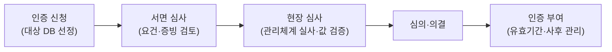

# 공공데이터 품질인증 매뉴얼

---

## I. 공공데이터 신뢰의 공식 보증, 공공데이터 품질인증의 개요

### 가. 정의

- 공공기관이 보유한 데이터의 **관리체계·데이터 값·개방 활용 수준을 심사해 일정 품질 이상임을 공식 인증하는 제도**의 운영 기준 (행정안전부·한국지능정보사회진흥원)

### 나. 추진 배경 및 특징

| 구분 | 내용 |
| --- | --- |
| AI 활용 대비 | 학습·분석에 바로 쓸 수 있는 고품질(AI-Ready) 공공데이터 확보 |
| 자율 관리 | 일괄 점검 중심에서 기관이 스스로 품질을 보증하는 체계로 전환 |
| 단위 | 기관 전체가 아닌 개별 데이터베이스(DB) 단위 인증 |
| 평가 범위 | 관리체계, 데이터 값, 개방·활용 전 주기 |

---

## II. 인증 절차 및 심사 영역

### 가. 인증 절차

- 기관 신청으로 시작해 서면·현장 심사를 거쳐 인증하며, 유효기간 동안 사후 점검으로 품질 유지 여부를 확인

### 나. 심사 영역

| 구분 | 요소 | 설명 |
| --- | --- | --- |
| 관리체계 | 품질관리 계획·조직 | 품질 목표, 담당 조직·역할, 정기 진단·개선 활동 |
| | 데이터 표준 | 표준 단어·용어·도메인·코드 정의와 준수 ([[데이터 표준화]]) |
| | 구조 관리 | 데이터 모델과 물리 DB의 일치, [[스키마]] 변경 이력 관리 |
| 데이터 값 | 구문 정확성 | 형식·범위·필수값 등 도메인 규칙 준수 |
| | 의미 정확성 | 업무 규칙, 참조 무결성 준수 |
| | 오류율 측정 | 진단 도구로 값 오류를 측정하고 개선 이력 관리 |
| 개방·활용 | 개방 정합성 | 원천 DB와 공공데이터포털 개방 데이터의 일치 |
| | 제공 품질 | 오픈 API 표준 준수, 가용성, 이용자 오류 신고 대응 |

---

## III. 비교 및 동향

### 가. 품질관리 수준평가 vs 품질인증

| 비교 항목 | 공공데이터 품질관리 수준평가 | 공공데이터 품질인증 |
| --- | --- | --- |
| 성격 | 법적 근거의 정기 평가 | 기관 신청 기반 자율 인증 |
| 대상 | 기관 단위 | DB 단위 |
| 방식 | 정량 지표 중심 일괄 평가 | 관리체계 실사 + 값 정밀 검증 |
| 결과 활용 | 기관 평가 반영, 개선 권고 | 인증서 부여, 신뢰도 제고 |

### 나. 동향

- **민간 인증과 연계**: 한국데이터산업진흥원의 [[데이터 품질인증 가이드라인 - DQ인증 (2025.02.26)|DQ 인증]], [[데이터 품질관리(ISO 8000)|ISO 8000]]과 상호 보완
- **상시 품질 관리**: 적재·개방 파이프라인에 자동 검증을 넣어 오류를 사전 차단
- **비정형·AI 데이터 확장**: 텍스트·이미지 데이터의 [[비식별화]], 라벨 정확도까지 품질 범위 확대

---

### 🔗 연관 토픽

- **소속 도메인**: [[00_데이터베이스_MOC|🗄️ 데이터베이스]]
- **세부 분류**: `2. 트랜잭션 & 동시성 제어 (Concurrency)`
- **핵심 연관 토픽**:
  - [[공공데이터|공공데이터 (Open Data)]]
  - [[데이터 품질인증 가이드라인 - DQ인증 (2025.02.26)]]
  - [[데이터 품질관리(ISO 8000)]]
  - [[데이터 표준화]]
  - [[데이터 거버넌스|데이터 거버넌스 (Data Governance)]]
