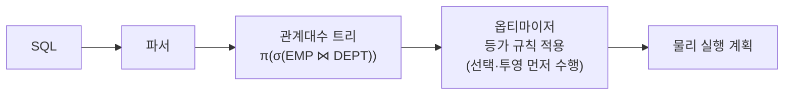

# 관계대수 (Relational Algebra)

---

## I. 연산 순서로 질의를 표현, 관계대수의 개요

### 가. 정의

- 릴레이션을 입력으로 받아 릴레이션을 출력하는 **연산자들의 조합으로 원하는 결과를 얻는 절차를 기술하는 절차적 질의 언어** (E. F. Codd, 1970년대)

### 나. 특징

| 구분 | 내용 |
| --- | --- |
| 절차적 | 무엇을 얻을지와 함께 어떤 순서로 연산할지 기술 |
| 폐쇄성 | 연산 결과도 릴레이션이라 연산을 중첩 가능 |
| 관계적 완전성 | 관계해석과 표현력이 동등 (Codd 정리) |
| 최적화 기반 | DBMS가 SQL을 관계대수 트리로 바꿔 등가 변환·최적화 |

---

## II. 질의 처리 구조 및 연산자

### 가. 관계대수 기반 질의 처리

- 선택(σ)을 조인 아래로 내리는(Predicate Pushdown) 등 결과가 같은 다른 트리로 바꿔 비용을 줄임 ([[OPTIMIZER]])

### 나. 연산자

| 구분 | 요소 | 설명 |
| --- | --- | --- |
| 순수 관계 | Select (σ) | 조건을 만족하는 튜플 추출 (수평 부분집합) |
| | Project (π) | 지정 속성만 추출, 중복 튜플 제거 (수직 부분집합) |
| | Join (⋈) | 공통 속성 조건으로 두 릴레이션 결합 = 카티션 곱 + 선택 (자연 조인은 + 중복 속성 제거) ([[조인]]) |
| | Division (÷) | R ÷ S: S의 모든 튜플과 짝을 이루는 R의 튜플(속성 R−S 부분) 추출 (예: 모든 과목을 수강한 학생) |
| 일반 집합 | Union (∪) | 합집합, 합병 가능(차수·도메인 일치) 조건 필요 |
| | Intersection (∩) | 교집합 |
| | Difference (−) | 차집합 |
| | Cartesian Product (×) | 모든 조합, 차수는 합·카디널리티는 곱 |
| 기본 연산 | σ, π, ∪, −, ×, ρ(재명명) | 나머지 연산(⋈, ∩, ÷)은 기본 연산으로 표현 가능 |

---

## III. 비교 및 동향

### 가. 관계대수 vs 관계해석

| 비교 항목 | 관계대수 | [[관계해석]] |
| --- | --- | --- |
| 성격 | 절차적 (How 포함) | 비절차적 (What) |
| 기반 | 집합 연산 | 1차 술어 논리 |
| 역할 | DBMS 내부 실행 계획·최적화 | SQL·QBE 언어 설계 기반 |
| 표현력 | 동등 (관계적 완전성) | 동등 |

### 나. 동향

- **분산 엔진 최적화**: Spark Catalyst, Trino 등이 관계대수 논리 계획에 규칙 기반 변환(Predicate Pushdown, Column Pruning) 적용
- **확장 연산**: 집계(γ), 외부 조인, 재귀 등 SQL 기능을 확장 관계대수로 표현해 최적화

---

### 🔗 연관 토픽

- **소속 도메인**: [[00_데이터베이스_MOC|🗄️ 데이터베이스]]
- **세부 분류**: `6. SQL 표준 문법 & 쿼리 성능 튜닝`
- **핵심 연관 토픽**:
  - [[관계해석|관계해석(Relational Calculus)]]
  - [[조인|조인(Join)]]
  - [[OPTIMIZER]]
  - [[SQL(Structured Query Language)]]
  - [[DBMS]]
