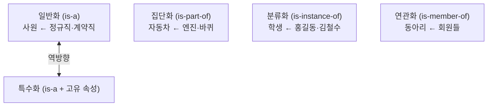

# 관계성 (데이터 추상화 관계)

---

## I. 개념 간 연결 방식, 관계성의 개요

### 가. 정의

- 데이터 모델링에서 객체(개체)들을 **분류·일반화·집단화·연관화의 추상화 원리로 묶어 의미 관계를 표현하는 방식**으로, 개념 모델의 계층과 상속 범위를 결정

### 나. 특징

| 구분 | 내용 |
| --- | --- |
| 목적 | 복잡한 현실 세계를 단순화해 [[엔티티]] 간 의미 관계를 명확히 표현 |
| 방향성 | 상향식(일반화·집단화) 추상화와 하향식(특수화) 구체화 |
| 상속 여부 | is-a 관계는 속성·연산 상속, is-part-of·is-member-of는 상속 없음 |
| 활용 | ERD 슈퍼·서브타입, UML 클래스 다이어그램, [[객체지향]] 설계 |

---

## II. 관계성 유형

### 가. 추상화 관계 구조

- 일반화와 특수화는 같은 is-a 계층을 반대 방향에서 본 것이며, 나머지 관계는 상속을 동반하지 않음
- 데이터 마이닝 용어인 [[분류화]](Classification), [[집단화]](Clustering), [[연관화]](연관 규칙), 머신러닝의 [[일반화]](Generalization 성능)와는 다른 개념

### 나. 유형별 구성

| 구분 | 요소 | 설명 |
| --- | --- | --- |
| 분류화 | 분류 (is-instance-of) | 공통 속성을 가진 인스턴스를 하나의 클래스로 묶음 |
| 일반화 | 일반화 (is-a) | 하위 개체의 공통 특성을 추출해 상위 개체 정의, 하위로 속성 상속 |
| 특수화 | [[특수화]] (is-a + α) | 상위 개체에 고유 속성을 더해 하위 개체 정의 |
| 집단화 | 집단화 (is-part-of) | 구성 요소를 모아 상위 집합체 생성 (Part-Whole), 상속 없음 |
| 연관화 | 연관화 (is-member-of) | 독립 개체를 비계층적 멤버 관계로 묶음 |

---

## III. 비교 및 동향

### 가. 관계성 비교

| 비교 항목 | 일반화 | 집단화 | 연관화 | 분류화 |
| --- | --- | --- | --- | --- |
| 관계 | is-a | is-part-of | is-member-of | is-instance-of |
| 상속 | O | X | X | X (클래스–인스턴스) |
| 구조 | 계층형 | 계층형 (전체–부분) | 비계층형 | 클래스–인스턴스 |
| 예 | 사원–정규직 | 자동차–엔진 | 팀–팀원 | 학생–홍길동 |

### 나. 동향

- **객체지향 모델링**: UML 상속(일반화), 집합·합성(Aggregation·Composition), 연관 관계로 대응
- **지식 그래프·온톨로지**: OWL의 subClassOf, partOf 관계로 추상화 의미를 기계가 해석 가능하게 표현

---

### 🔗 연관 토픽

- **소속 도메인**: [[00_데이터베이스_MOC|🗄️ 데이터베이스]]
- **세부 분류**: `1. 데이터 모델링 & 관계형 DB 설계`
- **핵심 연관 토픽**:
  - [[특수화]]
  - [[엔티티]]
  - [[객체지향]]
  - [[UML의 관계]]
  - [[클래스 다이어그램]]
