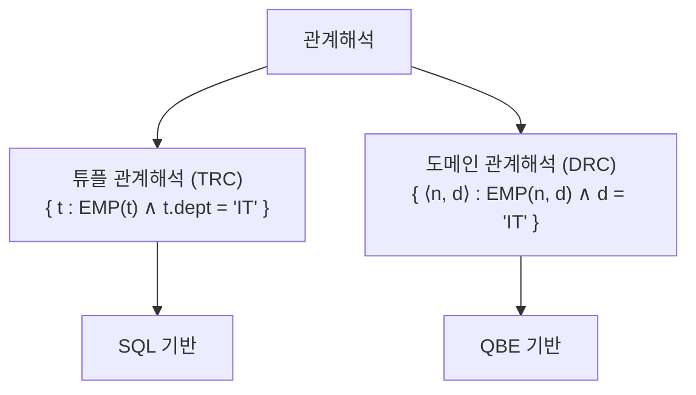

# 관계해석 (Relational Calculus)

---

## I. 원하는 결과의 조건만 기술, 관계해석의 개요

### 가. 정의

- 1차 술어 논리에 기반해 **얻고자 하는 튜플이 만족해야 할 조건만 기술하고 처리 절차는 기술하지 않는 비절차적 질의 언어** (튜플 관계해석, 도메인 관계해석)

### 나. 특징

| 구분 | 내용 |
| --- | --- |
| 비절차적 | What만 기술, How는 시스템이 결정 |
| 관계적 완전성 | 안전한 식으로 한정하면 [[관계대수]]와 표현력 동등 (Codd 정리) |
| 언어 기반 | SQL(튜플 관계해석), QBE(도메인 관계해석)의 이론적 바탕 |
| 안전성 | 결과가 무한해지지 않는 안전한 식(Safe Expression)만 허용 |

---

## II. 유형 및 구성요소

### 가. 관계해석 유형

- 질의는 결과 형태(대상 변수)와 조건식(정형식, WFF)으로 구성

### 나. 구성요소

| 구분 | 요소 | 설명 |
| --- | --- | --- |
| 기반 | 1차 술어 논리 | 참·거짓을 판정하는 술어로 조건 기술 |
| 구성 | 대상 변수 | 결과로 반환할 튜플·도메인 변수 (SQL의 SELECT 목록에 대응) |
| | 정형식 (WFF) | 원자식을 논리 연산자·정량자로 결합한 조건식 (SQL의 FROM·WHERE에 대응) |
| 논리 기호 | ∧, ∨, ¬, → | 논리곱·합·부정·함의 |
| | ∀ (전칭 정량자) | 모든 값이 조건을 만족할 때 참 |
| | ∃ (존재 정량자) | 조건을 만족하는 값이 하나 이상 있을 때 참 (SQL EXISTS) |
| 유형 | TRC | 변수가 튜플 범위 (Codd 제안) |
| | DRC | 변수가 속성 도메인 범위 (Lacroix·Pirotte, 1977), QBE의 기반 |

---

## III. 비교 및 동향

### 가. TRC vs DRC

| 비교 항목 | 튜플 관계해석 | 도메인 관계해석 |
| --- | --- | --- |
| 변수 | 튜플 | 속성값(도메인) |
| 표기 | { t \| P(t) } | { ⟨x1, …, xn⟩ \| P(x1, …, xn) } |
| 대표 언어 | SQL, QUEL | QBE |
| 특징 | 행 단위 사고 | 열 값 단위 사고, 예시 기반 질의에 적합 |

### 나. 동향

- **선언형 언어 계승**: Datalog, 그래프 질의어(Cypher, GQL)가 조건 중심 선언형 사상을 확장
- **Text-to-SQL**: LLM이 자연어 질의를 조건·정량자 구조로 해석해 SQL을 생성 ([[SQL(Structured Query Language)|SQL]])

---

### 🔗 연관 토픽

- **소속 도메인**: [[00_데이터베이스_MOC|🗄️ 데이터베이스]]
- **세부 분류**: `6. SQL 표준 문법 & 쿼리 성능 튜닝`
- **핵심 연관 토픽**:
  - [[관계대수|관계대수(Relational Algebra)]]
  - [[SQL(Structured Query Language)]]
  - [[SQL 문법]]
  - [[DBMS]]
  - [[OPTIMIZER|옵티마이저 (Optimizer)]]
