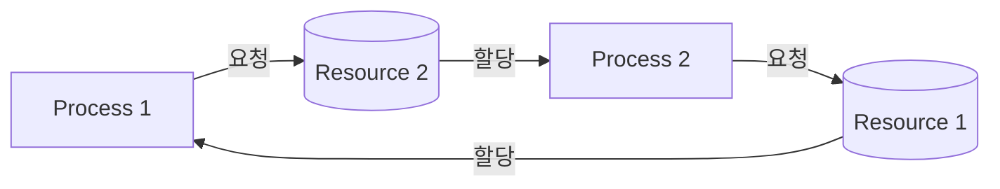

# 교착상태 (Deadlock)

---

## I. 자원의 순환 대기, 교착상태의 개요

### 가. 정의

- 둘 이상의 [[프로세스]]·스레드가 **서로 상대가 점유한 자원을 기다리며 무한히 진행하지 못하는 상태**

### 나. 발생 조건 (4가지 모두 성립 시 발생)

| 구분 | 내용 |
| --- | --- |
| 상호배제 (Mutual Exclusion) | 자원을 한 번에 하나의 프로세스만 사용 |
| 점유와 대기 (Hold and Wait) | 자원을 보유한 채 다른 자원을 추가로 요청 |
| 비선점 (No Preemption) | 보유 자원을 강제로 빼앗을 수 없음 |
| 환형 대기 (Circular Wait) | 프로세스 간 자원 요청이 원형 사슬을 이룸 |

---

## II. 발생 구조 및 해결 기법

### 가. 환형 대기 개념도

- P1은 R1을 쥔 채 R2를, P2는 R2를 쥔 채 R1을 요청 → [[자원할당 그래프]]에 사이클 형성

### 나. 해결 기법

| 구분 | 요소 | 설명 |
| --- | --- | --- |
| 예방 (Prevention) | 상호배제 부정 | 스풀링, 읽기 전용 공유 등으로 독점 자원 축소 (현실적으로 어려움) |
| | 점유와 대기 부정 | 필요한 자원을 한꺼번에 요청하거나, 보유 자원이 없을 때만 요청 허용 |
| | 비선점 부정 | 추가 자원을 얻지 못하면 보유 자원을 반납 후 재요청 |
| | 환형 대기 부정 | 자원에 순서 번호를 매기고 오름차순으로만 요청 |
| 회피 (Avoidance) | [[은행가 알고리즘]] | Dijkstra 제안, 최대 요구량을 미리 받아 할당 후에도 안전 상태(Safe State)일 때만 할당 |
| 탐지 (Detection) | 대기 그래프 (Wait-for Graph) | 자원 할당 그래프에서 자원 노드를 없앤 프로세스 간 그래프에서 사이클 탐지 |
| | 타임아웃 | 락 대기 시간이 임계치를 넘으면 교착으로 간주 ([[트랜잭션]] 환경) |
| 회복 (Recovery) | 프로세스 종료·자원 선점 | 희생자(Victim)를 비용 기준으로 골라 중단·롤백 후 자원 회수 |
| 무시 | 타조 알고리즘 | 발생 빈도가 낮고 해결 비용이 크면 무시 (UNIX·Windows 등 범용 OS) |

---

## III. 비교 및 동향

### 가. 해결 기법 비교

| 비교 항목 | 예방 | 회피 | 탐지·회복 |
| --- | --- | --- | --- |
| 원리 | 4가지 조건 중 하나를 원천 차단 | 할당 전 안전 상태 검사 | 발생을 허용하고 사후 처리 |
| 자원 이용률 | 낮음 | 중간 | 높음 |
| 사전 정보 | 불필요 | 최대 요구량 필요 | 불필요 |
| 오버헤드 | 제약에 따른 자원 낭비 | 요청마다 안전성 검사 | 주기적 사이클 탐지, 롤백 비용 |
| 한계 | 처리율 저하 | 최대 요구량 예측이 비현실적 | 반복 희생 시 [[기아\|기아(Starvation)]] |

### 나. 동향

- **DBMS**: 대기 그래프 기반 탐지가 기본, 타임스탬프 기반 예방 기법으로 [[Wait-Die와 Wound-Wait]](각각 비선점·선점 방식) 사용, MVCC로 읽기 락 충돌 자체를 축소
- **분산 환경**: 전역 대기 그래프 구성이 어려워 락 타임아웃, [[MSA (Micro Service Architecture)|MSA]]에서는 장기 락을 피하는 Saga 패턴(보상 트랜잭션) 활용
- **커널 검증**: Linux Lockdep(락 순서 위반을 런타임에 검출하는 디버깅 기능)으로 잠재적 교착을 개발 단계에서 발견

---

### 🔗 연관 토픽

- **소속 도메인**: [[00_운영체제_MOC|⚙️ 운영체제]]
- **세부 분류**: `1. 프로세스 & 스레드 관리`
- **핵심 연관 토픽**:
  - [[기아|기아(Starvation)]]
  - [[자원할당 그래프|자원할당 그래프(Resource Allocation Graph)]]
  - [[은행가 알고리즘|Banker's 알고리즘(은행가 알고리즘)]]
  - [[Wait-Die와 Wound-Wait]]
  - [[스핀락|스핀락 (Spin Lock)]]
