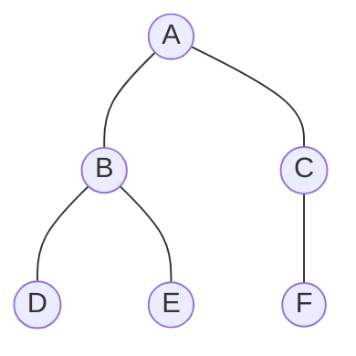

# 그래프 순회 (Graph Traversal)

---

## I. 모든 정점을 빠짐없이 방문하는, 그래프 순회의 개요

### 가. 정의

- 그래프의 **한 정점에서 시작해 간선(Edge)을 따라 도달 가능한 모든 정점을 한 번씩 방문**하는 [[알고리즘]]으로, 깊이 우선 탐색(DFS)과 너비 우선 탐색(BFS)이 대표적

### 나. 특징

| 구분 | 내용 |
| --- | --- |
| 방문 표시 | 사이클로 인한 무한 반복을 막기 위해 방문 여부 기록 필수 |
| 보조 자료구조 | DFS는 [[Stack]](또는 재귀), BFS는 [[Queue]] |
| 완전 탐색 | 연결된 모든 정점 방문, 연결 요소 판별 가능 |
| 복잡도 | 인접 리스트 O(V+E), 인접 행렬 O(V²) |

---

## II. 동작 및 구성요소

### 가. DFS와 BFS 방문 순서

- 인접 정점을 알파벳 순으로 방문할 때 DFS: A → B → D → E → C → F (끝까지 들어간 뒤 되돌아감), BFS: A → B → C → D → E → F (거리 0, 1, 2 순)

### 나. 구성요소

| 구분 | 요소 | 설명 |
| --- | --- | --- |
| 그래프 표현 | 인접 리스트 | 정점별 이웃 목록, 희소 그래프에 유리 |
| | 인접 행렬 | V×V 행렬, 간선 존재 확인 O(1), 밀집 그래프에 유리 |
| 상태 관리 | 방문 배열 | 정점별 방문 여부 |
| DFS | 스택·재귀 | 갈 수 있는 데까지 깊이 진행 후 백트래킹 |
| BFS | 큐 | 시작점에서 가까운 정점부터 레벨 단위로 확장 |
| 응용 | 위상 정렬·사이클 탐지 | DFS 종료 순서, 역방향 간선 검사 ([[방향성 비순환 그래프\|DAG]]) |
| | 최단 경로 | 가중치 없는 그래프는 BFS, 가중치 있으면 [[다익스트라 알고리즘\|다익스트라]] |
| | A* 탐색 | 실제 비용 + 휴리스틱 추정 비용으로 탐색 공간 축소 |
| 대규모 처리 | BSP 모델 | Pregel·Apache Giraph처럼 슈퍼스텝 단위 분산 그래프 처리 |

---

## III. 비교 및 동향

### 가. DFS vs BFS

| 비교 항목 | DFS | BFS |
| --- | --- | --- |
| 탐색 방식 | 깊이 우선, 끝까지 간 뒤 되돌아감 | 너비 우선, 가까운 정점부터 |
| 자료구조 | 스택·재귀 | 큐 |
| 최단 경로 | 보장 안 함 | 가중치 없는 그래프에서 보장 |
| 메모리 | 탐색 깊이에 비례 | 한 레벨의 최대 정점 수에 비례 |
| 시간 | O(V+E) (인접 리스트) | O(V+E) (인접 리스트) |
| 활용 | 위상 정렬, 사이클 탐지, 미로·백트래킹 | 최단 거리, 웹 크롤러, 친구 추천(n촌) |

### 나. 동향

- **GNN**: 이웃 정점 정보를 반복 집계하는 그래프 신경망이 추천·신약·이상 탐지에 활용
- **벡터 검색**: HNSW 인덱스가 다층 근접 그래프를 탐욕적으로 순회해 근사 최근접 이웃 탐색 ([[벡터 데이터베이스]])
- **그래프 DB·가속**: Neo4j·Amazon Neptune 등 그래프 DB와 [[GPU]] 기반 그래프 분석 라이브러리(cuGraph) 확산

---

### 🔗 연관 토픽

- **소속 도메인**: [[00_컴퓨터구조_MOC|💻 컴퓨터구조]]
- **세부 분류**: `3. 고성능 AI 가속기 & 입출력 시스템`
- **핵심 연관 토픽**:
  - [[트리 순회|트리 순회 (Tree Traversal)]]
  - [[다익스트라 알고리즘|다익스트라 (Dijkstra) 알고리즘]]
  - [[방향성 비순환 그래프|방향성 비순환 그래프(DAG, Directed Acyclic Graph)]]
  - [[Stack]]
  - [[Queue]]
