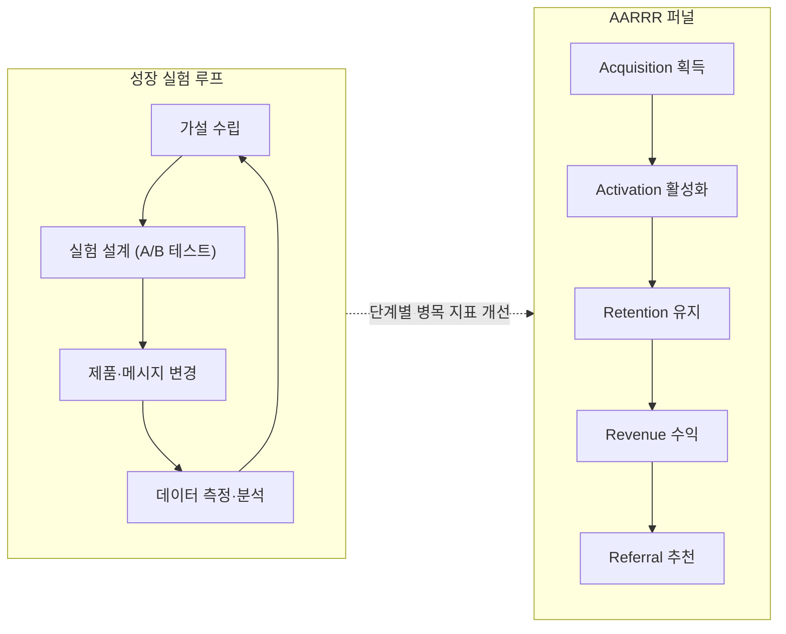

# 그로스 해킹 (Growth Hacking)

---

## I. 실험으로 성장 병목을 찾는, 그로스 해킹의 개요

### 가. 정의

- 제품·마케팅·데이터 분석을 결합해 **고객 생애 주기(AARRR) 단계별로 가설 수립 → 실험 → 측정을 빠르게 반복**하여 성장을 이끄는 데이터 기반 성장 방법론 (Sean Ellis, 2010 명명)

### 나. 필요성 및 특징

| 구분 | 내용 |
| --- | --- |
| 필요성 | 고객 획득 비용(CAC) 상승, 대규모 매체 광고의 ROI 한계 |
| 데이터 기반 | 직관 대신 코호트·퍼널 지표와 A/B 테스트로 의사결정 |
| 전 퍼널 관점 | 획득뿐 아니라 활성화·유지(Retention)까지 최적화 |
| 교차 기능 팀 | 기획·마케팅·개발·데이터 분석가가 한 팀으로 실험 수행 |

---

## II. 그로스 해킹의 구조 및 구성요소

### 가. 성장 루프와 AARRR 퍼널

- [[린 방법론|린 스타트업]]의 Build–Measure–Learn 루프를 AARRR 각 단계의 병목에 적용해 이탈을 줄이고 LTV를 높임

### 나. 구성요소

| 구분 | 요소 | 설명 |
| --- | --- | --- |
| 지표 | AARRR (Dave McClure) | 획득·활성화·유지·수익·추천 5단계 퍼널 지표 |
| | 북극성 지표 (NSM) | 고객이 얻는 핵심 가치를 대표하는 전사 단일 지표 |
| 분석 | 코호트 분석 | 가입 시점 등 동일 특성 집단별 유지율 추적 |
| | 퍼널 분석 | 단계 간 전환율로 병목 구간 식별 |
| 실험 | A/B·다변량 테스트 | 대조군·실험군 비교로 변경 효과를 통계적으로 검증 |
| | 멀티암드 밴딧 | 성과 좋은 안으로 트래픽을 점진적으로 자동 배분 |
| 경험 설계 | 아하 모먼트 (Aha Moment) | 사용자가 제품 가치를 처음 체감해 유지율이 올라가는 순간 |
| 데이터 기반 | CDP (고객 데이터 플랫폼) | 흩어진 행동 데이터를 고객 단위로 통합 |

---

## III. 전통적 마케팅 비교 및 동향

### 가. 전통적 마케팅 vs 그로스 해킹

| 구분 | 전통적 마케팅 | 그로스 해킹 |
| --- | --- | --- |
| 대상 | 불특정 다수 | 세분화된 코호트 |
| 집중 단계 | 인지·획득 | AARRR 전체 (특히 활성화·유지) |
| 의사결정 | 경험·직관, 브랜드 중심 | 가설–실험–데이터 검증 |
| 예산 | 대규모 매체 광고 선집행 | 소규모 실험 반복 후 확대 |
| 조직 | 마케팅 부서 단독 | 교차 기능 그로스 팀 |

### 나. 동향

- **제품 주도 성장 (PLG)**: 무료 체험·프리미엄 모델과 온보딩 개선으로 제품 자체가 획득·전환을 이끄는 방식 확산
- **퍼스트 파티 데이터 중심**: 서드파티 쿠키 축소와 개인정보 규제에 대응해 CDP·리버스 ETL로 자사 데이터 활용
- **AI 기반 실험 자동화**: 생성형 AI로 문구·크리에이티브 변형을 대량 생성하고 밴딧 알고리즘으로 자동 최적화

---

### 🔗 연관 토픽

- **소속 도메인**: [[00_경영전략_MOC|📈 경영전략]]
- **세부 분류**: `1. 경영 환경 분석 & 전략 수립 프레임워크`
- **핵심 연관 토픽**:
  - [[린 방법론|린 (Lean) 방법론]]
  - [[고객여정지도]]
  - [[MVP]]
  - [[CRM]]
  - [[의도 경제|의도 경제(Intention Economy)]]
