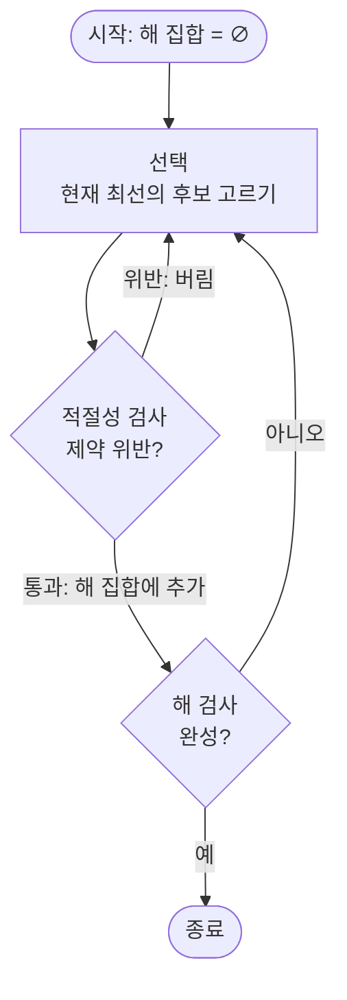

# 그리디 알고리즘 (Greedy Algorithm)

---

## I. 매 순간 가장 좋아 보이는 것을 고르는, 그리디 알고리즘의 개요

### 가. 정의

- 각 단계에서 **그 순간 가장 좋아 보이는 선택(국소 최적)을 되돌리지 않고 반복**해 해를 구성하는 [[알고리즘]] 설계 기법으로, 특정 조건을 만족할 때만 전역 최적해를 보장

### 나. 특징

| 구분 | 내용 |
| --- | --- |
| 단순·고속 | 정렬 + 한 번의 순회 정도로 동작, 보통 O(n log n) 수준 |
| 비가역 | 한 번 한 선택을 다시 검토하지 않음 |
| 최적성 조건 | 탐욕 선택 속성 + 최적 부분 구조가 성립해야 최적해 보장 |
| 근사 활용 | 최적성을 보장하지 못하는 문제에서도 빠른 근사해로 사용 |

---

## II. 동작 및 구성요소

### 가. 동작 절차

- 예: 거스름돈(500·100·50·10원)은 큰 동전부터 고르면 최적이지만, 동전이 1·3·4원이면 6원을 4+1+1로 내어 최적(3+3)이 아님

### 나. 구성요소

| 구분 | 요소 | 설명 |
| --- | --- | --- |
| 성립 조건 | 탐욕 선택 속성 | 국소 최적 선택을 포함하는 전역 최적해가 항상 존재 |
| | 최적 부분 구조 | 문제의 최적해가 부분 문제의 최적해로 구성 |
| 이론 | 매트로이드 | 이 구조를 갖는 문제에서는 가중치 최대 독립 집합을 그리디로 구할 수 있음 |
| 절차 | 선택 / 적절성 검사 / 해 검사 | 후보 선택 → 제약 확인 → 완성 여부 확인 |
| 대표 알고리즘 | [[최소 신장 트리\|MST]] | Kruskal(최소 간선부터), Prim(인접 최소 간선 확장) |
| | 최단 경로 | [[다익스트라 알고리즘\|Dijkstra]] (음수 가중치 없을 때) |
| | 압축 | [[허프만 코딩]] (빈도 최소 두 노드 병합) |
| | 스케줄링 | 활동 선택 문제(종료 시간이 빠른 순) |

---

## III. 비교 및 동향

### 가. 그리디 vs 동적 계획법

| 비교 항목 | 그리디 | [[동적 계획법\|동적 계획법 (Dynamic Programming)]] |
| --- | --- | --- |
| 결정 방식 | 현재 최선 하나만 선택 | 부분 문제의 모든 경우를 저장·비교 |
| 부분 문제 | 선택 후 남은 하나 | 중복되는 여러 부분 문제 |
| 최적해 | 탐욕 선택 속성이 있을 때만 보장 | 최적 부분 구조가 있으면 보장 |
| 자원 | 빠르고 메모리 적음 | 상대적으로 느리고 테이블 메모리 필요 |
| 배낭 문제 | 분할 가능(Fractional) 배낭은 최적 | 0-1 배낭 |

### 나. 동향

- **근사 알고리즘**: 집합 덮개(Set Cover)에서 ln n 근사비를 보장하는 등 NP-Hard 문제의 근사해 기법으로 활용
- **시스템 자원 할당**: 클라우드·엣지의 실시간 [[스케줄링]], 캐시 교체 등 빠른 의사결정이 필요한 곳에 휴리스틱으로 적용

---

### 🔗 연관 토픽

- **소속 도메인**: [[00_컴퓨터구조_MOC|💻 컴퓨터구조]]
- **세부 분류**: `3. 고성능 AI 가속기 & 입출력 시스템`
- **핵심 연관 토픽**:
  - [[동적 계획법|동적 계획법 (Dynamic Programming)]]
  - [[최소 신장 트리|최소 신장 트리 (MST, Minimum Spanning Tree)]]
  - [[다익스트라 알고리즘|다익스트라 (Dijkstra) 알고리즘]]
  - [[허프만 코딩|허프만 (Huffman) 코딩]]
  - [[알고리즘]]
