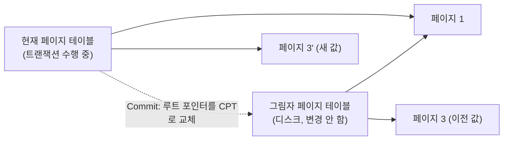

# 그림자페이지 (Shadow Paging) 기법

---

## I. 로그 대신 페이지 테이블 교체, 그림자페이지 기법의 개요

### 가. 정의

- 갱신을 원래 위치가 아닌 **새 페이지에 기록하고, 커밋 시 현재 페이지 테이블을 그림자 페이지 테이블과 원자적으로 교체해 회복하는 기법** (로그 미사용 회복)

### 나. 특징

| 구분 | 내용 |
| --- | --- |
| 비제자리 갱신 | Out-of-place Update, 원본 페이지 보존 |
| No-UNDO / No-REDO | 철회 시 현재 테이블만 버리면 원상태 (단일 트랜잭션 기준) |
| 원자적 교체 | 디스크의 루트 포인터 하나만 바꿔 커밋 |
| 한계 | 데이터 단편화, 가비지 수집, 동시 트랜잭션 환경에서는 로그 병행 필요 |

---

## II. 동작 구조 및 구성요소

### 가. 동작 원리

- 트랜잭션 시작 시 그림자 테이블을 복사해 현재 테이블 생성 → 갱신 시 새 블록 할당 후 현재 테이블만 수정 → 커밋 시 현재 테이블을 디스크에 쓰고 루트 포인터 교체

### 나. 구성요소

| 구분 | 요소 | 설명 |
| --- | --- | --- |
| 자료구조 | 그림자 페이지 테이블 | 트랜잭션 시작 시점의 일관된 상태를 가리키는 디스크 상 테이블 |
| | 현재 페이지 테이블 | 수행 중 변경된 페이지를 가리키는 테이블 |
| 갱신 | 비제자리 갱신 | 빈 블록에 새 값 기록, 원본 유지 |
| 반영 | 원자적 포인터 교체 | 마스터 레코드(루트 포인터) 1회 갱신으로 커밋 |
| 회복 | 철회·장애 처리 | 현재 테이블 폐기, 그림자 테이블로 즉시 복원 |
| 사후 처리 | 가비지 수집 | 커밋 후 참조되지 않는 이전 페이지 회수 |

---

## III. 비교 및 동향

### 가. 그림자페이지 vs 로그 기반 회복

| 비교 항목 | 그림자페이지 | 로그 기반 (WAL) |
| --- | --- | --- |
| 갱신 방식 | Out-of-place | In-place |
| 회복 연산 | 포인터 교체 | UNDO·REDO |
| 복구 속도 | 빠름 | 로그 분석 필요 |
| 데이터 배치 | 클러스터링 파괴, 단편화 | 클러스터링 유지 |
| 부담 | 페이지 테이블 복사, 가비지 수집 | 로그 기록 I/O |
| 동시성 | 다중 트랜잭션 지원 어려움 | 다중 트랜잭션 지원 |

### 나. 동향

- **Copy-on-Write 계승**: ZFS·Btrfs 파일 시스템, LMDB의 CoW B+Tree가 같은 원리로 일관성 보장
- **플래시 저장장치**: 덮어쓰기가 불가능한 SSD의 FTL이 비제자리 갱신·매핑 교체를 사용
- **실무 DBMS**: 상용 RDBMS는 [[ARIES]] 계열 WAL을 사용하고 그림자 방식은 보조적으로만 활용 ([[DB 회복기법]])

---

### 🔗 연관 토픽

- **소속 도메인**: [[00_데이터베이스_MOC|🗄️ 데이터베이스]]
- **세부 분류**: `2. 트랜잭션 & 동시성 제어 (Concurrency)`
- **핵심 연관 토픽**:
  - [[DB 회복기법]]
  - [[ARIES|ARIES (Algorithms for Recovery and Isolation Exploiting Semantics)]]
  - [[트랜잭션]]
  - [[MVCC(다중 버전 동시성 제어) 2가지 유형]]
  - [[데이터베이스]]
