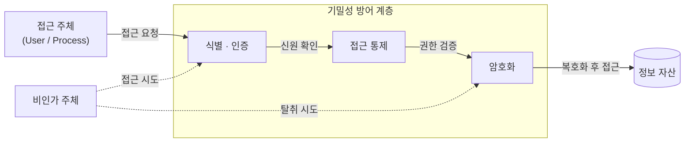

# 기밀성 (Confidentiality)

---

## I. 인가된 자만 본다, 기밀성의 개요

### 가. 정의

- 정보보안 3요소(CIA) 중 하나로, **인가되지 않은 사용자·[[프로세스]]·시스템에 정보가 노출되지 않도록 보장**하는 특성

### 나. 특징

| 구분 | 내용 |
| --- | --- |
| 최소 권한 | 업무 수행에 필요한 최소 권한만 부여 (Least Privilege) |
| 알 필요성 | 직무상 필요한 정보만 열람 허용 (Need-to-Know) |
| 상태별 보호 | 저장(At Rest)·전송(In Transit)·사용(In Use) 데이터 각각 보호 |
| 주요 위협 | 스니핑, 사회공학, 내부자 유출, APT·[[랜섬웨어]]의 데이터 탈취 |

---

## II. 기밀성 보장 구조 및 구성요소

### 가. 다층 방어 구조

- 인증 → 접근 통제 → 암호화의 다층 방어로, 한 계층이 뚫려도 정보 내용이 노출되지 않도록 설계

### 나. 구성요소

| 구분 | 요소 | 설명 |
| --- | --- | --- |
| 권한 관리 | 접근 통제 | [[MAC]](강제적), [[DAC]](임의적), [[RBAC]](역할 기반) 정책으로 주체-객체 접근 제어 |
| | [[IAM]] | 전사 IT 자원에 대한 신원 식별·인증·권한 통합 관리 |
| 인증 | 다중 인증(MFA) | 비밀번호 외 [[FIDO]]·OTP 등 결합으로 계정 탈취 방지 |
| 데이터 보호 | 암호화 | [[대칭키 암호화\|대칭키]]([[AES]])·[[비대칭키 암호화\|비대칭키]]([[RSA (Rivest Shamir Adleman)\|RSA]])로 저장·전송 데이터 보호 |
| | [[비식별화]] | 마스킹·가명처리·익명처리로 식별 불가 처리 |
| 환경 통제 | 망분리 | 내부망·외부망 분리로 기밀 데이터 격리 |
| 사용 중 보호 | [[기밀컴퓨팅]] | TEE(SGX, TrustZone 등)로 사용 중 메모리 데이터 보호 |
| | [[동형 암호]] | 암호문 상태로 연산해 처리 중 노출 방지 |

---

## III. 비교 및 동향

### 가. CIA 3요소 비교

| 비교 항목 | 기밀성 | [[무결성]] | [[가용성]] |
| --- | --- | --- | --- |
| 목적 | 비인가 열람·유출 방지 | 비인가 위·변조 방지 | 필요 시 사용 보장 |
| 위협 | 스니핑, 사회공학 | 중간자 변조, 악성코드 변조 | [[DoS (Denial of Service)\|DoS]]·[[DDOS\|DDoS]], 랜섬웨어 |
| 대응 기술 | 암호화, 접근 통제, [[VPN]] | [[해시함수\|해시]], [[HMAC]], 전자서명 | 이중화, 백업, DR, [[CDN]] |

### 나. 동향

- **[[제로 트러스트 보안모델|제로 트러스트]]**: 경계 기반 신뢰를 버리고 지속 인증과 마이크로 [[세그멘테이션]] 적용
- **[[양자내성암호]] 전환**: 양자 컴퓨터의 공개키 암호(RSA, [[ECC]]) 해독 위협에 대비해 ML-KEM 등 PQC 도입
- **사용 중 데이터 보호**: 기밀컴퓨팅·[[PEC(Privacy-Enhancing Computation)|PEC]]로 클라우드·AI 처리 단계까지 기밀성 확장

---

### 🔗 연관 토픽

- **소속 도메인**: [[00_보안_MOC|🛡️ 보안]]
- **세부 분류**: `1. 정보보안 원칙 & 거버넌스 · 인증`
- **핵심 연관 토픽**:
  - [[가용성]]
  - [[무결성]]
  - [[암호화|암호화 (Encryption)]]
  - [[접근 제어 접근 통제|접근 제어/접근 통제(Access Control)]]
  - [[기밀컴퓨팅|기밀컴퓨팅(Confidential Computing)]]
