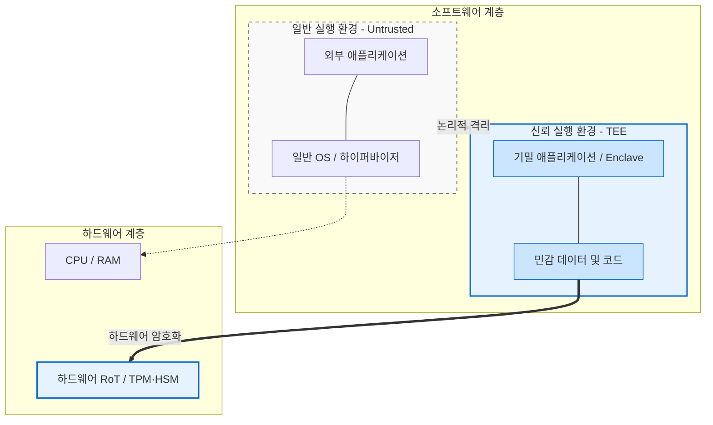

# 기밀컴퓨팅(Confidential Computing)

---

## I. '사용 중인 데이터(Data in Use)' 보호의 핵심, 기밀 컴퓨팅의 개요

기밀 컴퓨팅(Confidential Computing)은 클라우드 및 분산 환경에서 하드웨어 기반의 신뢰 실행 환경(TEE, Trusted Execution Environment)을 구축하여, 메모리에서 연산 처리 중인 데이터(Data in Use)의 유출 및 무단 변조를 원천 차단하는 하드웨어 격리 보안 기술이다.

| 구분 | 내용 |
| :--- | :--- |
| **정의** | 하드웨어 기반 신뢰 실행 환경(TEE)을 통해 메모리 연산 중(Data in Use) 데이터의 노출·변조를 차단하는 보안 기술 |
| **등장 배경** | 저장(At Rest), 전송(In Transit) 암호화의 한계 극복, 클라우드 호스트 관리자/하이퍼바이저 권한 탈취 시 메모리 평문 탈취 위협 방어 |
| **핵심 기제** | 하드웨어 Enclave 격리, 메모리 실시간 암호화(AES-XTS), 원격 증명(Remote Attestation) |

---

## II. 기밀 컴퓨팅의 개념도 및 핵심 요소 기술

### 가. 기밀 컴퓨팅의 개념도

### 나. 기밀 컴퓨팅의 세부 기술 요소

| 구분 | 핵심 기술 | 상세 설명 |
| :--- | :--- | :--- |
| **격리 환경** | **TEE (신뢰 실행 환경)** | 메인 OS나 클라우드 제공자([[CSP]])조차 접근할 수 없는 [[CPU]] 내부의 격리된 보안 영역(Enclave)을 생성하여 연산 수행 |
| **메모리 보호** | **메모리 실시간 [[암호화]]** | CPU 내장 암호화 엔진을 사용하여 TEE 내의 메모리 버스 데이터를 하드웨어 레벨에서 암호화 (예: AMD SEV, Intel TDX, ARM CCA) |
| **신뢰 검증** | **하드웨어 RoT 및 [[TPM]]** | 플랫폼의 무결성을 증명하기 위해 TPM(Trusted Platform Module)과 TEE를 연동하여 하드웨어 기반 신뢰 근원(Root of Trust) 확보 |
| **원격 무결성** | **원격 증명 (Remote Attestation)** | 워크로드가 실행 중인 플랫폼의 무결성을 지속 검증하기 위해, TPM/CPU 서명 기반의 측정치(Measurement)를 외부 검증자에게 전송·확인 |

---

## III. 데이터 보호 상태별 기술 비교 및 향후 동향

### 가. 데이터 생애주기별 보안 기술 비교

| 비교 항목 | 저장 중 데이터 (Data at Rest) | 전송 중 데이터 (Data in Transit) | 사용 중 데이터 (Data in Use, 기밀컴퓨팅) |
| :--- | :--- | :--- | :--- |
| **보호 대상** | 디스크, DB, 스토리지 파일 | 네트워크 패킷, API 전송 구간 | CPU 레지스터, 캐시, 메모리(RAM) 연산 데이터 |
| **핵심 기술** | TDE, BitLocker, 파일 암호화 | TLS/SSL, IPSec VPN, MACsec | TEE Enclave, 메모리 암호화(SEV/TDX), 동형암호 |
| **신뢰 범위** | OS 및 호스트 관리자 신뢰 전제 | 통신 엔드포인트 호스트 신뢰 | 호스트 OS/하이퍼바이저도 신뢰하지 않음 (Zero Trust) |
| **주요 위협** | 저장매체 도난, 물리적 덤프 | 스니핑, 중간자(MITM) 공격 | 메모리 덤프, 권한 탈취된 하이퍼바이저 공격 |

### 나. 향후 기술 동향 및 발전 전망
- **프라이버시 보존형 AI 및 연합학습 융합**: 의료·금융 등 민감 데이터를 외부 유출 없이 TEE 내부에서만 복호화하여 다자간 AI 모델을 공동 학습시키는 기밀 연합학습(Confidential Federated Learning) 확산.
- **클라우드 네이티브 기밀 컨테이너 표준화**: Confidential Containers(CoCo) 프로젝트를 중심으로 쿠버네티스 파드(Pod) 단위의 투명한 TEE 배포 자동화 및 클라우드 CSP 인프라 기본 탑재.
- **[[제로 트러스트 보안모델|제로 트러스트]] 기반 양자내성(PQC) 융합**: 원격 증명 과정에서 양자 컴퓨터 위협에 대응하기 위해 ML-KEM, ML-[[DSA]] 기반 PQC 암호화 알고리즘을 하드웨어 RoT 및 TPM 규격에 조기 통합.

---

### 🔗 연관 토픽

- **소속 도메인**: [[00_보안_MOC|🛡️ 보안]]
- **세부 분류**: `3. 네트워크 & 엔드포인트 · 인프라 보안`
- **핵심 연관 토픽**:
  - [[암호화|암호화 (Encryption)]]
  - [[TPM|TPM (Trusted Platform Module)]]
  - [[DSA]]
  - [[CSP|CSP (Cloud Service Provider)]]
  - [[CPU Ring Level]]
