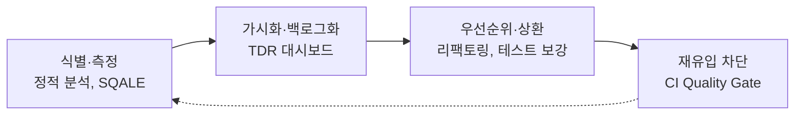

# 기술 부채 (Technical Debt)

---

## I. 빠른 출시의 대가, 기술 부채의 개요

### 가. 정의

- 빠른 출시를 위해 최적 설계 대신 임시방편을 택한 결과, 이후 수정·[[유지보수]] 때 **추가 비용(이자)을 계속 치러야 하는 잠재적 부채** (Ward Cunningham, 1992 비유)

### 나. 특징

| 구분 | 내용 |
| --- | --- |
| 금융 비유 | 원금(구조 개선 비용) + 이자(결함 증가, 변경 속도 저하) |
| 4사분면 (M. Fowler) | 신중함/무모함 × 의도적/비의도적 → 신중·의도적 부채만 전략적으로 허용 |
| 유형 | 코드, 설계·아키텍처, 테스트, 문서, 인프라, 데이터 부채 |
| 누적성 | 상환하지 않으면 이자가 복리처럼 증가해 변경 비용 급증 |

---

## II. 기술 부채의 관리 체계 및 구성요소

### 가. 관리 사이클

- 정적 분석으로 부채를 정량화하고 백로그에 올려 스프린트마다 일정 비율을 상환하며, 품질 게이트로 신규 부채 유입을 막는 반복 구조

### 나. 구성요소

| 구분 | 요소 | 설명 |
| --- | --- | --- |
| 측정 | SQALE 모델 | 품질 특성별 수정 소요 시간(Remediation Cost)으로 부채 산정 |
| | TDR (Technical Debt Ratio) | 수정 비용 ÷ 개발 비용, 부채 수준 지표 |
| | [[정적 분석 도구]] | SonarQube 등으로 코드 스멜·중복·순환 복잡도 탐지 |
| 예방 | ADR (Architecture Decision Record) | 설계 결정·포기한 대안·의도적 타협을 기록해 추적성 확보 |
| | 품질 게이트 | 커버리지·결함 기준 미달 시 빌드·배포 차단 |
| 상환 | [[소프트웨어 리팩토링\|리팩토링]] | 외부 동작 변경 없이 내부 구조 개선 |
| | 테스트 자동화·[[TDD]] | [[코드 커버리지\|테스트 커버리지]] 확보로 리팩토링 회귀 결함 방지 |
| | 상환 버퍼 | 스프린트 용량의 일부(예: 15~20%)를 부채 상환에 할당 |

---

## III. 전통적 SW 부채 vs ML 시스템 부채 및 동향

### 가. 비교

| 구분 | 전통적 SW 기술 부채 | ML 시스템 기술 부채 |
| --- | --- | --- |
| 주요 원인 | 스파게티 코드, 테스트 부재, 설계 결함 | 데이터 의존성, Glue Code, 파이프라인 정글 |
| 영향 범위 | 모듈 경계·캡슐화로 국소화 가능 | CACE (Changing Anything Changes Everything) |
| 부채 위치 | 주로 소스코드 | 코드보다 데이터·설정·파이프라인에 은닉 |
| 측정 | 정적 분석으로 비교적 명확 | 데이터 분포 변화로 정량화 어려움 |
| 상환 | 리팩토링, 코드 리뷰 | [[MLOps]], 피처 스토어, 드리프트 모니터링 |

- ML 부채 개념: D. Sculley 외, "Hidden Technical Debt in Machine Learning Systems" (NeurIPS 2015)

### 나. 동향

- **AI 생성 코드 부채**: AI 코딩 도구로 생성된 코드의 중복·검증 부족이 새 부채원으로 지목됨
- **아키텍처 부채 관리**: [[MSA (Micro Service Architecture)\|MSA]]·모듈러 모놀리스 전환 시 모듈 [[결합도]] 진단과 ADR 기반 거버넌스 강화
- **부채의 경영 지표화**: TDR·변경 리드타임 등을 경영 보고 지표로 관리해 상환 투자 근거 확보

---

### 🔗 연관 토픽

- **소속 도메인**: [[00_경영전략_MOC|📈 경영전략]]
- **세부 분류**: `1. 경영 환경 분석 & 전략 수립 프레임워크`
- **핵심 연관 토픽**:
  - [[유지보수]]
  - [[소프트웨어 리팩토링]]
  - [[결합도]]
  - [[코드 커버리지|테스트 커버리지 (Test Coverage)]]
  - [[MLOps]]
