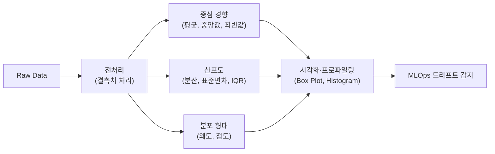

# 기술 통계 (Descriptive Statistics)

---

## I. 데이터를 요약해 패턴을 보는, 기술 통계의 개요

### 가. 정의

- 수집된 데이터의 특성을 **중심 경향·산포도·분포 형태 등의 지표와 시각화로 요약·정리**하는 통계 기법 (모집단 추론은 하지 않음)

### 나. 필요성 및 특징

| 구분 | 내용 |
| --- | --- |
| [[EDA]]의 기반 | 모델링 전 분포 왜곡, [[결측치]]·[[이상치]] 조기 식별 |
| 데이터 프로파일링 | 데이터 품질 진단·정합성 검증의 선행 단계 |
| 의사결정 지원 | 대규모 데이터를 소수의 요약 지표와 차트로 전달 |
| 확정성 | 관측된 데이터 자체를 기술하므로 표본 오차 개념이 없음 |

---

## II. 분석 체계 및 핵심 지표

### 가. 분석 흐름

- 정제된 데이터에서 중심·산포·형태 지표를 산출하고 시각화로 이상 징후를 확인, [[MLOps]] 모니터링 기준값으로 활용

### 나. 핵심 지표

| 구분 | 요소 | 설명 |
| --- | --- | --- |
| 중심 경향 | 평균 (Mean) | 산술평균은 합÷개수, 이상치에 민감 (기하·조화평균은 비율·속도 데이터에 사용) |
| | 중앙값·최빈값 | 정렬 시 가운데 값(이상치에 강건), 가장 빈도 높은 값(범주형 대푯값) |
| 산포도 | 분산·표준편차 | 평균과의 편차 제곱의 평균, 표준편차는 그 제곱근 |
| | 사분위범위 (IQR) | $Q_3 - Q_1$, $1.5 \times IQR$ 기준 이상치 판별과 박스플롯에 사용 |
| 분포 형태 | 왜도 (Skewness) | 비대칭도, 왜도 > 0이면 오른쪽 꼬리가 김 ([[왜도 & 첨도]]) |
| | 첨도 (Kurtosis) | 꼬리 두께, [[정규분포]]는 3(초과첨도 0), 3보다 크면 극단값 빈발 |
| 관계 | 공분산·상관계수 | 공분산은 함께 변하는 방향, 상관계수는 이를 $-1 \sim +1$로 정규화 ([[상관 관계 분석]]) |
| 대규모 처리 | 스트리밍 스케치 | HyperLogLog(카디널리티), t-digest(분위수)로 고정 메모리 근사 산출 |

---

## III. 비교 및 동향

### 가. 기술 통계 vs 추론 통계

| 비교 항목 | 기술 통계 | [[추론 통계]] |
| --- | --- | --- |
| 목적 | 보유 데이터의 특성 요약 | 표본으로 모집단 모수 추정·검정 |
| 기법 | 대푯값, 산포도, 빈도표, 히스토그램 | [[가설 검정]], 신뢰구간, [[회귀분석]] |
| 불확실성 | 없음 (관측 사실 기술) | 표본 오차, 제1·2종 오류 존재 |
| AI 파이프라인 | 특성 분포 파악, 결측·이상치 탐지 | 모델 성능 차이 유의성, A/B 테스트 |

### 나. 동향

- **데이터 관측성**: Great Expectations, ydata-profiling 등으로 파이프라인 단계에서 통계 지표를 자동 산출해 결측 급증·분포 변화 탐지
- **드리프트 감지**: 서빙 데이터의 평균·분위수를 학습 데이터와 비교해 공변량 변화(Covariate Shift)를 감지하고 재학습 트리거로 활용 ([[모델 드리프트 컨셉 드리프트 & 데이터 드리프트|데이터 드리프트]])

---

### 🔗 연관 토픽

- **소속 도메인**: [[00_인공지능_MOC|🤖 인공지능]]
- **세부 분류**: `1. 수학 · 통계학 & 데이터 전처리`
- **핵심 연관 토픽**:
  - [[추론 통계|추론 통계(Inferential Statistics)]]
  - [[왜도 & 첨도|왜도(skewness) & 첨도(kurtosis)]]
  - [[이상치]]
  - [[결측치]]
  - [[상관 관계 분석|상관 관계 분석 (Correlation Analysis)]]
