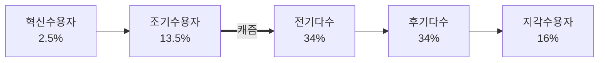

# 기술수용 주기 (Technology Adoption Life Cycle)

---

## I. 혁신이 시장에 퍼지는 순서, 기술수용 주기의 개요

### 가. 정의

- 신기술·신제품이 시장에 확산되는 과정을 **수용 시점에 따른 5개 수용자 집단(종 모양 분포, 누적 S자 곡선)** 으로 설명하는 모델 (E. Rogers, 『Diffusion of Innovations』 1962)

### 나. 특징

| 구분 | 내용 |
| --- | --- |
| 수용자 구분 | 혁신수용자 → 조기수용자 → 전기다수 → 후기다수 → 지각수용자 |
| 캐즘 (Chasm) | 조기 시장과 주류 시장 사이의 큰 단절 (G. Moore, 『Crossing the Chasm』 1991) |
| 집단별 전략 | 집단마다 구매 동기가 달라 마케팅·제품 전략을 바꿔야 함 |
| 활용 | 신기술 시장 진입(GTM), 목표 고객 선정, 확산 시점 예측 |

---

## II. 구조 및 구성요소

### 가. 수용 단계와 캐즘

- 비전을 보고 사는 조기수용자와 검증된 레퍼런스를 원하는 전기다수 사이의 기대 차이로 캐즘이 생기며, 교두보 시장과 완전제품으로 건넘

### 나. 구성요소

| 구분 | 요소 | 설명 |
| --- | --- | --- |
| 수용자 | 혁신수용자 (Innovators, 2.5%) | 기술 자체에 관심, 불완전함 감수 |
| | 조기수용자 (Early Adopters, 13.5%) | 비전가, 경쟁 우위를 위해 먼저 채택 |
| | 전기다수 (Early Majority, 34%) | 실용주의자, 검증된 레퍼런스·안정성 중시 |
| | 후기다수 (Late Majority, 34%) | 보수주의자, 표준화·가격 하락 후 채택 |
| | 지각수용자 (Laggards, 16%) | 회의론자, 대안이 없을 때 채택 |
| 캐즘 돌파 (Moore) | 교두보 시장 (Beachhead) | 1위가 가능한 좁은 틈새시장에 집중 |
| | 완전제품 (Whole Product) | 핵심 기술 + 서비스·연계·교육 등 바로 쓸 수 있는 해결책 |
| | 볼링핀 전략 | 교두보에서 인접 시장으로 연쇄 확장 |
| | 토네이도 | 주류 시장 진입 후 사실상 표준이 되며 수요 급증 |

---

## III. 모델 비교 및 동향

### 가. Rogers 확산 모델 vs Moore 캐즘 모델

| 구분 | Rogers 혁신 확산 | Moore 캐즘 |
| --- | --- | --- |
| 대상 | 혁신 일반 | 불연속적 하이테크 혁신 |
| 확산 형태 | 집단 간 연속적 전이 | 조기·주류 시장 사이 단절 |
| 핵심 변수 | 상대적 이점, 적합성, 복잡성, 시험 가능성, 관찰 가능성 | 비전가 vs 실용주의자 구매 동기 차이 |
| 전략 | 확산 촉진 (홍보, 채널) | 교두보, 완전제품, 볼링핀 |

### 나. 동향

- **생성형 AI의 기업 도입**: PoC 단계를 넘어 보안·[[할루시네이션]] 통제·업무 연계가 갖춰진 완전제품 형태로 주류 시장 진입 시도 ([[AI TRiSM]])
- **하이프 사이클과 병행 분석**: 가트너 하이프 사이클의 '환멸의 골짜기'를 캐즘과 유사한 국면으로 보고 도입 시점 판단에 함께 활용
- **확산 속도 단축**: 디지털 서비스는 배포 비용이 낮아 수용 곡선이 짧아지는 반면, 규제 산업은 여전히 캐즘이 길게 나타남

---

### 🔗 연관 토픽

- **소속 도메인**: [[00_경영전략_MOC|📈 경영전략]]
- **세부 분류**: `3. 비즈니스 프로세스 혁신 & 디지털 전환 (DX)`
- **핵심 연관 토픽**:
  - [[TRL|TRL(Technology Readiness Level)]]
  - [[그로스 해킹|그로스 해킹(Growth hacking)]]
  - [[가트너 2026 전략 기술]]
  - [[AI TRiSM|AI TRiSM(AI Trust Risk and Security Management)]]
  - [[정규분포|정규분포(Normal Distribution)]]
