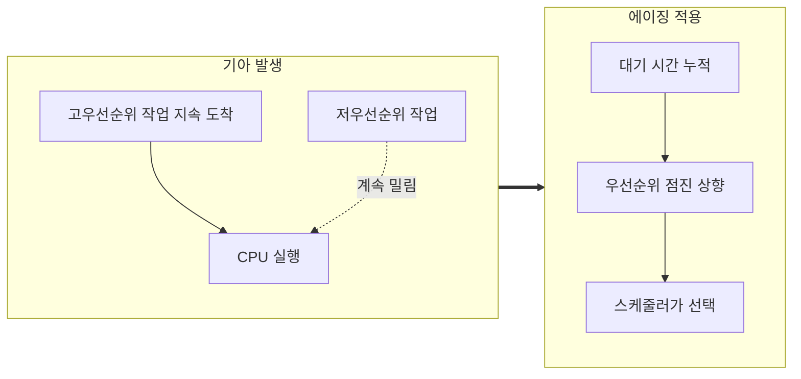

# 기아 (Starvation)

---

## I. 끝없는 양보, 기아의 개요

### 가. 정의

- 자원([[CPU]], 락, I/O 등)을 요청한 특정 프로세스·스레드가 **우선순위나 [[스케줄링]] 정책 때문에 무기한 할당받지 못하는 상태** (Indefinite Blocking)

### 나. 특징 및 원인

| 구분 | 내용 |
| --- | --- |
| 정적 우선순위 | 높은 우선순위 작업이 계속 들어오면 낮은 우선순위 작업이 계속 밀림 |
| 짧은 작업 우대 | SJF·SRTF는 평균 대기시간을 줄이지만 실행시간이 긴 작업이 밀릴 수 있음 |
| 불공정 락 | 경쟁 시 순서를 보장하지 않는 락(단순 [[스핀락]])에서 특정 스레드가 계속 탈락 |
| 교착상태와 차이 | 시스템 전체는 진행되며 특정 개체만 진행하지 못함 |

---

## II. 발생 구조 및 방지 기법

### 가. 기아와 에이징 개념도

- 오래 기다린 작업일수록 우선순위를 높여(Aging) 결국 실행 기회를 얻게 함

### 나. 방지 기법

| 구분 | 요소 | 설명 |
| --- | --- | --- |
| 스케줄링 | 에이징 (Aging) | 대기 시간에 비례해 우선순위 상향, 대표적 기아 방지 기법 |
| | 라운드 로빈 (RR) | 고정 시간 할당량(Time Quantum)으로 모든 준비 작업에 차례 보장 |
| | HRN | (대기시간 + 서비스시간) / 서비스시간으로 우선순위 계산, 대기할수록 우선순위 상승 |
| | 공정 스케줄러 (CFS, EEVDF) | 가상 실행시간(vruntime)·가상 마감시간 기준으로 CPU를 공정 분배 |
| 비례 배분 | 복권 스케줄링 (Lottery) | 티켓 수에 비례한 확률로 선택, 장기적으로 기아 확률이 0에 수렴 |
| | 보폭 스케줄링 (Stride) | 티켓 수의 역수(Stride)만큼 Pass 값을 누적, 결정론적 비례 배분 |
| 동기화 | 티켓 락·MCS 락 | 도착 순서([[FIFO]])대로 락 획득, 스핀락 경쟁 탈락 방지 |
| | 우선순위 상속 (Priority Inheritance) | 락을 쥔 저우선순위 작업을 대기 중인 고우선순위로 일시 승격, 우선순위 역전 해소 |

---

## III. 비교 및 동향

### 가. 기아 vs 교착상태

| 비교 항목 | 기아 (Starvation) | [[교착상태\|교착상태 (Deadlock)]] |
| --- | --- | --- |
| 상태 | 특정 개체만 진행 불가, 나머지는 정상 실행 | 사이클에 속한 프로세스 집합 전체 진행 불가 |
| 원인 | 불공정한 스케줄링·락 정책 | 4가지 필요조건 동시 성립 |
| 탐지 | 어려움 (지연인지 기아인지 구분 곤란) | 자원 할당 그래프·대기 그래프 사이클 탐지 |
| 해결 | 에이징, 공정 스케줄링, FIFO 락 | 예방, 회피([[은행가 알고리즘\|Banker's]]), 탐지·회복 |
| 관계 | 교착 회복 시 같은 희생자를 반복 선택하면 기아 발생 | |

### 나. 동향

- **Linux EEVDF**: 2007년(2.6.23) 도입된 CFS를 대체해 Linux 6.6부터 EEVDF(Earliest Eligible Virtual Deadline First) 적용, 공정성에 지연 요구를 함께 반영
- **sched_ext**: Linux 6.12에 병합, eBPF로 작성한 스케줄러를 커널 재빌드 없이 적재해 워크로드별 공정성 정책 실험
- **컨테이너 자원 격리**: cgroup CPU 가중치·쿼터로 멀티테넌트 환경에서 특정 컨테이너의 자원 기아 방지

---

### 🔗 연관 토픽

- **소속 도메인**: [[00_운영체제_MOC|⚙️ 운영체제]]
- **세부 분류**: `1. 프로세스 & 스레드 관리`
- **핵심 연관 토픽**:
  - [[교착상태|교착상태 (Deadlock)]]
  - [[스케줄링]]
  - [[비선점방식 유형]]
  - [[스핀락|스핀락 (Spin Lock)]]
  - [[커널|커널(Kernel)]]
