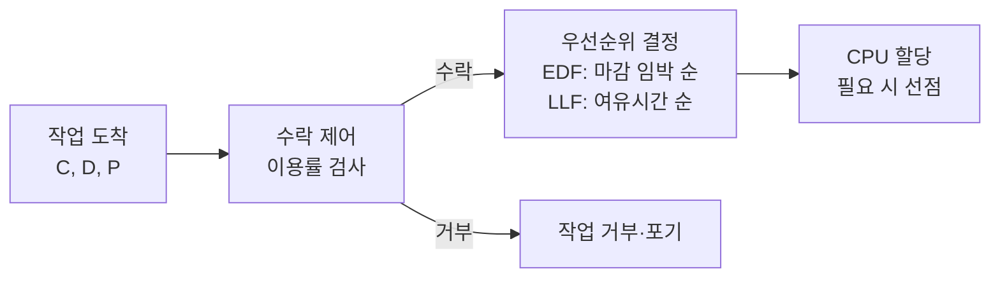

# 기한부 스케줄링 (Deadline Scheduling)

---

## I. 마감시간을 지키는, 기한부 스케줄링의 개요

### 가. 정의

- 각 작업에 **마감시간(Deadline)을 정하고 그 안에 완료되도록 CPU 할당 순서를 결정**하는 [[스케줄링]] 방식, 실시간 시스템의 핵심 기법

### 나. 특징

| 구분 | 내용 |
| --- | --- |
| 시간적 정확성 | 결과의 정확성뿐 아니라 기한 준수가 성공 조건 (Hard·Soft 실시간) |
| 사전 정보 | 작업의 실행시간(C)·주기(P)·마감시간(D)을 미리 알아야 함 |
| 수락 제어 | 기한을 지킬 수 없으면 작업을 받지 않거나 포기 |
| 교과서 분류 | 전통적 OS 교재에서는 비선점 기법으로 분류, 실시간 OS의 EDF는 선점형으로 구현 |
| 과부하 | 기한 미준수가 연쇄로 번지는 도미노 현상 주의 |

---

## II. 동작 구조 및 구성요소

### 가. 기한부 스케줄러 동작

- 들어오는 작업의 스케줄 가능성을 먼저 검사하고, 마감시간이 가까운 작업부터 실행

### 나. 구성요소

| 구분 | 요소 | 설명 |
| --- | --- | --- |
| 동적 우선순위 | EDF (Earliest Deadline First) | 마감시간이 가장 빠른 작업 우선, 단일 코어 선점형에서 U ≤ 1이면 스케줄 가능 (최적) |
| | LLF (Least Laxity First) | 여유시간 = 마감시간 − 현재시각 − 남은 실행시간이 가장 작은 작업 우선 |
| 정적 우선순위 | RMS (Rate Monotonic) | 주기가 짧을수록 높은 고정 우선순위, U ≤ n(2^(1/n) − 1)이면 스케줄 가능 |
| 수락 제어 | 이용률 검사 | U = Σ Ci / Pi로 부하 검사 |
| 자원 격리 | CBS (Constant Bandwidth Server) | 작업별 실행 예산을 정해 초과 시 억제, 다른 작업의 기한 보호 |
| 동기화 | 우선순위 상속·상한 (PIP·PCP) | 락으로 인한 [[우선순위 역전현상]] 방지 |
| OS 구현 | Linux `SCHED_DEADLINE` | 3.14부터 제공, EDF + CBS, runtime·deadline·period 파라미터 |

---

## III. 비교 및 동향

### 가. EDF vs RMS

| 비교 항목 | EDF | RMS |
| --- | --- | --- |
| 우선순위 | 동적 (마감시간 기준) | 정적 (주기 기준) |
| 스케줄 가능 이용률 | 최대 100% | n → ∞일 때 약 69.3% (충분조건) |
| 오버헤드 | 큼 (우선순위 재계산·정렬) | 작음 |
| 과부하 시 | 도미노 현상으로 다수 작업이 기한 초과 | 우선순위 낮은 작업부터 기한 초과, 예측 가능 |
| 적용 | Linux `SCHED_DEADLINE` | 고정 우선순위 RTOS (OSEK·AUTOSAR Classic OS 등) |

### 나. 동향

- **멀티코어 실시간 스케줄링**: Global EDF, 분할(Partitioned)·클러스터 EDF로 코어 간 이동 비용과 활용률 균형
- **PREEMPT_RT 메인라인화**: Linux 6.12에 실시간 선점이 병합되어 범용 Linux에서 기한 보장 워크로드 확대
- **차량·로봇 SW**: [[Smart Car(자율주행)|자율주행]]·ROS 2 환경에서 센서 처리부터 제어까지 종단 간 지연 상한을 보장하는 스케줄링 연구

---

### 🔗 연관 토픽

- **소속 도메인**: [[00_운영체제_MOC|⚙️ 운영체제]]
- **세부 분류**: `2. CPU 스케줄링 알고리즘`
- **핵심 연관 토픽**:
  - [[스케줄링]]
  - [[비선점방식 유형]]
  - [[선점 스케줄링|선점 방식(선비)]]
  - [[우선순위 역전현상]]
  - [[디스크 스케줄링|디스크 스케줄링(Disk Scheduling)]]
