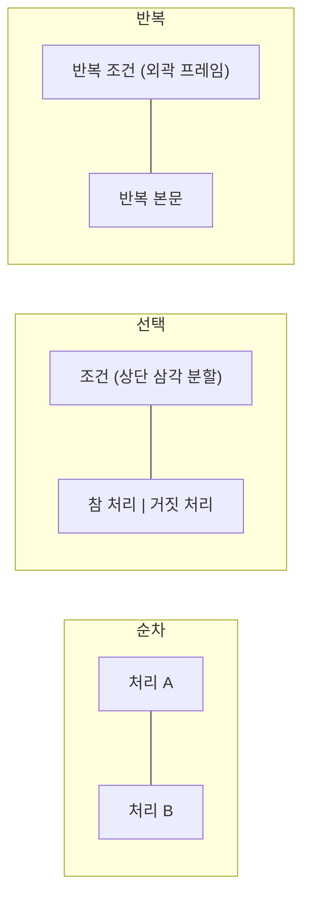

# 나씨-슈나이더만 차트 (Nassi-Shneiderman Chart)

---

## I. 화살표 없는 구조적 설계도, NS 차트의 개요

### 가. 정의

- **순차·선택·반복 제어 구조를 화살표 없이 중첩된 사각형 블록으로 표현**하여 구조적 프로그래밍을 강제하는 알고리즘 설계 도표 (I. Nassi·B. Shneiderman, 1973)

### 나. 특징

| 구분 | 내용 |
| --- | --- |
| 등장 배경 | 순서도의 무분별한 GOTO·화살표로 인한 스파게티 구조 (Dijkstra의 GOTO 유해론) |
| 화살표 배제 | 블록의 공간 배치로 흐름을 표현해 임의 분기 불가 |
| 단일 입출구 | 모든 블록이 하나의 진입점과 출구를 가짐 (SESE) |
| 중첩 가시화 | 블록 중첩 깊이로 제어 구조 복잡도 파악 용이 |

---

## II. 기본 구조 및 구성요소

### 가. 3대 기본 제어 구조

- 순차는 상하로 쌓고, 선택은 상단을 대각선으로 나눠 조건별 열로 분기하며, 반복은 조건 프레임이 본문 블록을 감싸는 형태

### 나. 구성요소

| 구분 | 요소 | 설명 |
| --- | --- | --- |
| 기본 구조 | 순차 (Sequence) | 위에서 아래로 쌓인 처리 블록 |
| | 선택 (If-Then-Else) | 상단 삼각 영역에 조건, 아래를 참·거짓 열로 분할 |
| | 반복 (While · Until) | 조건을 위(선 검사) 또는 아래(후 검사) 프레임에 두고 본문을 감쌈 |
| 확장 구조 | 다중 선택 (Case) | 상단을 여러 구간으로 나눠 다방향 분기 |
| 구조화 원칙 | 화살표 배제 | GOTO 표현 자체가 불가능 |
| | 단일 입출구 (SESE) | 블록 단위 [[모듈화]]·검증 용이 |
| 품질 분석 | 중첩 깊이 | 깊은 중첩으로 [[McCabe 회전 복잡도\|복잡도]]·리팩토링 대상 식별 |
| 도구 | Structorizer 등 | 코드와 NS 차트 간 상호 변환 |

---

## III. 비교 및 동향

### 가. NS 차트 vs 순서도

| 비교 항목 | NS 차트 | 순서도 (Flowchart) |
| --- | --- | --- |
| 표현 방식 | 사각형 블록 중첩 | 기호와 화살표 |
| GOTO 표현 | 불가 | 자유로움 |
| 구조적 프로그래밍 | 강제 | 보장 못 함 |
| 복잡도 파악 | 중첩 깊이로 직관적 | 선이 얽혀 파악 곤란 |
| 예외 · 탈출 | Break·예외 처리 표현 곤란 | 쉽게 표현 |
| 수정 | 블록 크기 재조정 필요 | 기호·선 추가로 용이 |

### 나. 동향

- 교육용 블록 코딩(Scratch, Blockly)의 중첩 블록 구조에 개념 계승
- 레거시 코드 역공학 시 제어 구조를 시각화해 업무 규칙 추출에 활용

---

### 🔗 연관 토픽

- **소속 도메인**: [[00_소프트웨어공학_MOC|🏗️ 소프트웨어공학]]
- **세부 분류**: `3. 요구사항 공학 & UML 객체지향 분석/설계`
- **핵심 연관 토픽**:
  - [[소프트웨어 설계의 원리]]
  - [[McCabe 회전 복잡도]]
  - [[모듈화|모듈화 (Modularity)]]
  - [[데이터 흐름도]]
  - [[정적 분석 도구]]
