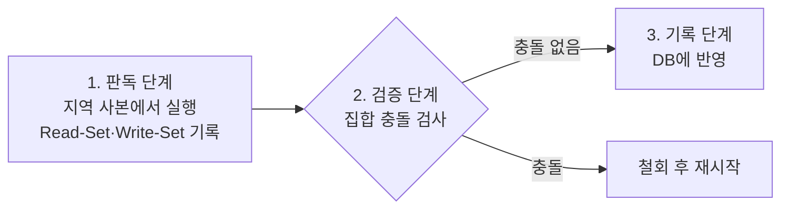

# 낙관적 검증 (Validation) 기법

---

## I. 먼저 실행하고 나중에 검증, 낙관적 검증 기법의 개요

### 가. 정의

- [[트랜잭션]]이 잠금 없이 **지역 사본에서 실행한 뒤 커밋 직전 검증 단계에서 직렬 가능성 위반 여부를 확인하고, 통과하면 반영·실패하면 철회하는 동시성 제어 기법** (Kung·Robinson, 1981)

### 나. 특징

| 구분 | 내용 |
| --- | --- |
| 잠금 미사용 | 잠금 관리 부담 없음, 교착상태 없음 |
| 사후 검증 | 충돌이 드물다는 가정 아래 커밋 시점에만 검사 |
| 적합 환경 | 읽기 위주, 충돌이 적은 워크로드 |
| 한계 | 충돌이 잦으면 철회·재실행 비용 증가 |

---

## II. 동작 단계 및 구성요소

### 가. 3단계 동작

- 각 트랜잭션에 Start·Validation·Finish 시점을 부여하고, 검증 순서를 직렬화 순서로 사용

### 나. 구성요소

| 구분 | 요소 | 설명 |
| --- | --- | --- |
| 단계 | 판독 (Read) | DB를 읽어 지역 작업 공간에서 연산, DB는 변경하지 않음 |
| | 검증 (Validation) | 동시 수행 트랜잭션과의 충돌 검사 |
| | 기록 (Write) | 검증 통과 시 Write-Set을 DB에 반영 |
| 검증 방식 | 후방 검증 (BOCC) | 자신의 판독 중 커밋한 트랜잭션의 Write-Set과 자신의 Read-Set 비교 |
| | 전방 검증 (FOCC) | 자신의 Write-Set과 아직 실행 중인 트랜잭션의 Read-Set 비교 |
| 관리 정보 | Read-Set·Write-Set | 읽고 쓴 항목 집합 |
| | 타임스탬프 | Start(T), Validation(T), Finish(T) |
| 충돌 처리 | 철회·재시작 | 실패 트랜잭션 폐기 후 재실행 (FOCC는 상대 트랜잭션 철회도 선택 가능) |

---

## III. 비교 및 동향

### 가. 낙관적 vs 비관적 동시성 제어

| 비교 항목 | 낙관적 (OCC) | 비관적 ([[2PL]]) |
| --- | --- | --- |
| 가정 | 충돌 드묾 | 충돌 잦음 |
| 충돌 대응 | 커밋 시 검증 후 철회 | 사전 잠금으로 대기 |
| [[교착상태]] | 없음 | 발생 가능 |
| 비용 | 철회·재실행 | 잠금 대기·관리 |
| 적합 환경 | 읽기 위주, 짧은 트랜잭션 | 쓰기 경합이 큰 환경 |

### 나. 동향

- **인메모리 DB**: Silo, Microsoft Hekaton이 OCC 변형으로 잠금 병목 제거
- **애플리케이션 낙관적 잠금**: JPA `@Version`, 조건부 UPDATE(버전 비교)로 갱신 손실 방지
- **블록체인 병렬 실행**: Aptos의 Block-STM이 트랜잭션을 낙관적으로 병렬 실행 후 검증·재실행 ([[01_IT Tech/블록체인|블록체인]])

---

### 🔗 연관 토픽

- **소속 도메인**: [[00_데이터베이스_MOC|🗄️ 데이터베이스]]
- **세부 분류**: `2. 트랜잭션 & 동시성 제어 (Concurrency)`
- **핵심 연관 토픽**:
  - [[병행 제어]]
  - [[2PL|2PL (Two-Phase Locking Protocol)]]
  - [[타임스탬프 순서 기법|Timestamp Ordering]]
  - [[MVCC(다중 버전 동시성 제어) 2가지 유형]]
  - [[트랜잭션]]
