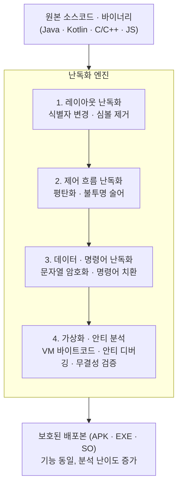

# 난독화 (Obfuscation) / SW 난독화

---

## I. 역공학 방지와 지식재산 보호, 난독화의 개요

### 가. 정의

- 프로그램의 **기능(의미)은 그대로 유지하면서 소스코드·바이너리를 사람과 분석 도구가 이해하기 어렵게 변환**하여 역공학(Reverse Engineering)과 위·변조를 지연시키는 소프트웨어 보호 기술

### 나. 필요성 및 특징

| 구분 | 내용 |
| --- | --- |
| 지식재산 보호 | 모바일 앱·상용 SW·펌웨어의 핵심 로직과 알고리즘 유출 방지 |
| 분석 도구 대응 | IDA Pro, Ghidra, jadx 등 디컴파일러의 코드 복원 방해 |
| 위·변조 방지 | API 키, 인증·결제 로직, [[DRM(Digital Right Management)\|DRM]] 우회 차단 |
| 의미 보존 | 변환 전후 실행 결과가 동일 (Semantics Preserving) |
| 비용 증가 | 분석 시간을 늘리는 것이 목표이며 완전한 방어는 아님 |
| 성능 Trade-off | 코드 크기·실행 시간 증가 |

---

## II. 난독화 절차 및 핵심 기법

### 가. 다계층 난독화 절차

- 식별자를 지우고 제어 흐름 그래프(CFG)를 평탄화한 뒤, 데이터를 인코딩하고 핵심 함수를 자체 VM 바이트코드로 바꿔 디컴파일러의 복원을 차단

### 나. 핵심 기법

| 구분 | 기법 | 설명 |
| --- | --- | --- |
| 레이아웃 | 식별자 변경 (Renaming) | [[클래스]]·함수·변수명을 `a`, `b` 등 무의미한 이름으로 치환 (ProGuard, R8) |
| | 심볼 제거 (Stripping) | 디버그 심볼·주석·메타데이터 삭제 |
| 제어 흐름 | 제어 흐름 평탄화 (CFF) | 기본 블록을 하나의 switch-loop 디스패처 아래로 재배치해 흐름 은닉 |
| | 불투명 술어 (Opaque Predicate) | 실행 시 결과가 고정이지만 정적 분석으로는 판별이 어려운 조건과 더미 코드 삽입 |
| 데이터 | 문자열·상수 암호화 | 평문 문자열을 XOR·[[AES]]로 인코딩하고 실행 시점에만 복호화 |
| | 변수 분할·병합 | 하나의 값을 여러 변수·수식으로 쪼개 추적 교란 |
| 명령어 | 명령어 치환 (MBA) | $x+y$를 $(x \oplus y)+2(x \land y)$ 같은 등가 복합 연산으로 대체 |
| [[가상화]] | VM 기반 난독화 | 네이티브 명령어를 자체 바이트코드와 인터프리터로 변환 (VMProtect 계열) |
| 안티 분석 | 안티 디버깅 | `ptrace`, `IsDebuggerPresent` 등으로 디버거 탐지 시 종료 |
| | 안티 탬퍼링 | 코드 체크섬([[CRC]])·서명 검증으로 변조 감지 ([[무결성]]) |

---

## III. 비교 및 동향

### 가. 난독화 vs 암호화

| 비교 항목 | 난독화 | [[암호화\|암호화 (Encryption)]] |
| --- | --- | --- |
| 목적 | 이해 방지 (분석 지연) | [[기밀성]] 보장 |
| 실행 | 복호화 없이 그대로 실행 | 키로 복호화해야 사용 가능 |
| 안전성 근거 | 휴리스틱한 복잡도 증가 | 수학적 난제(소인수분해, 이산대수 등) |
| 적용 대상 | 실행 파일, 라이브러리, 프런트엔드 JS, 앱 | 저장·전송 데이터, 토큰 |
| 한계 | 기호 실행·SMT 솔버로 역난독화 가능 | 키 유출 시 원본 노출 |

### 나. 정적 난독화 vs 앱 실딩

| 비교 항목 | 정적 난독화 | 앱 실딩 (App Shielding / RASP) |
| --- | --- | --- |
| 적용 시점 | 빌드 시 1회 변환 | 빌드 변환 + 런타임 자기 보호 |
| 방어 범위 | 정적 분석 | 동적 분석·디버깅·후킹·루팅 탐지 |
| 성능 영향 | 작음 | 가상화·실시간 검증으로 큼 |

### 다. 동향

- **LLM 기반 역난독화 대응**: [[초거대 언어 모델\|LLM]]이 난독화 코드를 해석하는 수준이 높아져, 다형성·변성(Metamorphic) 코드와 런타임 JIT 생성으로 매 배포마다 형태를 바꾸는 방식 확대
- **기호 실행 무력화**: Angr·Triton 등 SMT 기반 도구의 상태 폭발을 유도하는 복합 루프·MBA 표현식 적용
- **이론적 난독화 (iO)**: 2020년 표준적 가정만으로 구분 불가능 난독화(Indistinguishability Obfuscation) 구성이 증명되었으나, 아직 실용적 성능에는 미치지 못함

---

### 🔗 연관 토픽

- **소속 도메인**: [[00_보안_MOC|🛡️ 보안]]
- **세부 분류**: `1. 정보보안 원칙 & 거버넌스 · 인증`
- **핵심 연관 토픽**:
  - [[암호화|암호화 (Encryption)]]
  - [[무결성]]
  - [[기밀성]]
  - [[가상화]]
  - [[디지털 포렌식|디지털 포렌식(Digital Forensic)]]
