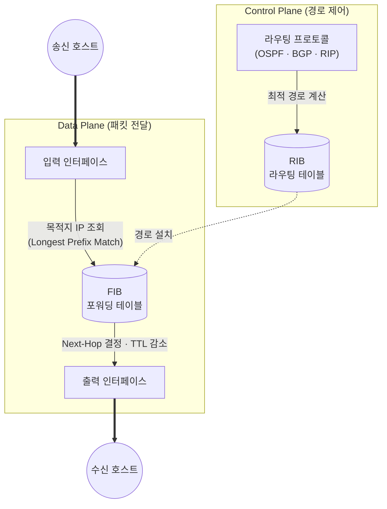

# 네트워크 계층 (Network Layer, OSI 3계층)

---

## I. 서로 다른 네트워크 간 패킷 전달, 네트워크 계층의 개요

### 가. 정의

- OSI 7계층 중 3계층으로, **논리 주소(IP)를 기반으로 송신 호스트에서 수신 호스트까지 패킷의 경로를 결정(Routing)하고 전달(Forwarding)** 하는 계층

### 나. 특징

| 구분 | 내용 |
| --- | --- |
| 논리 주소 | IP 주소로 전 세계 호스트를 계층적으로 식별 ([[논리 주소]]) |
| 경로 결정 | 이기종 네트워크를 거쳐 목적지까지 최적 경로 선택 |
| 비연결·Best-Effort | IP는 순서·도착을 보장하지 않으며 신뢰성은 상위 계층([[TCP]])이 담당 |
| 루프 방지 | 라우터 통과 시마다 TTL(IPv6는 Hop Limit) 1 감소, 0이면 폐기 |
| 전송 단위 | 패킷 (Packet, Datagram) |

---

## II. 동작 구조 및 핵심 기술

### 가. 라우팅과 포워딩 구조

- 제어부는 라우팅 프로토콜로 경로를 계산해 RIB에 저장하고, 데이터부는 RIB에서 내려받은 FIB로 패킷을 하드웨어 속도로 포워딩

### 나. 핵심 기술

| 구분 | 기술 | 설명 |
| --- | --- | --- |
| 주소 | [[IPv4]] / [[IPv6]] | 32비트 / 128비트 논리 주소 |
| | [[Subnetting (서브네팅)\|서브네팅]] · CIDR | 네트워크·호스트 부분을 가변 분할해 주소 효율화, 경로 집약 |
| 경로 설정 | 라우팅 프로토콜 | 내부: [[거리 벡터 알고리즘\|거리 벡터]](RIP)·[[링크 상태 알고리즘\|링크 상태]](OSPF), 외부: [[BGP]] |
| 패킷 제어 | 단편화 (Fragmentation) | 링크 MTU보다 큰 패킷을 분할, 목적지에서 재조립 (IPv6는 송신 호스트만 분할) |
| 오류 · 진단 | [[ICMP]] | 목적지 도달 불가·TTL 초과 보고, ping·traceroute |
| 주소 변환 | [[ARP]] / NDP | IP → MAC 주소 확인 (IPv6는 ICMPv6 기반 NDP) |
| 그룹 통신 | [[IGMP]] | 멀티캐스트 그룹 가입·탈퇴 관리 |
| 품질 | [[QoS\|QoS (Quality of Service)]] | [[DiffServ (Differentiated Services)\|DiffServ]](DSCP), [[IntServ (Integrated Services)\|IntServ]]로 우선 처리 |
| 가상화 | VRF · MPLS | 한 라우터에 독립 라우팅 인스턴스, 레이블 스위칭 기반 [[VPN]]·트래픽 엔지니어링 |

---

## III. 비교 및 동향

### 가. 2계층 vs 3계층 vs 4계층

| 비교 항목 | 데이터 링크 (L2) | 네트워크 (L3) | 전송 (L4) |
| --- | --- | --- | --- |
| 전달 범위 | 인접 노드 간 (Hop-to-Hop) | 호스트 간 (Host-to-Host) | [[프로세스]] 간 (End-to-End) |
| 주소 | MAC 주소 (48비트) | IP 주소 | 포트 번호 |
| 전송 단위 | 프레임 | 패킷 | 세그먼트 · 데이터그램 |
| 신뢰성 | 링크 단위 오류 검출 | 보장 안 함 (Best-Effort) | TCP는 재전송·순서 보장 |
| 장비 · 프로토콜 | L2 [[스위치]], Ethernet, PPP | [[라우터]], IP, ICMP, OSPF, BGP | TCP, UDP, QUIC |

### 나. 동향

- **SDN**: Control Plane을 중앙 컨트롤러로 분리해 포워딩 규칙을 프로그래밍 ([[SDN(Software Defined Network)\|SDN]], [[OpenFlow]])
- **SRv6**: IPv6 확장 헤더에 경로(Segment 목록)를 담아 중간 라우터의 상태 유지를 줄이고 트래픽 엔지니어링 단순화
- **의도 기반 네트워킹**: 운영자의 의도를 정책으로 변환해 라우팅 설정과 장애 복구를 자동화 ([[IBN(Intent-Based Networking)\|IBN]])

---

### 🔗 연관 토픽

- **소속 도메인**: [[00_네트워크_MOC|🌐 네트워크]]
- **세부 분류**: `1. OSI 7계층 & 데이터링크 계층 (L1/L2)`
- **핵심 연관 토픽**:
  - [[데이터 링크 계층]]
  - [[전송 계층]]
  - [[라우터]]
  - [[IPv6]]
  - [[BGP|BGP(Border Gateway Protocol)]]
