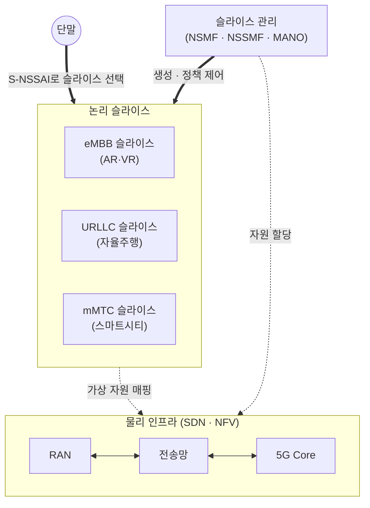

# 네트워크 슬라이싱 (Network Slicing)

---

## I. 하나의 물리망, 여러 개의 논리망, 네트워크 슬라이싱의 개요

### 가. 정의

- 하나의 물리 네트워크 위에 [[SDN(Software Defined Network)|SDN]]·[[NFV]]로 **서비스 요구사항([[QoS]])별로 격리된 논리 네트워크(Slice)를 단말부터 코어까지 [[End-to-End]]로 구성**하는 5G 핵심 기술

### 나. 필요성 및 특징

| 구분 | 내용 |
| --- | --- |
| 이기종 QoS 수용 | eMBB·URLLC·mMTC처럼 상충하는 요구를 한 인프라에서 동시 제공 |
| 비용 절감 | 서비스별 전용망 대신 공유 인프라로 CAPEX·OPEX 절감 |
| 격리 (Isolation) | 한 슬라이스의 트래픽 폭증·장애가 다른 슬라이스에 영향 없음 |
| 동적 생명주기 | 생성·변경·폐기를 오케스트레이터가 자동 수행 |
| 비즈니스 모델 | 기업·산업별 맞춤 슬라이스 판매 (B2B, [[5G 특화망]] 대안) |

---

## II. 구조 및 핵심 기술

### 가. E2E 슬라이싱 구조

- 단말이 S-NSSAI로 원하는 슬라이스를 요청하면 코어의 NSSF가 슬라이스를 선택하고, 관리 기능이 RAN·전송망·코어 자원을 슬라이스별로 할당

### 나. 핵심 기술

| 구분 | 요소 | 설명 |
| --- | --- | --- |
| [[가상화]] | SDN | 제어·데이터 평면 분리로 슬라이스별 경로 중앙 제어 |
| | NFV | [[방화벽]]·[[라우터]]·코어 기능을 VNF/CNF로 소프트웨어화 |
| 관리 | NSMF · NSSMF | 3GPP 슬라이스 관리 기능, 슬라이스·서브넷 단위 생명주기 관리 |
| | NFV MANO | 가상 자원(VNF, NFVI) 배치·확장 |
| 코어망 | 5GC SBA · NSSF | 서비스 기반 구조로 기능 조합, NSSF가 슬라이스 선택 |
| 무선망 | RAN 슬라이싱 | 무선 자원·[[스케줄링]] 우선순위를 슬라이스별로 분할 |
| 전송망 | FlexE · SRv6 | 하드 격리 채널, 세그먼트 라우팅으로 대역·경로 보장 |
| 식별자 | S-NSSAI | SST(슬라이스 유형) + SD(세부 구분)로 슬라이스 식별 |

---

## III. 비교 및 동향

### 가. 5G 슬라이스 유형 비교

| 비교 항목 | eMBB | URLLC | mMTC |
| --- | --- | --- | --- |
| 목적 | 초고속·대용량 | 초저지연·고신뢰 | 초연결 |
| 대표 요구치 | 최대 20Gbps (하향) | 사용자 평면 지연 1ms, 99.999% [[신뢰성]] | km²당 100만 기기 |
| 활용 | UHD, AR·VR | [[Smart Car(자율주행)\|자율주행]](V2X), 원격 제어, 스마트팩토리 | 스마트시티, 원격 검침 |
| 슬라이싱 초점 | 데이터 평면 대역 확보 | [[Mobile Edge Computing\|MEC]] 근접 배치, 우선 스케줄링 | 제어 평면 경량화 |

### 나. 동향

- **Zero-touch 운영**: ETSI ZSM, AI 기반 트래픽 예측으로 슬라이스 자원 자동 확장·축소
- **의도 기반 관리**: 운영자가 [[SLA]] 수준의 의도만 입력하면 슬라이스를 자동 생성·복구 ([[IBN(Intent-Based Networking)|IBN]])
- **상용 서비스화**: 5G SA 확산과 함께 방송 중계·공공안전·게임용 슬라이스 상품 출시

---

### 🔗 연관 토픽

- **소속 도메인**: [[00_네트워크_MOC|🌐 네트워크]]
- **세부 분류**: `1. OSI 7계층 & 데이터링크 계층 (L1/L2)`
- **핵심 연관 토픽**:
  - [[SDN(Software Defined Network)]]
  - [[NFV]]
  - [[5G|5G 주요 기술]]
  - [[Mobile Edge Computing|Mobile Edge Computing (MEC)]]
  - [[QoS|QoS (Quality of Service)]]
