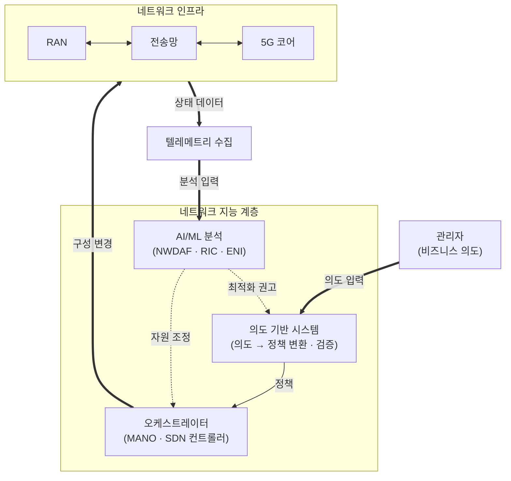

# 네트워크 지능 (Network Intelligence)

---

## I. 스스로 보고 판단하는 망, 네트워크 지능의 개요

### 가. 정의

- 망의 장비·트래픽 데이터를 **AI/ML로 분석해 상태 인지, 장애 예측, 자원 할당, 자가 치유를 폐루프(Closed-loop)로 자동화**하는 네트워크 운영 기술

### 나. 필요성 및 특징

| 구분 | 내용 |
| --- | --- |
| 복잡도 증가 | 5G 슬라이싱·가상화·멀티벤더로 사람이 직접 운영하기 어려움 |
| 품질 보장 | [[SLA]] 위반을 사전에 예측해 대응 |
| 비용 절감 | 운영 인력·장애 시간 감소로 OPEX 절감 |
| 폐루프 제어 | 수집 → 분석 → 결정 → 실행 → 재측정 반복 |
| Zero-touch | 사람 개입을 최소화한 자율 네트워크 지향 |

---

## II. 구조 및 구성요소

### 가. 폐루프 자동화 구조

- 관리자의 의도를 정책으로 바꿔 망을 설정하고, 수집한 데이터를 AI가 분석해 다시 정책·자원을 조정하는 폐루프 구조

### 나. 구성요소

| 구분 | 요소 | 설명 |
| --- | --- | --- |
| 의도 기반 | [[IBN(Intent-Based Networking)\|IBN]] | 요구사항(의도)을 정책으로 변환하고 결과를 지속 검증 |
| 코어 분석 | [[NWDAF(Network Data Analytics Function)\|NWDAF]] | 3GPP 5G 코어의 데이터 분석 기능, 부하·QoS 예측 제공 |
| 무선 분석 | [[O-RAN]] RIC | Near-RT RIC(xApp)·Non-RT RIC(rApp)로 RAN 최적화 |
| 표준 프레임워크 | ETSI ZSM · ENI | 종단 간 Zero-touch 관리, AI 기반 경험적 네트워크 지능 |
| | TM Forum AN | 자율 네트워크 수준(L0~L5) 정의 |
| 데이터 수집 | 스트리밍 텔레메트리 | 장비가 gNMI 등으로 상태를 실시간 Push, SNMP 폴링 대체 |
| 분석 기법 | 시계열 예측 · 연합학습 | [[LSTM (Long Short-Term Memory)\|LSTM]] 등 트래픽 예측, 데이터 이동 없는 분산 학습 |
| 실행 기반 | [[SDN(Software Defined Network)\|SDN]] · [[NFV]] · 슬라이싱 | 분석 결과를 경로·자원·슬라이스 변경으로 적용 |
| 신기술 | 통신 특화 LLM 에이전트 | 장애 분석·설정 생성 보조 ([[초거대 언어 모델\|LLM]]) |

---

## III. 비교 및 동향

### 가. 자율 네트워크 수준 (TM Forum)

| 구분 | 내용 |
| --- | --- |
| L0 수동 | 모든 운영을 사람이 수행 |
| L1 보조 | 일부 반복 작업을 도구가 보조 |
| L2 부분 자율 | 특정 영역에서 규칙 기반 폐루프 자동화 |
| L3 조건부 자율 | 특정 영역에서 시스템이 상황 인지·분석·실행, 사람은 감독 |
| L4 고도 자율 | 여러 영역에 걸친 의도 기반 폐루프 자율 운영 |
| L5 완전 자율 | 모든 영역·시나리오에서 자율 운영 |

### 나. 동향

- **설명 가능성**: AI 결정의 근거 제시 요구로 [[XAI]] 적용
- **데이터 표준화**: 멀티벤더 데이터 형식 차이 해소를 위한 공통 데이터 모델·API (3GPP, O-RAN, TM Forum)
- **AI-Native 6G**: 무선 인터페이스·코어 설계 단계부터 AI를 내장하는 방향으로 표준화 논의 ([[6G]])

---

### 🔗 연관 토픽

- **소속 도메인**: [[00_네트워크_MOC|🌐 네트워크]]
- **세부 분류**: `3. 전송 계층 & 트래픽 / 혼잡 제어 (L4)`
- **핵심 연관 토픽**:
  - [[IBN(Intent-Based Networking)]]
  - [[NWDAF(Network Data Analytics Function)]]
  - [[O-RAN]]
  - [[디지털 트윈 네트워크]]
  - [[XAI]]
