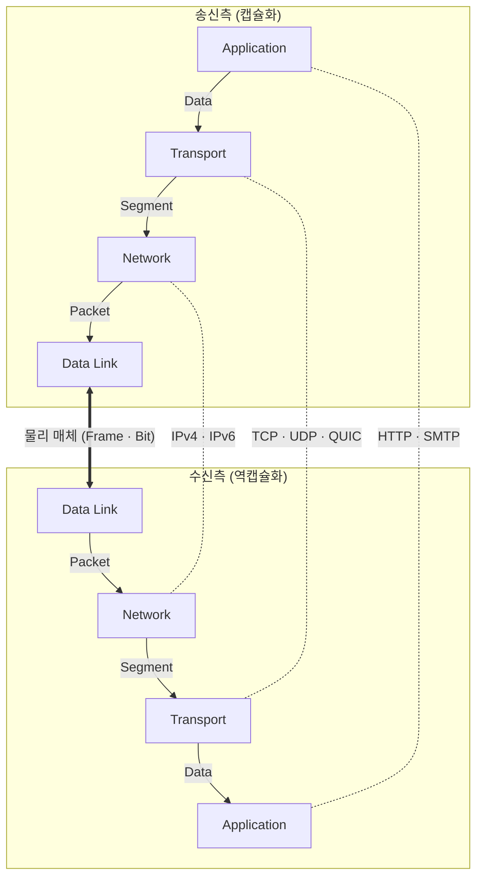

# 네트워크 프로토콜 (Network Protocol)

---

## I. 통신 주체 간의 약속, 네트워크 프로토콜의 개요

### 가. 정의

- 네트워크에서 이기종 시스템(단말, [[라우터]], 서버)이 데이터를 주고받기 위해 **형식(구문)·의미·타이밍을 미리 정한 통신 규약**

### 나. 특징 및 필요성

| 구분 | 내용 |
| --- | --- |
| 상호 운용성 | 제조사·OS가 달라도 같은 규약으로 통신 |
| 계층화 | 기능을 계층별로 나눠 독립적으로 설계·교체 ([[OSI 7 Layer]], TCP/IP) |
| 캡슐화 | 송신 시 계층마다 헤더를 붙이고 수신 시 제거 |
| 신뢰성 확보 | 오류·흐름·순서 제어로 데이터 [[무결성]] 확보 |
| 3대 요소 | 구문(Syntax), 의미(Semantics), 타이밍(Timing) |

---

## II. 구조 및 기능

### 가. 계층별 동등 계층(Peer) 통신 구조

- 실제 데이터는 아래로 내려가 물리 매체를 지나지만, 각 계층은 상대편 같은 계층과 해당 [[프로토콜]]로 논리적으로 통신

### 나. 3요소 및 주요 기능

| 구분 | 요소 | 설명 |
| --- | --- | --- |
| 3요소 | 구문 (Syntax) | 데이터 형식, 부호화, 신호 레벨 |
| | 의미 (Semantics) | 제어 정보의 뜻, 오류 처리 방법 |
| | 타이밍 (Timing) | 속도 일치, 메시지 순서 |
| 데이터 처리 | 캡슐화 · 역캡슐화 | 헤더 추가·제거 |
| | 단편화 · 재조립 | MTU에 맞게 분할 후 목적지에서 재조립 |
| 연결 제어 | 연결 설정 · 해제 | [[TCP 연결의 설정 및 해제\|3-Way Handshake]], 4-Way 종료 |
| 전송 제어 | 흐름 제어 | 수신 버퍼 넘침 방지 ([[Sliding Window & 네이글(Nagle's) 알고리즘\|슬라이딩 윈도우]]) |
| | 오류 제어 | 검출(CRC·Checksum) 후 재전송(ARQ) |
| | 순서 제어 · [[다중화]] · 주소 지정 | 순서 번호, 포트·채널 공유, 송수신자 식별 |

---

## III. 비교 및 동향

### 가. 계층별 기존 프로토콜과 차세대 프로토콜

| 계층 (TCP/IP) | 기존 | 차세대 | 개선점 |
| --- | --- | --- | --- |
| Application | HTTP/1.1, HTTP/2 | [[HTTP 3\|HTTP/3]] | TCP 계층 HOL Blocking 제거 |
| Transport | [[TCP]], UDP | QUIC | UDP 위 스트림 다중화, TLS 1.3 내장, 0-RTT 재연결 |
| Internet | [[IPv4]], MPLS | [[IPv6]], SRv6 | 주소 확장, 소스 라우팅으로 트래픽 엔지니어링 단순화 |
| IoT | HTTP 기반 API | [[MQTT (Message Queuing Telemetry Transport)\|MQTT]], [[CoAP]] | Pub/Sub·경량 헤더로 저전력 기기 지원 |

### 나. 동향

- **QUIC·HTTP/3 확산**: IETF RFC 9000(2021)·RFC 9114(2022) 표준화 이후 주요 브라우저·CDN 기본 지원
- **암호화 기본화**: TLS 1.3, DNS over HTTPS 등 평문 프로토콜을 암호화 기반으로 대체
- **IoT 경량화**: MQTT 5.0, CoAP으로 대규모 센서망의 오버헤드·전력 소모 감소

---

### 🔗 연관 토픽

- **소속 도메인**: [[00_네트워크_MOC|🌐 네트워크]]
- **세부 분류**: `1. OSI 7계층 & 데이터링크 계층 (L1/L2)`
- **핵심 연관 토픽**:
  - [[프로토콜]]
  - [[OSI 7 Layer|OSI 7 Layer (ISO 7498)]]
  - [[전송 계층|전송 계층 (Transport Layer)]]
  - [[TCP 와 UDP 비교]]
  - [[HTTP 3|HTTP/3]]
