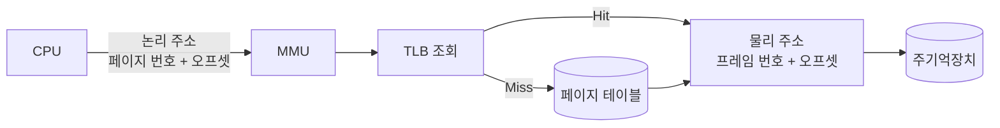

# 논리 주소 (Logical Address)

---

## I. 프로세스가 보는 주소, 논리 주소의 개요

### 가. 정의

- [[CPU]]가 프로그램 실행 중 생성하는 주소로, 실제 메모리 위치와 무관하게 **프로세스마다 독립된 주소 공간**에서 쓰이는 주소 (페이징 시스템에서는 가상 주소와 같은 의미)

### 나. 특징 및 필요성

| 구분 | 내용 |
| --- | --- |
| 독립 주소 공간 | 프로세스마다 0번지부터 시작하는 자기만의 공간 → 다른 프로세스 영역 침범 방지 |
| 동적 변환 | MMU가 실행 시점에 [[물리 주소]]로 변환 (실행 시간 바인딩) |
| 재배치 | 프로그램이 메모리의 어느 위치에 적재돼도 코드 수정 불필요 |
| [[가상 메모리]] 기반 | 물리 메모리보다 큰 주소 공간 제공 |

---

## II. 주소 변환 구조 및 구성요소

### 가. 주소 변환 개념도

- MMU가 TLB를 먼저 조회하고, 없으면 메모리의 페이지 테이블을 참조해 물리 주소로 변환

### 나. 구성요소

| 구분 | 요소 | 설명 |
| --- | --- | --- |
| 변환 장치 | [[MMU(Memory Management Unit)\|MMU]] | 논리 주소를 물리 주소로 변환하고 접근 권한 검사 |
| | TLB | 최근 변환 결과를 보관하는 연관 메모리 캐시 |
| 변환 구조 | 페이지 테이블 | 페이지 번호 → 프레임 번호 매핑 |
| | 세그먼트 테이블 | 세그먼트 번호 → 시작 주소(Base)·길이(Limit) 매핑 |
| 보호 | Base·Limit 레지스터 | 연속 할당에서 시작 주소를 더하고 범위를 벗어난 접근을 차단 |
| 바인딩 시점 | 컴파일·적재 시간 | 논리 주소 = 물리 주소 |
| | 실행 시간 | 논리 주소 ≠ 물리 주소, MMU 필요 |

---

## III. 비교 및 동향

### 가. 논리 주소 vs 물리 주소

| 비교 항목 | 논리 주소 | [[물리 주소]] |
| --- | --- | --- |
| 생성 주체 | CPU (실행 중인 프로그램) | MMU (변환 결과) |
| 주소 공간 | 프로세스별 독립 | 시스템 전체가 공유하는 단일 공간 |
| 공간 크기 | 주소 비트 수로 결정 (예: x86-64는 48비트 가상 주소) | 실제 장착 메모리와 CPU 물리 주소 비트 수로 결정 |
| 사용자 접근 | 프로그램이 직접 사용 | 사용자 프로그램은 직접 볼 수 없음 |

### 나. 동향

- **Huge Page**: 4KB 대신 2MB·1GB 페이지로 TLB 적중률을 높여 대용량 DB·[[가상화]] 환경 성능 개선
- **5단계 페이징**: x86-64 LA57로 가상 주소를 57비트까지 확장, 대용량 메모리 서버 지원
- **[[CXL]] 메모리 확장**: CXL 메모리를 물리 주소 공간에 NUMA 노드로 추가하고 OS가 논리 주소로 매핑해 사용

---

### 🔗 연관 토픽

- **소속 도메인**: [[00_운영체제_MOC|⚙️ 운영체제]]
- **세부 분류**: `1. 프로세스 & 스레드 관리`
- **핵심 연관 토픽**:
  - [[물리 주소]]
  - [[가상 메모리]]
  - [[메모리 관리]]
  - [[가상메모리의 페이징과 세그멘테이션]]
  - [[MMU(Memory Management Unit)]]
