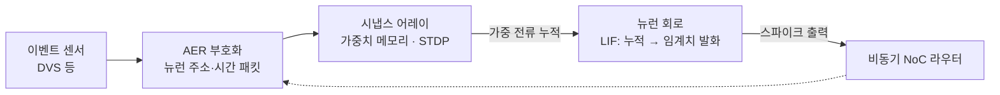

# 뉴로모픽 칩 (Neuromorphic Chip)

---

## I. 뇌를 닮은 이벤트 구동 프로세서, 뉴로모픽 칩의 개요

### 가. 정의

- 뇌의 **뉴런·시냅스 구조를 하드웨어로 모방**하여 스파이크(Spike) 기반 **비동기 이벤트 구동** 방식으로 연산·학습하는 비 폰노이만(Non-von Neumann) 반도체

### 나. 등장 배경 및 특징

| 구분 | 내용 |
| --- | --- |
| 배경 | 연산부([[CPU]]·[[GPU]])와 메모리 분리로 생기는 폰노이만 병목·전력 문제 |
| 이벤트 구동 | 스파이크가 발생할 때만 동작(희소성), mW~μW 수준의 저전력 |
| 연산·기억 근접 | 시냅스 가중치를 연산 회로 옆(또는 내부)에 저장해 데이터 이동 최소화 |
| 온칩 학습 | STDP 등 국소 학습 규칙을 칩 내부에서 실행, 실시간 적응 |

---

## II. 아키텍처 및 핵심 구성요소

### 가. 아키텍처 및 동작 원리

- 입력 이벤트를 AER 패킷으로 전달 → 시냅스 어레이에서 가중치 누적(Integrate) → 막전위가 임계치를 넘으면 발화(Fire) 후 NoC로 다른 코어에 분배

### 나. 핵심 구성요소

| 구분 | 요소 | 설명 |
| --- | --- | --- |
| 신경망 모델 | SNN (Spiking Neural Network) | 스파이크의 발생 시점·빈도로 정보를 표현하는 3세대 신경망 |
| | LIF (Leaky Integrate-and-Fire) | 입력을 막전위로 누적, 시간에 따라 누설, 임계치 도달 시 발화·리셋 |
| 학습 | STDP (Spike-Timing-Dependent Plasticity) | 시냅스 전·후 뉴런의 발화 시차(Δt)에 따라 가중치를 강화·약화하는 비지도 국소 학습 |
| 소자 | SRAM / [[멤리스터]](ReRAM) | 디지털 칩은 SRAM, 아날로그 칩은 멤리스터 크로스바로 시냅스 가중치 저장 |
| 연산 | IMC (In-Memory Computing) | 크로스바에서 옴·키르히호프 법칙으로 벡터-행렬 곱([[MAC 배열\|MAC]])을 아날로그로 수행 |
| 통신 | AER (Address-Event Representation) | 발화한 뉴런의 주소만 비동기 전송해 배선·대역폭 절감 |
| | 비동기 NoC | 전역 클록 없이 핸드셰이크로 코어 간 스파이크 라우팅 |
| 시스템 사례 | Intel Hala Point | Loihi 2 칩 1,152개, 뉴런 약 11.5억 개·시냅스 약 1,280억 개 (2024) |

---

## III. 비교 및 동향

### 가. GPU vs NPU vs 뉴로모픽 칩

| 비교 항목 | GPU | [[NPU]] | 뉴로모픽 칩 |
| --- | --- | --- | --- |
| 설계 목표 | 대규모 병렬 연산 | [[딥러닝]] 추론 가속 | 뇌 동작 모사 |
| 구조 | 폰노이만 (GPU-[[HBM]] 분리) | 폰노이만 변형 ([[시스톨릭 어레이]]) | 비 폰노이만 (연산·기억 근접) |
| 동작 | 클록 동기, 밀집 행렬 연산 | 클록 동기, 고정 정밀도 | 비동기 이벤트, 희소 스파이크 |
| 데이터 표현 | FP32·FP16·FP8 | INT8·FP16 | 스파이크 열 (Spike Train) |
| 학습 | 오차역전파 | 주로 추론 | STDP, ANN→SNN 변환 |
| 전력 (예) | 수백 W | 수 W~수십 W | μW~mW |
| 적용 | 대규모 모델 학습 | [[온디바이스 AI]], 추론 서버 | 엣지 센싱, 로보틱스, BCI |

### 나. 동향

- **학습 난제 대응**: 스파이크 함수의 미분 불가 문제를 대리 기울기(Surrogate Gradient)와 ANN→SNN 변환으로 해결 시도
- **디지털에서 아날로그로**: Intel Loihi 2 등 디지털 CMOS 칩이 주류이며, ReRAM·FeFET 기반 아날로그 크로스바 소자 연구 진행
- **적용 확대**: 이벤트 카메라(DVS)와 결합한 상시 대기형 비전, 생체 신호 처리 등 초저전력 엣지 분야

---

### 🔗 연관 토픽

- **소속 도메인**: [[00_컴퓨터구조_MOC|💻 컴퓨터구조]]
- **세부 분류**: `1. CPU 프로세서 & 마이크로아키텍처`
- **핵심 연관 토픽**:
  - [[멤리스터]]
  - [[NPU|NPU(Neural Processing Unit)]]
  - [[지능형 반도체]]
  - [[PIM|PIM(Processing-In-Memory)]]
  - [[시스톨릭 어레이]]
