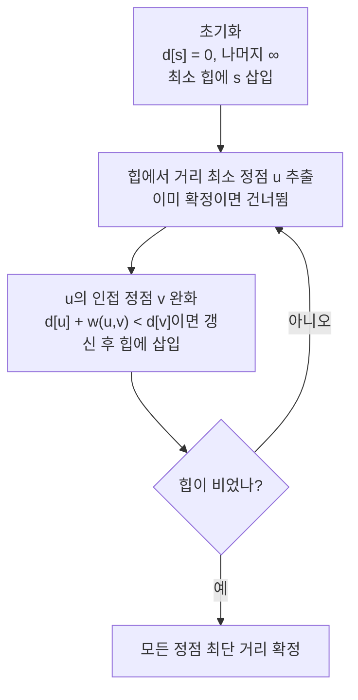

# 다익스트라 알고리즘 (Dijkstra's Algorithm)

---

## I. 한 출발점에서 모든 정점까지, 다익스트라 알고리즘의 개요

### 가. 정의

- **음수 가중치가 없는 그래프**에서 한 출발점으로부터 모든 정점까지의 최단 거리를, 거리가 가장 짧은 미확정 정점을 차례로 확정하며 구하는 단일 출발점 최단 경로(SSSP) [[알고리즘]] (E. W. Dijkstra, 1959)

### 나. 특징

| 구분 | 내용 |
| --- | --- |
| 전제 | 모든 간선 가중치 ≥ 0 (음수 간선이 하나라도 있으면 결과 보장 안 됨) |
| 탐욕적 확정 | 매 단계 최단 거리 미확정 정점을 골라 거리 확정 ([[그리디 알고리즘\|그리디]]) |
| 완화 (Relaxation) | d[v] = min(d[v], d[u] + w(u, v))로 인접 정점 거리 갱신 |
| 결과 | 최단 거리와 최단 경로 트리(이전 정점 정보) |

---

## II. 동작 및 구성요소

### 가. 동작 절차

- 확정된 정점의 거리는 이후 줄어들지 않음 (음수 간선이 없기 때문)

### 나. 구성요소

| 구분 | 요소 | 설명 |
| --- | --- | --- |
| 기법 | 탐욕 선택 | 미확정 정점 중 d가 최소인 정점 확정 |
| 연산 | 완화 | 더 짧은 경로 발견 시 d[v]와 이전 정점 갱신 |
| 자료구조 | 우선순위 큐 ([[힙]]) | 최소 거리 정점을 O(log V)에 추출 |
| | 인접 리스트 | 정점별 인접 간선 목록 |
| 복잡도 | 배열 구현 | O(V²), 밀집 그래프에 적합 |
| | 이진 힙 | O((V + E) log V) |
| | 피보나치 힙 | O(E + V log V) |
| 가속 | 양방향 탐색 | 출발·도착 양쪽에서 탐색해 탐색 범위 축소 |
| | A* | 목적지까지 추정 거리(휴리스틱)를 더해 우선순위 결정 |
| | Contraction Hierarchies | 도로망 전처리로 단축 간선을 추가해 질의를 ms 단위로 응답 |
| | Delta-stepping | 거리 구간별 버킷으로 완화를 병렬 처리 (멀티코어·[[GPU]]) |

---

## III. 비교 및 동향

### 가. 최단 경로 알고리즘 비교

| 비교 항목 | 다익스트라 | 벨만-포드 | 플로이드-워셜 |
| --- | --- | --- | --- |
| 범위 | 단일 출발점 | 단일 출발점 | 모든 정점 쌍 |
| 기법 | 그리디 | [[동적 계획법]] (V-1회 완화) | 동적 계획법 |
| 음수 간선 | 불가 | 가능, 음수 사이클 검출 | 가능 (음수 사이클 없을 때) |
| 시간 | O((V + E) log V) | O(VE) | O(V³) |
| 표현 | 인접 리스트 + 힙 | 간선 리스트 | 인접 행렬 |
| 활용 | OSPF·IS-IS, 내비게이션 | 거리 벡터 라우팅(RIP), 환율 차익 탐지 | 소규모 그래프 전체 경로 |

### 나. 동향

- **링크 상태 라우팅**: OSPF·IS-IS 라우터가 링크 상태 DB로 자신을 루트로 한 최단 경로 트리(SPF)를 계산
- **대규모 지도 서비스**: 순수 다익스트라 대신 A*·Contraction Hierarchies·CCH 등 전처리 기반 기법으로 실시간 경로 탐색

---

### 🔗 연관 토픽

- **소속 도메인**: [[00_컴퓨터구조_MOC|💻 컴퓨터구조]]
- **세부 분류**: `4. 기본 자료구조 (Data Structures)`
- **핵심 연관 토픽**:
  - [[그리디 알고리즘|그리디 (탐욕) 알고리즘]]
  - [[그래프 순회|그래프 순회 (Graph Traversal)]]
  - [[최소 신장 트리|최소 신장 트리 (MST, Minimum Spanning Tree)]]
  - [[힙|힙 (Heap)]]
  - [[동적 계획법|동적 계획법 (Dynamic Programming)]]
