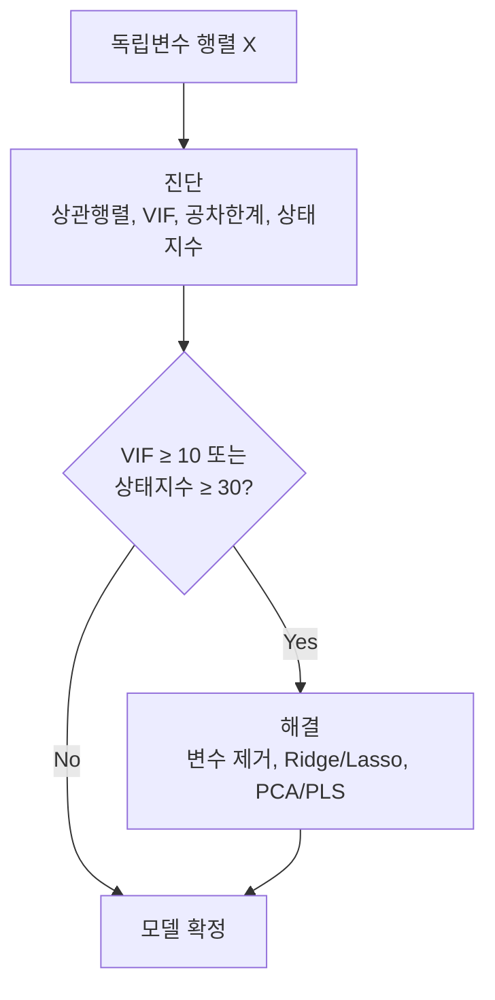

# 다중공선성 (Multicollinearity)

---

## I. 독립변수끼리 겹칠 때 생기는 문제, 다중공선성의 개요

### 가. 정의

- 다중회귀분석에서 **독립변수 사이에 강한 선형 상관관계가 있어 회귀계수의 분산이 커지고 추정·해석이 불안정해지는 현상**

### 나. 문제점

| 구분 | 내용 |
| --- | --- |
| 수치 불안정 | $X^T X$가 특이행렬에 가까워져(행렬식 ≈ 0) 역행렬 계산이 불안정, 조건수 급증 |
| 검정 왜곡 | $R^2$는 높아 모델 전체는 유의하나, 개별 계수의 표준오차가 커져 [[t-검정 (t-test)\|t-검정]]에서 유의하지 않게 나옴 |
| 해석 왜곡 | 계수의 부호가 실제 영향과 반대로 나오거나 표본에 따라 크게 흔들림 |
| 예측 영향 | 예측 성능 자체는 크게 떨어지지 않을 수 있음 (문제는 주로 해석) |

---

## II. 진단 및 해결

### 가. 진단·해결 절차

- VIF 등으로 공선성을 진단하고 기준을 넘으면 변수 제거, 정규화 회귀, [[PCA(Principal Component Analysis)|PCA]] 직교화로 분산 팽창을 억제

### 나. 진단 지표 및 해결 기법

| 구분 | 요소 | 설명 |
| --- | --- | --- |
| 진단 | VIF | $VIF_i = 1/(1-R_i^2)$, 10 이상(엄격하게는 5 이상)이면 공선성 의심 |
| | 공차한계 (Tolerance) | $1-R_i^2 = 1/VIF$, 0.1 이하이면 심각 |
| | 상태지수 (Condition Index) | $\sqrt{\lambda_{max}/\lambda_i}$, 30 이상이면 심각 |
| | 상관계수 행렬 | $\lvert r \rvert \ge 0.8$인 변수 쌍 식별 |
| 변수 처리 | 변수 선택 | 전진선택·후진제거·단계적 선택으로 중복 변수 제거, 도메인상 중요 변수는 보존 |
| 정규화 | Ridge (L2) | $\lambda \sum \beta^2$ 패널티로 계수 축소, $(X^TX+\lambda I)^{-1}$로 역행렬 안정화 |
| | Lasso·Elastic Net | L1로 일부 계수를 0으로 만들어 변수 선택, Elastic Net은 상관 변수 묶음을 함께 유지 |
| [[차원 축소]] | PCR·PLS | 상관된 변수를 서로 직교하는 성분으로 변환해 공선성 제거 |

---

## III. 비교 및 동향

### 가. 통계 모델 vs 머신러닝 환경

| 비교 항목 | 선형 회귀 (OLS) | 트리·DNN 모델 |
| --- | --- | --- |
| 목적 | 변수별 효과 추정·해석 | 예측 정확도 |
| 영향 | 계수 분산 급증, 부호 역전 | 예측 영향은 작음, 변수 중요도가 상관 변수 사이에 분산 |
| 진단 | VIF, 공차한계, 상관행렬 | 상관 클러스터 분석, 순열 중요도 비교 |
| 대응 | 변수 제거, Ridge/Lasso | 상관 변수 군집화 후 대표 변수 사용 |

### 나. 동향

- **[[XAI]] 해석 왜곡 대응**: 상관된 피처가 있으면 SHAP·순열 중요도가 분산·과소평가되므로 계층적 군집으로 피처를 묶어 그룹 단위로 해석
- **파이프라인 자동화**: [[MLOps]]·피처 스토어에서 상관계수·VIF를 사전 측정해 중복 피처를 제거·결합하는 [[데이터 전처리]] 단계 적용

---

### 🔗 연관 토픽

- **소속 도메인**: [[00_인공지능_MOC|🤖 인공지능]]
- **세부 분류**: `1. 수학 · 통계학 & 데이터 전처리`
- **핵심 연관 토픽**:
  - [[회귀분석|회귀분석(Regression Analysis)]]
  - [[PCA(Principal Component Analysis)]]
  - [[정규화, 규제화, 표준화]]
  - [[차원 축소|차원 축소(Dimensionality Reduction)]]
  - [[상관 관계 분석|상관 관계 분석 (Correlation Analysis)]]
