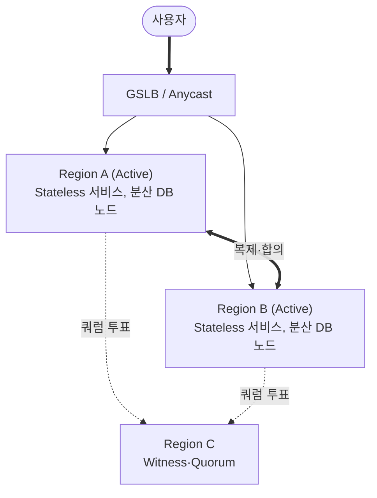

# 다중지역 A-A DRS (Multi-Region Active-Active Disaster Recovery System)

---

## I. 모든 리전이 동시에 서비스하는, 다중지역 A-A DRS의 개요

### 가. 정의

- 지리적으로 분리된 **2개 이상 리전에서 동일 서비스를 동시에 운영(Active-Active)** 하며 트래픽을 나눠 처리하고, 한 리전이 중단되면 나머지 리전이 전체 트래픽을 넘겨받는 재해복구 구조

### 나. 필요성 및 특징

| 구분 | 내용 |
| --- | --- |
| 광역 재해 대응 | 데이터센터·리전 단위 정전, 화재, 네트워크 단절에도 서비스 유지 |
| RTO 최소화 | 대기 시스템 기동 없이 트래픽 재라우팅만으로 수 초~수 분 내 전환 |
| 자원 효율 | 대기 센터 유휴 자원 없이 모든 리전이 평시 처리 |
| 지연 단축 | 사용자와 가까운 리전에서 응답 |
| 난제 | 리전 간 데이터 일관성·쓰기 충돌 처리, 높은 운영 복잡도 |

---

## II. 구조 및 구성요소

### 가. 개념도

- 평시에는 GSLB가 두 리전에 트래픽을 분산하고, 리전 장애 시 해당 리전을 격리해 남은 리전으로 전환하며, 제3 리전의 Witness가 스플릿 브레인을 방지

### 나. 구성요소

| 구분 | 요소 | 설명 |
| --- | --- | --- |
| 트래픽 | GSLB / Anycast [[BGP]] | 지연·위치·헬스체크 기반 리전 선택 |
| | 라우팅 제어 | 장애 리전 트래픽 차단 스위치 (예: Route 53 ARC) |
| 데이터 | 동기 합의 복제 (Raft·Paxos) | 과반 리전 기록 후 커밋, RPO = 0 / 쓰기 지연 증가 |
| | 비동기 다중 마스터 | 리전별 쓰기 후 복제 (예: DynamoDB Global Tables), 지연 낮음 / RPO > 0, 충돌 해소(LWW) 필요 |
| | CRDT | 충돌 없이 병합 가능한 자료구조로 다중 쓰기 |
| 격리 | Witness·쿼럼 | 홀수 투표로 분할 상황에서 단일 주체 결정 |
| 애플리케이션 | Stateless 설계 | 세션을 토큰·외부 저장소로 분리해 리전 간 이동 |
| | 멀티 클러스터 메시 | 리전 간 [[쿠버네티스]] 서비스 통신 (mTLS) |

---

## III. Active-Standby 비교 및 구축 전략

### 가. Active-Standby vs 다중지역 Active-Active

| 구분 | Active-Standby [[DRS (Disaster Recovery System)\|DRS]] | 다중지역 Active-Active |
| --- | --- | --- |
| 운영 | 주 센터 운영, DR 센터 대기 | 모든 리전 동시 운영 |
| RTO | 수십 분~수 시간 (기동·승격) | 수 초~수 분 (재라우팅) |
| RPO | 복제 방식에 따라 0 이상 | 동기 합의 시 0, 비동기 시 0 이상 |
| 자원 효율 | 대기 자원 유휴 | 상시 활용 |
| 일관성 | 단일 쓰기 주체로 단순 | 다중 쓰기 충돌 처리 필요 |
| 난이도 | 보통 | 매우 높음 |

### 나. 구축 전략

- **셀 기반 아키텍처**: 사용자·테넌트 단위로 데이터를 [[파티셔닝]]해 쓰기를 특정 리전에 고정, 리전 간 충돌 축소
- **데이터 등급별 정책**: 결제·잔액은 동기 합의(강한 일관성), 로그·추천은 비동기(최종 일관성)로 구분
- **장애 주입 검증**: [[카오스 엔지니어링]]으로 리전 단절·지연을 주기적으로 주입해 전환 절차 검증

---

### 🔗 연관 토픽

- **소속 도메인**: [[00_경영전략_MOC|📈 경영전략]]
- **세부 분류**: `5. IT 투자 성과 평가 & 비즈니스 연속성 계획 (BCP)`
- **핵심 연관 토픽**:
  - [[DRS (Disaster Recovery System)]]
  - [[DRaaS]]
  - [[카오스 엔지니어링]]
  - [[CockroachDB|CockroachDB(코크로치DB)]]
  - [[파티셔닝|파티션]]
