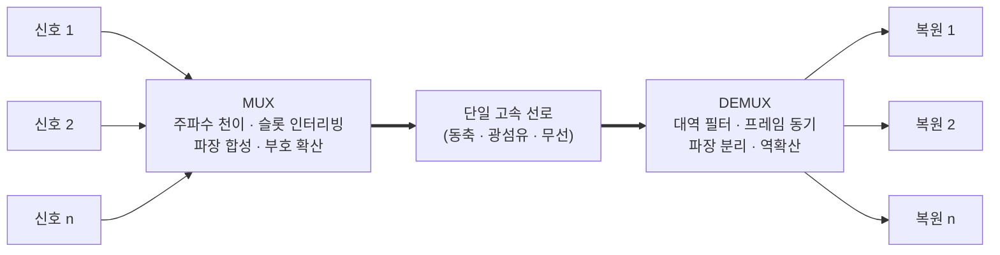

# 다중화 (Multiplexing)

---

## I. 하나의 선로를 여럿이 나눠 쓰는, 다중화의 개요

### 가. 정의

- 하나의 전송 매체를 **주파수·시간·파장·부호·공간 등으로 나누어 여러 신호를 동시에 전송**하고 수신측에서 다시 분리하는 기술

### 나. 특징 및 필요성

| 구분 | 내용 |
| --- | --- |
| 매체 효율 | 고가의 회선·스펙트럼을 공유해 이용률 향상, 회선 비용 절감 |
| 분할 축 다양화 | 주파수, 시간, 파장, 부호, 공간, 전력 영역 |
| 투명성 | 상위 계층 데이터와 무관하게 독립 채널 제공 |
| 다중화 vs 다중 접속 | 다중화는 한 송신기가 여러 신호를 묶음, 다중 접속(FDMA·TDMA·CDMA)은 여러 사용자가 자원 공유 |

---

## II. 구조 및 방식

### 가. MUX/DEMUX 구조

- 송신측 MUX가 여러 신호를 한 선로용 복합 신호로 묶고, 수신측 DEMUX가 같은 분할 기준(주파수·시간·파장·부호)으로 원래 신호를 분리

### 나. 다중화 방식

| 구분 | 방식 | 설명 |
| --- | --- | --- |
| 기본 | FDM (주파수 분할) | 대역을 여러 주파수 채널로 분할, 채널 간 보호 대역(Guard Band) 필요 |
| | TDM (시분할) | 시간 슬롯을 순서대로 할당. 동기식(고정 슬롯)과 통계적(STDM, 데이터 있는 채널만 할당) |
| 광통신 | WDM · DWDM | 광섬유 하나에 여러 파장을 실어 전송, DWDM은 50·100GHz 간격 고밀도 |
| 부호 | CDM (부호 분할) | 같은 시간·주파수를 공유하고 직교 확산 부호(Walsh 등)로 구분 |
| 직교 주파수 | [[OFDM (Orthogonal Frequency Division Multiplexing)\|OFDM]] | 직교 부반송파를 겹쳐 배치, CP로 다중 경로 ISI 억제 |
| 공간 | SDM | 다중 안테나([[MIMO]]) 공간 스트림, 다중 코어 광섬유(MCF)·소수 모드 광섬유(FMF) |
| 전력 | [[비직교 다중접속\|NOMA]] | 같은 자원에 전력 차등 할당, 수신측 SIC로 분리 |
| 차세대 | OTFS | 지연-도플러 영역에서 다중화해 고속 이동 환경([[저궤도 위성]], 고속철)의 도플러에 강함 |

---

## III. 비교 및 동향

### 가. 주요 방식 비교

| 비교 항목 | FDM | TDM | WDM | CDM |
| --- | --- | --- | --- | --- |
| 분할 영역 | 주파수 | 시간 | 광 파장 | 부호 |
| 간섭 방지 | 보호 대역 | 보호 시간 | 파장 간격·광 필터 | 직교 부호, 전력 제어 |
| 동기 요구 | 낮음 | 엄격한 시간 동기 | 파장 안정성 | 코드(칩) 동기 |
| 대표 적용 | 라디오·CATV | E1/T1, SONET/SDH | 광 기간망 | 3G(WCDMA), GPS |
| 단점 | 보호 대역 낭비 | 동기식은 빈 슬롯 낭비 | 소자 비용 | 원근 문제(Near-Far) |

### 나. 동향

- **광 전송 용량 확장**: 단일 코어 광섬유의 용량 한계를 넘기 위해 다중 코어 광섬유 기반 SDM 연구
- **6G 파형 후보**: OFDM 계열 유지와 함께 OTFS 등 고이동성 파형, OAM 기반 공간 다중화 연구

---

### 🔗 연관 토픽

- **소속 도메인**: [[00_네트워크_MOC|🌐 네트워크]]
- **세부 분류**: `1. OSI 7계층 & 데이터링크 계층 (L1/L2)`
- **핵심 연관 토픽**:
  - [[OFDM (Orthogonal Frequency Division Multiplexing)]]
  - [[MIMO]]
  - [[비직교 다중접속]]
  - [[PCM(Pulse-Code Modulation)]]
  - [[네트워크 프로토콜|네트워크 프로토콜 (Network Protocol)]]
