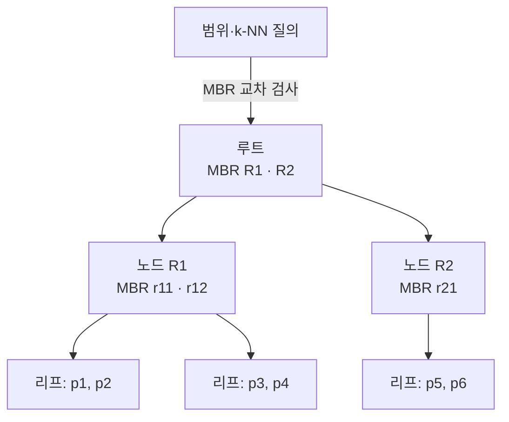

# 다차원 색인구조 (Multidimensional Index Structure)

---

## I. 여러 속성을 동시에 검색, 다차원 색인구조의 개요

### 가. 정의

- 공간 좌표·특징 벡터처럼 **2개 이상의 속성으로 이루어진 데이터를 공간 분할·계층화해 범위·최근접 질의를 빠르게 처리하는 색인 구조** (R-Tree, k-d Tree, Grid File 등)

### 나. 필요성 및 특징

| 구분 | 내용 |
| --- | --- |
| B-Tree 한계 | 1차원 정렬로는 다차원 범위 질의 시 대부분을 스캔 |
| 공간 지역성 | 가까운 데이터를 같은 블록에 모아 I/O 감소 ([[지역성]]) |
| 지원 질의 | 점 질의, 범위 질의, k-NN 질의, 공간 조인 |
| 차원의 저주 | 차원이 높아지면(대략 10차원 이상) 분할 효과 급감 |

---

## II. 구조 및 구성요소

### 가. R-Tree 구조

- 객체를 최소 경계 사각형(MBR)으로 묶어 상위 노드를 구성하고, 질의 영역과 겹치지 않는 서브트리는 탐색에서 제외

### 나. 주요 구조

| 구분 | 요소 | 설명 |
| --- | --- | --- |
| 공간 객체 (SAM) | R-Tree | B-Tree를 다차원으로 확장한 높이 균형 트리, MBR 중첩 허용 (Guttman, 1984) |
| | R*-Tree | 분할 시 면적·둘레·중첩 최소화, 강제 재삽입 |
| | R+-Tree | MBR 중첩을 없애고 객체를 여러 노드에 중복 저장 |
| 점 데이터 (PAM) | k-d Tree | 축을 번갈아 가며 공간을 이분하는 [[이진 탐색 트리]] |
| | Quad Tree | 2차원 공간을 4분할 재귀 분할 |
| | Grid File | 격자 디렉터리로 셀과 디스크 블록을 매핑 |
| 차원 변환 | Z-Order·Hilbert 곡선 | 다차원 좌표를 인접성을 보존하는 1차원 값으로 변환 후 B-Tree 사용 |
| 고차원 근사 | HNSW, IVF-PQ, LSH | 고차원 벡터의 근사 최근접 탐색 ([[ANN(Approximate Nearest Neighbor)알고리즘\|ANN]]) |

---

## III. 비교 및 동향

### 가. 색인 방식 비교

| 비교 항목 | B+Tree | R-Tree 계열 | 공간 채움 곡선 | HNSW |
| --- | --- | --- | --- | --- |
| 대상 | 1차원 값 | 2~3차원 공간 객체 | 저차원 점 | 수백~수천 차원 벡터 |
| 분할 | 값 범위 | MBR 계층 | 1차원 투영 | 근접 그래프 |
| 결과 | 정확 | 정확 | 정확 | 근사 (Recall 기반) |
| 활용 | 일반 인덱스 | GIS, 위치 기반 서비스 | PostGIS·지오해시 | RAG, 추천, 이미지 검색 |

### 나. 동향

- **벡터 DB**: pgvector·Milvus 등이 메타데이터 필터와 HNSW를 결합한 하이브리드 검색 제공 ([[벡터 데이터베이스]])
- **레이크하우스 데이터 배치**: Delta Lake·Iceberg가 Z-Order·Hilbert 정렬로 다차원 필터의 파일 건너뛰기 지원
- **학습 색인**: 데이터 분포를 모델로 학습하는 Learned Index(Flood 등) 연구

---

### 🔗 연관 토픽

- **소속 도메인**: [[00_데이터베이스_MOC|🗄️ 데이터베이스]]
- **세부 분류**: `2. 트랜잭션 & 동시성 제어 (Concurrency)`
- **핵심 연관 토픽**:
  - [[RDBMS 인덱스(index)]]
  - [[인덱스 구조에 따른 분류]]
  - [[벡터 데이터베이스|벡터 데이터베이스(Vector Database)]]
  - [[ANN(Approximate Nearest Neighbor)알고리즘]]
  - [[지역성|지역성(Locality)]]
