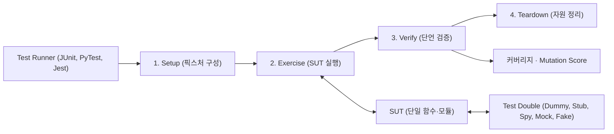

# 단위 테스트 (Unit Test)

---

## I. 가장 작은 단위의 결함 조기 검출, 단위 테스트의 개요

### 가. 정의

- 구현 단계에서 검증 가능한 **최소 단위(함수·[[클래스]]·컴포넌트)를 외부 의존성과 격리**하여 명세 충족 여부와 내부 로직 결함을 검증하는 테스트 레벨

### 나. 특징

| 구분 | 내용 |
| --- | --- |
| 조기 결함 발견 | 결함 수정 비용이 후반으로 갈수록 급증(Boehm)하므로 구현 직후 검출 (Shift-Left) |
| 격리성 | Test Double로 DB·네트워크 등 외부 의존성을 차단해 실패 원인을 즉시 특정 |
| 자동화·고속 | ms 단위 실행, CI 파이프라인의 1차 품질 게이트 |
| 리팩토링 안전망 | 반복 실행으로 회귀 결함 방지 |

---

## II. 단위 테스트 수행 구조 및 구성요소

### 가. xUnit 4단계 수행 구조

- Test Double로 외부 의존성을 끊은 뒤 Setup→Exercise→Verify→Teardown 순으로 SUT를 실행하고, 단언(Assertion)과 커버리지로 품질 판정

### 나. 구성요소

| 구분 | 요소 | 설명 |
| --- | --- | --- |
| 실행 기반 | xUnit [[프레임워크]] | 4단계 구조의 자동화 프레임워크 (JUnit, PyTest, Vitest) |
| 의존성 격리 | Test Double | Dummy·Stub·Fake·Spy·Mock 5종 대역 객체 |
| 설계 기법 | [[TDD]] | Red→Green→Refactor 사이클로 테스트 가능한 [[모듈화]] 유도 |
| 케이스 설계 | 명세 기반 | 동등 분할, 경계값 분석 ([[블랙박스 테스트]]) |
| | 구조 기반 | 구문(C0)·결정(C1)·조건(C2)·MC/DC 커버리지 ([[화이트박스 테스트]]) |
| | Property-based | 불변 조건에 무작위 대량 입력을 생성해 반례 탐색 (Hypothesis, jqwik) |
| 품질 평가 | [[뮤테이션 테스트\|Mutation Testing]] | 인위적 결함(Mutant)을 주입해 테스트의 검출력 측정 (PITest, Stryker) |

---

## III. 비교 및 동향

### 가. 단위 테스트 vs 통합 테스트

| 비교 항목 | 단위 테스트 | [[통합 테스트]] |
| --- | --- | --- |
| 대상 | 단일 함수·클래스·모듈 | 모듈 간 인터페이스, DB·API 연동 |
| 의존성 | Test Double로 격리 | 실제 컴포넌트 또는 컨테이너 인프라 |
| 결함 위치 특정 | 즉시 가능 | 연계 흐름 추적 필요 |
| 실행 속도 | ms 단위, 병렬 실행 | 수 초~수 분, I/O 지연 |
| 테스트 피라미드 | 하단 (가장 많은 비중) | 중간 |
| 도구 | JUnit 5, PyTest, Mockito, Jest | SpringBootTest, Testcontainers, RestAssured |

### 나. 동향

- Testcontainers로 DB·메시지 브로커를 경량 컨테이너로 띄워 격리성과 현실성을 함께 확보
- PR 단계에서 단위 테스트 통과·커버리지 기준(예: 분기 80%) 미달 시 머지 차단하는 브랜치 보호 규칙 확산
- LLM 코딩 에이전트가 미검증 분기에 대한 테스트 케이스를 자동 생성

---

### 🔗 연관 토픽

- **소속 도메인**: [[00_소프트웨어공학_MOC|🏗️ 소프트웨어공학]]
- **세부 분류**: `1. 소프트웨어 개발 생명주기(SDLC) & 방법론`
- **핵심 연관 토픽**:
  - [[TDD|TDD (Test Driven Development)]]
  - [[통합 테스트]]
  - [[블랙박스 테스트]]
  - [[코드 커버리지]]
  - [[CI, CD (Continuous Integration, Continuous Delivery)]]
