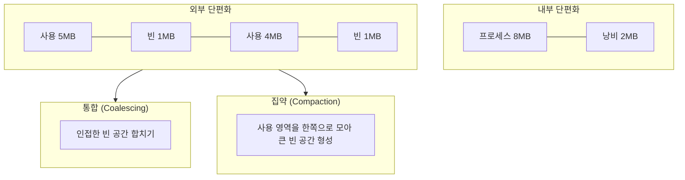

# 단편화 (Memory Fragmentation)

---

## I. 남아도 쓸 수 없는 공간, 단편화의 개요

### 가. 정의

- 메모리 할당·반납이 반복되면서 **빈 공간이 쓸 수 없는 조각으로 남아 메모리 활용률이 떨어지는 현상**, 할당 단위 안의 낭비(내부)와 할당 단위 사이의 작은 빈 공간(외부)으로 구분

### 나. 특징

| 구분 | 내용 |
| --- | --- |
| 활용률 저하 | 실제 사용 가능한 메모리 감소 |
| 할당 실패 | 외부 단편화는 전체 여유 공간이 충분해도 연속 공간이 없어 할당 불가 |
| 성능 저하 | 배치 알고리즘 탐색, 집약·스와핑 비용 증가 |
| 할당 방식 의존 | 고정 분할·페이징은 내부, 가변 분할·세그멘테이션은 외부 단편화 |

---

## II. 유형 및 해결 기법

### 가. 단편화 유형과 해결

- 10MB 고정 블록에 8MB를 넣으면 2MB가 내부 단편화, 1MB 빈 조각이 흩어져 2MB 요청을 못 받으면 외부 단편화

### 나. 해결 기법

| 구분 | 요소 | 설명 |
| --- | --- | --- |
| 외부 단편화 | 통합 (Coalescing) | 반납된 공간과 인접한 빈 공간을 하나로 병합 |
| | 집약 (Compaction) | 사용 중인 영역을 재배치해 빈 공간을 한곳으로 모음, 실행 중 재배치(동적 바인딩) 필요·비용 큼 |
| | 페이징 | 고정 크기 프레임 비연속 할당으로 외부 단편화 제거 |
| | 배치 전략 | 최초·최적·최악 적합으로 조각 발생 완화 |
| 내부 단편화 | 세그멘테이션·가변 분할 | 요구량만큼 할당 |
| | 작은 페이지 크기 | 내부 낭비 감소, 대신 페이지 테이블·TLB 부담 증가 |
| 커널 할당기 | 버디 시스템 (Buddy) | 2^n 블록으로 분할·병합해 외부 단편화 완화, 2^n 반올림으로 내부 단편화 발생 |
| | 슬랩 할당기 (Slab) | 같은 크기 커널 객체를 미리 만든 캐시에 할당, 내부 단편화 최소화 |

---

## III. 비교 및 동향

### 가. 내부 단편화 vs 외부 단편화

| 비교 항목 | 내부 단편화 | 외부 단편화 |
| --- | --- | --- |
| 발생 방식 | 고정 분할, 페이징 | 가변 분할, 세그멘테이션 |
| 낭비 위치 | 할당된 블록 내부 | 할당된 블록 사이 |
| 해결 | 가변 크기 할당, 작은 페이지, 슬랩 | 통합, 집약, 페이징 |

### 나. 동향

- **LLM 추론 메모리**: vLLM PagedAttention이 KV 캐시를 고정 블록과 블록 테이블로 관리해 [[GPU]] 메모리 낭비를 크게 줄임 (페이징 개념 적용)
- **Huge Page와 단편화**: THP(2MB)는 TLB 효율을 높이지만 연속 물리 메모리가 필요해 Linux가 백그라운드 집약(kcompactd)으로 확보
- **[[CXL]] 메모리 풀링**: 서버마다 남아 갇히는 좌초 메모리(Stranded Memory)를 공유 풀로 묶어 데이터센터 수준의 단편화 완화

---

### 🔗 연관 토픽

- **소속 도메인**: [[00_운영체제_MOC|⚙️ 운영체제]]
- **세부 분류**: `5. 가상 메모리 관리 & 페이지 교체 알고리즘`
- **핵심 연관 토픽**:
  - [[가상메모리의 페이징과 세그멘테이션]]
  - [[세그멘테이션|세그멘테이션 (Segmentation, 가변분할)]]
  - [[메모리 관리]]
  - [[가상 메모리]]
  - [[커널|커널(Kernel)]]
