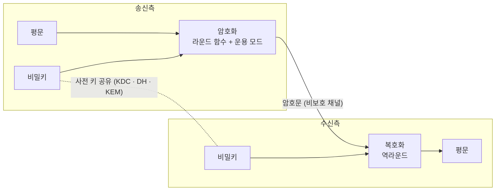

# 대칭키 암호화 (Symmetric-Key Cryptography)

---

## I. 같은 키로 잠그고 여는, 대칭키 암호화의 개요

### 가. 정의

- 송신자와 수신자가 **동일한 비밀키를 공유하여 암호화와 복호화를 수행**하는 [[암호화]] 방식

### 나. 특징

| 구분 | 내용 |
| --- | --- |
| 고속 처리 | 공개키 암호 대비 수백~수천 배 빠름, 대용량 데이터·실시간 트래픽에 적합 |
| 키 개수 | n명이 서로 통신하려면 $\frac{n(n-1)}{2}$개 키 필요 |
| 키 분배 문제 | 비밀키를 사전에 안전하게 공유할 채널 필요 (DH·KEM으로 해결) |
| 설계 원리 | [[Shannon의 암호 설계 원칙\|Shannon]]의 혼돈(Confusion)·확산(Diffusion) |
| 하드웨어 가속 | AES-NI 등 CPU 명령어 지원 |

---

## II. 동작 구조 및 구성요소

### 가. 동작 구조

- 사전에 공유한 같은 키로 라운드 변환(치환·전치)을 반복해 암호문을 만들고, 수신측은 역변환으로 복호화

### 나. 구성요소

| 구분 | 요소 | 설명 |
| --- | --- | --- |
| 구조 | Feistel | 블록을 좌우로 나눠 라운드 함수 교차 적용, 암·복호화 구조 동일 ([[DES]], SEED) |
| | SPN | 치환(S-Box)과 전치(P-Box)를 블록 전체에 적용 ([[AES]], ARIA) |
| | ARX | 덧셈·회전·XOR만 사용, 테이블 조회가 없어 경량·[[부채널 공격]] 내성 (LEA, ChaCha20) |
| 방식 | [[블록 암호화\|블록 암호]] | 고정 길이 블록 단위 처리 (AES 128비트 블록, 128/192/256비트 키) |
| | 스트림 암호 | 키스트림과 평문을 XOR (ChaCha20) |
| 운용 모드 | CBC·CTR | 블록 연결 또는 카운터 기반 병렬 처리 |
| | GCM (AEAD) | CTR 암호화 + GHASH 인증으로 기밀성·[[무결성]] 동시 제공 |
| 경량 암호 | Ascon, LEA | NIST 경량 암호 표준(Ascon), 국내 경량 블록 암호(LEA) |

---

## III. 비교 및 동향

### 가. 대칭키 vs 비대칭키

| 비교 항목 | 대칭키 | [[비대칭키 암호화\|비대칭키]] |
| --- | --- | --- |
| 키 | 동일 비밀키 1개 공유 | 공개키·개인키 쌍 |
| 속도 | 빠름 | 느림 (모듈러 거듭제곱·타원곡선 연산) |
| 필요 키 수 (n명) | $\frac{n(n-1)}{2}$ | $2n$ |
| 보안 서비스 | [[기밀성]] (AEAD 시 무결성) | 키 교환, 전자서명, 부인방지 |
| 양자 위협 | Grover: 탐색 $O(\sqrt{N})$, 강도 절반 | Shor: RSA·ECC 다항 시간 해독 |
| 활용 | 디스크·DB 암호화, TLS 세션 데이터 | 인증서, TLS 핸드셰이크, SSH 키 인증 |

### 나. 동향

- **키 길이 상향**: Grover 알고리즘으로 실효 강도가 절반이 되므로 CNSA 2.0 등은 AES-256 사용 권고
- **하이브리드 암호**: 키 교환은 ML-KEM(FIPS 203) 등 [[양자내성암호]], 데이터는 AES-256-GCM으로 처리
- **경량 암호 표준화**: NIST가 Ascon을 경량 암호 표준(SP 800-232)으로 채택, IoT 기기에 적용

---

### 🔗 연관 토픽

- **소속 도메인**: [[00_보안_MOC|🛡️ 보안]]
- **세부 분류**: `1. 정보보안 원칙 & 거버넌스 · 인증`
- **핵심 연관 토픽**:
  - [[비대칭키 암호화]]
  - [[비밀키 암호화와 비대칭키 암호화 비교|비밀키 암호화(Symmetric)와 비대칭키 암호화(Asymmetric) 비교]]
  - [[AES]]
  - [[DES]]
  - [[블록 암호화|블록 암호화 (Block Cipher)]]
