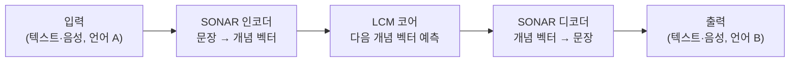

# 대형개념모델 (LCM, Large Concept Models)

---

## I. 토큰에서 문장 단위 개념으로, 대형개념모델의 개요

### 가. 정의

- 서브워드 토큰 대신 **문장 단위 임베딩(개념, Concept)을 입력·출력 단위로 삼아 다음 개념 벡터를 자기회귀 예측**하는 언어 모델 (Meta, 2024.12 발표)

### 나. 등장 배경 및 특징

| 구분 | 내용 |
| --- | --- |
| 토큰 예측의 한계 | 토큰 단위로는 긴 글의 전체 구성·계획을 명시적으로 다루기 어렵고 시퀀스가 길어 어텐션 비용 증가 |
| 언어 독립 | 다국어·음성을 하나의 임베딩 공간(SONAR)에 정렬해 언어·모달리티와 무관하게 추론 |
| 시퀀스 단축 | 문장 하나가 벡터 하나이므로 토큰 시퀀스보다 길이가 크게 줄어듦 |
| 제로샷 전이 | 영어 위주로 학습해도 SONAR가 지원하는 다른 언어로 출력 가능 |

---

## II. 구조 및 핵심 요소

### 가. 개념도

- 인코더·디코더(SONAR)는 고정하고, 그 사이의 개념 벡터 시퀀스만 Transformer로 학습

### 나. 핵심 요소

| 구분 | 요소 | 설명 |
| --- | --- | --- |
| 표현 공간 | SONAR 임베딩 | Meta의 다국어 문장 임베딩, 텍스트 약 200개 언어·음성 수십 개 언어 지원 |
| 모델 변형 | Base-LCM | 다음 개념 벡터를 MSE 회귀로 직접 예측 |
| | Diffusion LCM | 노이즈에서 다음 개념 벡터를 생성 (One-Tower, Two-Tower), 성능이 가장 좋았던 방식 |
| | Quant-LCM | 잔차 벡터 양자화(RVQ)로 개념 벡터를 이산화해 예측 |
| 학습 목표 | 벡터 회귀·확산 손실 | 어휘 분포의 Cross-Entropy 대신 연속 벡터 공간에서 손실 계산 |
| 계층 생성 | 개념 계획 → 문장 복원 | 문단 단위 개념 계획 후 디코더가 표층 문장 생성 |

---

## III. 비교 및 동향

### 가. LCM vs LLM

| 비교 항목 | LCM | [[초거대 언어 모델\|LLM]] |
| --- | --- | --- |
| 기본 단위 | 문장 임베딩 (연속 벡터) | 서브워드 토큰 (이산 어휘) |
| 예측 방식 | 다음 벡터 회귀·확산 | 다음 토큰 분류 |
| 시퀀스 길이 | 짧음 (문장 수) | 김 (토큰 수) |
| 언어 의존성 | 임베딩 공간 공유로 낮음 | 토크나이저·학습 언어에 의존 |
| 약점 | 고유명사·수치·코드 등 세부 정보 손실 | 긴 글 일관성·계획성 |

### 나. 동향

- **정보 병목 한계**: 문장을 고정 차원 벡터 하나로 압축하므로 정확한 숫자·코드 복원이 어렵고, 2024년 발표 시점 성능은 같은 규모 LLM 대비 제한적
- **잠재 공간 추론 연구**: 토큰 대신 잠재 벡터로 추론하는 흐름(Meta Coconut의 연속 사고, JEPA 계열 잠재 예측)과 함께 연구 진행

---

### 🔗 연관 토픽

- **소속 도메인**: [[00_인공지능_MOC|🤖 인공지능]]
- **세부 분류**: `1. 수학 · 통계학 & 데이터 전처리`
- **핵심 연관 토픽**:
  - [[초거대 언어 모델|초거대 언어 모델(Large Language Model)]]
  - [[표현 학습]]
  - [[Diffusion 모델]]
  - [[트랜스포머|트랜스포머(Transformer)]]
  - [[유사도|유사도(Similarity)]]
