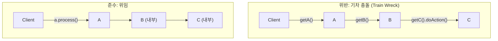

# 데메테르의 법칙 (Law of Demeter)

---

## I. 친구하고만 대화하라, 데메테르의 법칙의 개요

### 가. 정의

- 객체는 **직접 협력하는 객체에게만 메시지를 보내고, 그 객체가 반환한 다른 객체의 내부에는 접근하지 않아야 한다**는 [[결합도]] 최소화 원칙 (최소 지식 원칙, Lieberherr·Holland, 1987)

### 나. 특징

| 구분 | 내용 |
| --- | --- |
| 결합도 완화 | 다른 객체의 내부 구조 의존을 끊어 변경 파급(Ripple Effect) 차단 |
| [[캡슐화]] 강화 | 내부 구조를 노출하지 않고 행위만 공개 |
| 유지보수성 | 협력 객체 1단계만 알면 되므로 테스트·리팩토링 용이 |
| 연관 원칙 | Tell, Don't Ask (묻지 말고 시켜라) |

---

## II. 동작 구조 및 구성요소

### 가. 위반 구조 vs 준수 구조

- 호출자가 `a.getB().getC()`처럼 객체 그래프를 따라가지 않고, 이웃 객체(A)에 행위를 요청해 내부 경로를 숨김

### 나. 구성요소

| 구분 | 요소 | 설명 |
| --- | --- | --- |
| 호출 허용 범위 | 메서드 M이 호출 가능한 객체 | 자기 자신(this), M의 인자, M 안에서 생성한 객체, 자신의 [[인스턴스]] 변수 |
| 안티패턴 | 기차 충돌 | `a.getB().getC().doSomething()` 형태의 게터 체이닝 |
| 설계 원칙 | 최소 지식 | 협력 객체에 대해 알아야 할 지식 최소화 ([[정보은닉]]) |
| | Tell, Don't Ask | 상태를 꺼내 외부에서 판단하지 않고 행위를 요청 |
| 리팩토링 | 위임 숨기기 (Hide Delegate) | 중간 객체에 위임 메서드를 추가해 내부 구성 은닉 |
| 도메인 모델 | 애그리거트 루트 | [[DDD (Domain Driven Design)\|DDD]]에서 내부 엔티티는 루트를 통해서만 접근 |
| 예외 | 플루언트 인터페이스 | 빌더·Stream처럼 같은 타입을 반환하는 체이닝은 구조 노출이 아님 |
| 트레이드오프 | 미들맨 스멜 | 과도한 적용 시 단순 위임 메서드 양산 |

---

## III. 비교 및 동향

### 가. 위반 vs 준수

| 비교 항목 | 위반 (게터 체인) | 준수 (Tell, Don't Ask) |
| --- | --- | --- |
| 코드 예 | `order.getCustomer().getAddress().getCity()` | `order.shippingCity()` 또는 `order.deliver()` |
| 의존 대상 | Order·Customer·Address 모두 | Order 하나 |
| 변경 파급 | Address 구조 변경 시 호출자 수정 | 호출자 영향 없음 |
| 객체 성격 | 데이터만 가진 빈약한 모델 | 상태와 행위를 가진 풍부한 모델 |
| 테스트 | 다단계 Mock 필요 | 직접 협력 객체 1개만 Mock |

### 나. 동향

- [[MSA (Micro Service Architecture)|MSA]]에서 다른 서비스의 DB·내부 모델을 직접 조회하지 않고 공개 API·이벤트로만 통신하는 경계 원칙으로 확장
- [[Clean Architecture]]에서 유스케이스·어댑터 경계를 통해 내부 엔티티 노출 차단

---

### 🔗 연관 토픽

- **소속 도메인**: [[00_소프트웨어공학_MOC|🏗️ 소프트웨어공학]]
- **세부 분류**: `2. 애자일(Agile) & 지속적 통합/배포(CI/CD)`
- **핵심 연관 토픽**:
  - [[결합도]]
  - [[캡슐화|캡슐화 (encapsulation)]]
  - [[객체지향 설계 원리]]
  - [[소프트웨어 리팩토링]]
  - [[DDD (Domain Driven Design)]]
