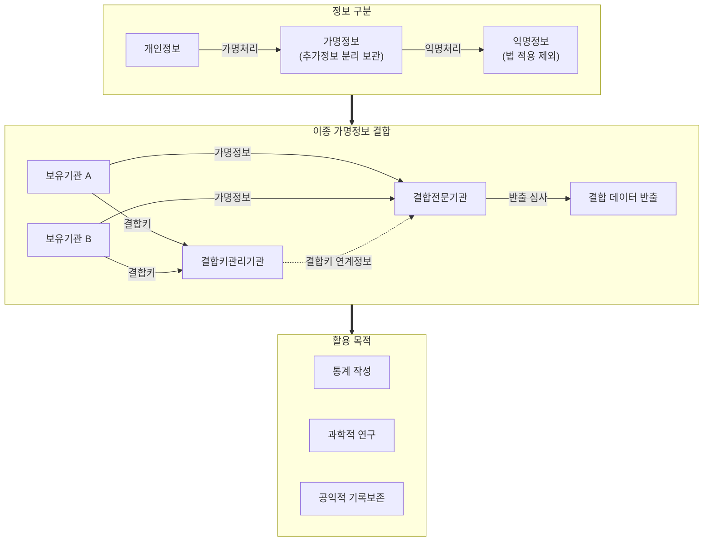

# 데이터 3법

---

## I. 데이터 활용과 개인정보 보호의 조화, 데이터 3법의 개요

### 가. 정의

- **개인정보 보호법·정보통신망법·신용정보법**을 함께 개정(2020.1 국회 통과, 2020.8 시행)하여 **가명정보 개념 도입, 감독기구 일원화, 마이데이터 근거**를 마련한 법 개정

### 나. 추진 배경 및 특징

| 구분 | 내용 |
| --- | --- |
| 데이터 경제 | 비식별 데이터의 법적 활용 근거 부재로 AI·빅데이터 산업 지체 |
| 감독 분산 | 행안부·방통위·금융위로 나뉜 개인정보 감독 체계 |
| 가명정보 신설 | 통계·과학적 연구·공익적 기록보존 목적이면 동의 없이 처리 허용 |
| 거버넌스 일원화 | 개인정보보호위원회를 국무총리 소속 중앙행정기관으로 격상 |
| 마이데이터 | 신용정보법 개정으로 개인신용정보 전송요구권과 본인신용정보관리업 도입 |

---

## II. 데이터 활용 구조 및 핵심 내용

### 가. 가명정보 처리·결합 구조

- 가명처리한 정보를 결합키관리기관과 결합전문기관을 거쳐 이종 결합하고, 반출 심사 후 통계·연구 목적으로 활용

### 나. 법별 핵심 내용

| 구분 | 요소 | 설명 |
| --- | --- | --- |
| [[개인정보보호법\|개인정보 보호법]] | 가명정보 | 추가정보 없이는 특정 개인을 알아볼 수 없게 처리한 정보 (제2조) |
| | 가명정보 결합 | 서로 다른 처리자 간 결합은 지정 결합전문기관에서 수행 (제28조의3) |
| | 개인정보보호위원회 | 국무총리 소속 중앙행정기관, 조사·처분 권한 일원화 |
| 정보통신망법 | 개인정보 조항 이관 | 망법의 개인정보 보호 규정을 개인정보 보호법으로 통합 |
| 신용정보법 | 가명정보 활용 | 금융 분야 가명정보 활용·결합 근거 (데이터전문기관) |
| | 마이데이터 | 개인신용정보 전송요구권, 본인신용정보관리업 신설 |
| 후속 개정 (2023) | 전 분야 전송요구권 | [[데이터 전송요구권\|개인정보 전송요구권]]을 전 분야로 확대 |
| | 자동화된 결정 대응권 | 완전 자동화 결정에 대한 거부·설명 요구권 |
| | 과징금 기준 | 전체 매출액의 3% 이하 (위반행위와 무관한 매출 제외) |

---

## III. 비교 및 동향

### 가. 개정 전후 비교

| 비교 항목 | 개정 전 | 개정 후 |
| --- | --- | --- |
| 정보 개념 | 개인정보 / 비식별 조치 정보 (법적 정의 불명확) | 개인정보 / 가명정보 / 익명정보 |
| 데이터 결합 | 이종 산업 간 결합 근거 없음 | 결합전문기관을 통한 결합 허용 |
| 동의 요건 | 사전 동의 중심 | 통계·연구·공익 목적 가명정보는 동의 없이 처리 |
| 감독 기구 | 행안부·방통위·금융위 분산 | 개인정보보호위원회 일원화 (금융 분야 일부는 금융위 유지) |
| 신산업 | 데이터 거래 기반 부족 | 금융 [[마이데이터]], 가명정보 결합 활성화 |

### 나. 동향

- **비정형 데이터 가명처리**: 영상·음성·텍스트 가명처리 기준을 담은 [[가명정보 처리 가이드라인]] 개정
- **안전한 활용 환경**: [[개인정보 안심구역]], [[합성 데이터]] 활용 확대
- **전 분야 마이데이터**: 의료·통신 분야부터 개인정보 전송요구권 단계적 시행

---

### 🔗 연관 토픽

- **소속 도메인**: [[00_보안_MOC|🛡️ 보안]]
- **세부 분류**: `1. 정보보안 원칙 & 거버넌스 · 인증`
- **핵심 연관 토픽**:
  - [[개인정보보호법]]
  - [[가명처리 기법|가명처리(Pseudonymization) 기법]]
  - [[비식별화]]
  - [[마이데이터]]
  - [[데이터 전송요구권|데이터 전송요구권 (Right to Request Data Transmission)]]
