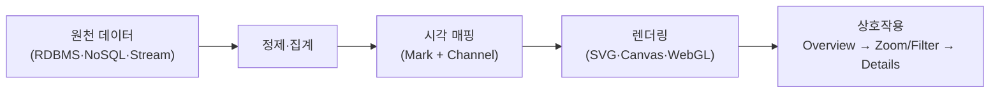

# 데이터 가시화 (Data Visualization)

---

## I. 숫자를 그림으로, 데이터 가시화의 개요

### 가. 정의

- 데이터를 위치·길이·색상 등 **시각 채널에 매핑해 패턴·추세·[[이상치]]를 직관적으로 파악하게 하는 기법**

### 나. 특징

| 구분 | 내용 |
| --- | --- |
| 인지 부하 감소 | 전주의적 속성(Pre-attentive Attributes)으로 수치표보다 빠르게 인지 |
| 탐색 지원 | 탐색적 데이터 분석([[EDA]])에서 분포·상관·이상치 발견 |
| 의사소통 | 데이터 문해력이 다른 이해관계자 간 공통 언어 제공 |
| 상호작용 | 필터·드릴다운·브러싱으로 사용자가 직접 탐색 |

---

## II. 가시화 파이프라인 및 구성요소

### 가. 가시화 파이프라인

- 데이터를 정제한 뒤 그래픽 문법으로 시각 요소에 매핑하고, 슈나이더만 만트라 순서로 탐색하도록 설계

### 나. 핵심 요소

| 구분 | 요소 | 설명 |
| --- | --- | --- |
| 인지 원리 | 전주의적 속성 | 의식적 주의 이전(약 200~250ms)에 감지되는 색상·크기·방향·움직임 |
| | Cleveland-McGill 순위 | 정확도: 공통 축 위치 > 길이 > 각도·기울기 > 면적 > 부피 > 색 채도 |
| 설계 이론 | 그래픽 문법 (Grammar of Graphics) | Wilkinson 제안, 데이터·기하 객체·미적 매핑·좌표계·패싯으로 분해 (ggplot2, Vega-Lite) |
| 상호작용 | Shneiderman's Mantra | Overview first, zoom and filter, then details-on-demand |
| | Brushing & Linking | 한 차트의 선택을 다른 차트에 동시 반영 |
| 구현 | D3.js, Vega-Lite | SVG 기반 데이터 바인딩, [[JSON]] 기반 선언적 명세 |
| | WebGL·WebGPU | 대량 포인트를 GPU로 가속 렌더링 |
| 지능형 | NLQ·Text-to-Vis | [[초거대 언어 모델\|LLM]]이 자연어 질의를 차트로 자동 변환 |

---

## III. 비교 및 동향

### 가. 전통 BI 가시화 vs 증강 가시화

| 비교 항목 | 전통 BI 가시화 | 증강(Augmented) 가시화 |
| --- | --- | --- |
| 차트 생성 | 분석가가 축·차트 유형 수동 설정 | 자연어 질의로 자동 추천·생성 |
| 패턴 탐색 | 육안 관찰·수작업 드릴다운 | 이상 탐지·원인 분석 자동 강조 |
| 해석 | 사용자 몫 | 텍스트 내러티브(NLG) 병기 |
| 도구 | Tableau, Power BI, D3.js | BI 도구 내장 Copilot·LLM 에이전트 |

### 나. 동향

- **생성형 AI 통합**: Power BI Copilot, Tableau Pulse 등 자연어 기반 차트 생성·요약 기능 확산
- **XAI 가시화**: SHAP·[[LIME]] 값, 어텐션 맵으로 모델 판단 근거를 시각화 ([[XAI]])
- **대용량 브라우저 렌더링**: WebGPU·WebAssembly로 수백만 건 데이터를 클라이언트에서 처리

---

### 🔗 연관 토픽

- **소속 도메인**: [[00_데이터베이스_MOC|🗄️ 데이터베이스]]
- **세부 분류**: `1. 데이터 모델링 & 관계형 DB 설계`
- **핵심 연관 토픽**:
  - [[EDA]]
  - [[탐색적 데이터 분석과 확증적 데이터 분석]]
  - [[대시보드]]
  - [[XAI]]
  - [[이상치]]
