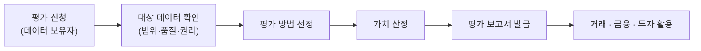

# 데이터 가치 평가 제도

---

## I. 데이터의 경제적 가치를 산정하는 제도, 데이터 가치 평가의 개요

### 가. 정의

- 데이터 자산의 **경제적 가치를 금액 등으로 산정**하여 거래·금융·투자에 활용할 수 있도록 하는 제도
- 「데이터 산업진흥 및 이용촉진에 관한 기본법」(데이터산업법, 2022년 시행)에 근거하여 정부가 지정한 평가기관이 수행

### 나. 필요성

| 구분 | 내용 |
| --- | --- |
| 거래 활성화 | 적정 가격 산정 기준이 없어 데이터 거래가 위축되는 문제 해소 |
| 금융 연계 | 데이터를 담보·투자 대상으로 인정받기 위한 객관적 근거 마련 |
| 자산화 | 기업 보유 데이터의 무형자산 인식 및 경영 의사결정 지원 |

---

## II. 데이터 가치 평가의 절차 및 방법

### 가. 평가 절차

### 나. 평가 방법

| 구분 | 산정 원리 | 장단점 |
| --- | --- | --- |
| 원가 접근법 (Cost Approach) | 데이터 수집·가공·저장에 든 비용 또는 재구축 비용 기준 | 산정이 쉬우나 미래 활용 가치를 반영하지 못함 |
| 시장 접근법 (Market Approach) | 유사 데이터의 실제 거래 사례 가격 비교 | 객관적이나 거래 사례가 부족함 |
| 수익 접근법 (Income Approach) | 데이터 활용으로 기대되는 미래 현금흐름을 현재가치로 할인 | 활용 가치를 반영하나 추정 불확실성이 큼 |

### 다. 가치 영향 요인

- **품질**: 정확성·완전성·최신성 등 [[데이터 품질관리(ISO 8000)|데이터 품질]] 수준
- **희소성·독점성**: 대체 데이터 존재 여부
- **법적 권리**: 개인정보 포함 여부, [[가명처리 기법|가명처리]] 등 적법한 활용 가능성
- **활용성**: 결합·재사용 가능성, 표준화 수준

---

## III. 비교 및 동향

### 가. 현안 vs 개선 방향

| 비교 항목 (현안) | 개선 방향 |
| --- | --- |
| 평가 방법론 표준 부족 | 데이터 유형별 평가 가이드라인 고도화 |
| 평가 결과 신뢰성 | 평가기관 전문성 강화, 사후 검증 체계 마련 |
| 금융권 활용 저조 | 데이터 담보 대출·보증 상품 연계 확대 |
| 회계 처리 기준 미비 | 데이터 자산의 회계상 인식 기준 정비 |

### 나. 동향

- **품질 인증 연계**: [[데이터 품질인증 가이드라인 - DQ인증 (2025.02.26)|데이터 품질 인증]] 결과를 평가에 반영해 신뢰도 제고
- **유통 생태계 기반**: 데이터 거래소·[[마이데이터]] 등 데이터 거래 가격 산정의 근거로 활용

---

### 🔗 연관 토픽

- **소속 도메인**: [[00_데이터베이스_MOC|🗄️ 데이터베이스]]
- **세부 분류**: `3. 장애 회복 기법 & 데이터 무결성`
- **핵심 연관 토픽**:
  - [[데이터 거버넌스]]
  - [[데이터 품질관리(ISO 8000)]]
  - [[데이터 3법]]
  - [[마이데이터]]
  - [[공공데이터]]
