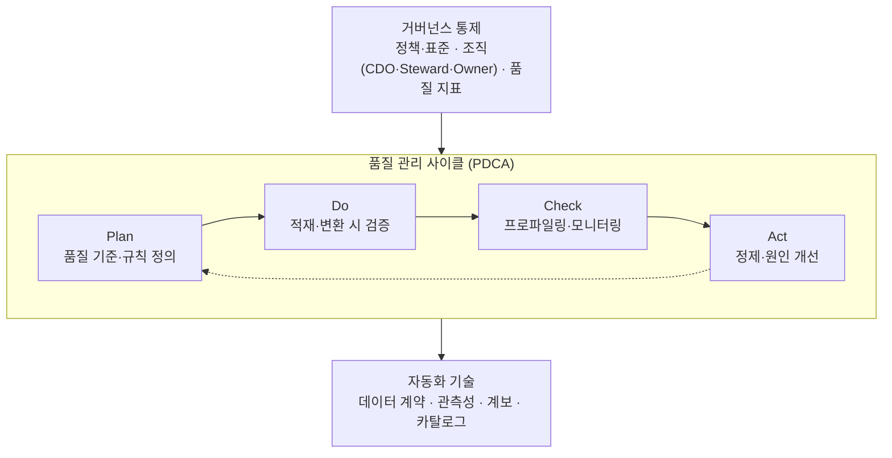

# 데이터 거버넌스 기반 데이터 품질

---

## I. 체계로 지키는 데이터 신뢰, 데이터 거버넌스 기반 품질 관리의 개요

### 가. 정의

- [[데이터 거버넌스]]의 원칙·조직·프로세스 아래에서 **데이터의 정확성·완전성·일관성·적시성 등을 정의·측정·개선하는 지속적 품질 관리 활동** (DAMA-DMBOK 데이터 품질 영역)

### 나. 필요성 및 특징

| 구분 | 내용 |
| --- | --- |
| 의사결정 신뢰 | 오류 데이터로 인한 지표 왜곡·잘못된 판단 방지 |
| AI 신뢰성 | 저품질 학습 데이터로 인한 성능 저하·[[할루시네이션]] 완화 |
| 관리 대상 | 데이터 값, 데이터 구조, 관리 프로세스 |
| 전환 방향 | 사후 정제 → 생성 단계 검증(Shift-Left), 중앙 통제 → 도메인 책임(연합형) |

---

## II. 관리 체계 및 구성요소

### 가. 품질 관리 프레임워크

- 거버넌스가 정한 기준에 따라 [[PDCA(Plan-Do-Check-Act, Deming Cycle)|PDCA]]를 반복하고, 자동화 도구로 원천부터 소비까지 품질을 추적

### 나. 구성요소

| 구분 | 요소 | 설명 |
| --- | --- | --- |
| 기준 | [[데이터 표준화]] | 표준 단어·용어·도메인·코드로 구조 일관성 확보 |
| | 품질 차원 | 정확성, 완전성, 일관성, 유효성, 유일성, 적시성 (DAMA UK 6대 차원) |
| | 품질 모델 | ISO/IEC 25012 (고유·시스템 의존 15개 특성), [[데이터 품질관리(ISO 8000)\|ISO 8000]] |
| 조직 | Data Owner·Steward | 도메인별 품질 규칙 제정과 오류 조치 책임 |
| 진단 | [[데이터 프로파일링]] | 값 분포·[[결측치]]·패턴·이상치 분석 |
| 예방 | 데이터 계약 | 생산자–소비자 간 스키마·품질 조건을 코드로 명시 |
| 감시 | 데이터 관측성 | 신선도·볼륨·스키마·분포·계보 5개 축 모니터링 |
| 추적 | 데이터 계보 | 변환 경로 추적으로 결함 근본 원인 분석 |

---

## III. 비교 및 동향

### 가. 전통 DQM vs 현대적 품질 관리

| 비교 항목 | 전통 DQM | 현대적 품질 관리 |
| --- | --- | --- |
| 접근 | 적재 후 사후 진단·정제 | 생성·적재 단계 사전 차단 |
| 조직 | 중앙 IT·DBA 팀 | 도메인 Owner·Steward 연합 |
| 검증 시점 | 주기적 배치 | CI/CD·스트리밍 실시간 |
| 모니터링 | 정적 규칙 리포트 | 데이터 관측성 플랫폼 |
| 대상 | 정형 RDBMS | 비정형·벡터·[[합성 데이터]] 포함 |

### 나. 동향

- **DataOps·[[MLOps]] 통합**: 파이프라인에 Great Expectations·dbt test 등 검증 단계 내장
- **데이터 제품(Data Product)**: 데이터 메시에서 도메인이 품질 SLA를 갖춘 데이터 제품으로 제공 ([[Daap(Data as a product)]])
- **AI 데이터 품질 기준**: 학습 데이터의 다양성·편향·비식별 조치까지 평가 범위 확대

---

### 🔗 연관 토픽

- **소속 도메인**: [[00_데이터베이스_MOC|🗄️ 데이터베이스]]
- **세부 분류**: `2. 트랜잭션 & 동시성 제어 (Concurrency)`
- **핵심 연관 토픽**:
  - [[데이터 거버넌스]]
  - [[데이터 품질관리(ISO 8000)]]
  - [[데이터 표준화]]
  - [[데이터 프로파일링|데이터 프로파일링 (Data Profiling)]]
  - [[데이터 분석 거버넌스]]
