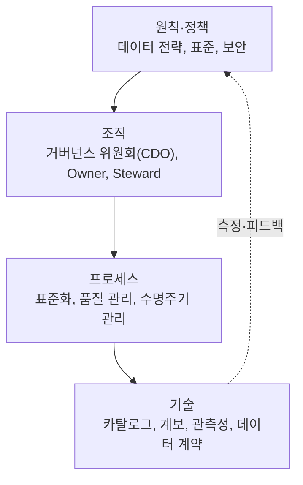

# 데이터 거버넌스

---

## I. 데이터를 자산으로 관리하는 체계, 데이터 거버넌스의 개요

### 가. 정의

- 데이터의 품질·보안·활용을 보장하기 위해 **원칙·조직·프로세스·기술을 정하고 데이터 관리 활동을 통제**하는 전사 체계 (DAMA-DMBOK2에서 11개 지식 영역의 중심 영역)

### 나. 필요성 및 특징

| 구분 | 내용 |
| --- | --- |
| 사일로 해소 | 표준 부재로 인한 중복 데이터·정합성 불일치 해결 |
| AI 신뢰성 | 학습·RAG 데이터 품질 확보 (Garbage In, Garbage Out 방지) |
| 규제 대응 | [[개인정보보호법]], GDPR, EU AI Act 등 데이터 규제 준수 |
| 책임 명확화 | Data Owner·Steward 중심 오너십 체계 |

---

## II. 데이터 거버넌스의 구조 및 구성요소

### 가. 프레임워크

- 위원회가 정책을 정하면 도메인별 Owner·Steward가 표준·품질 프로세스를 수행하고, 카탈로그·계보 등 도구로 이행을 자동 점검

### 나. 구성요소

| 구분 | 요소 | 설명 |
| --- | --- | --- |
| 원칙·정책 | [[데이터 표준화]] | 표준 단어·용어·도메인·코드 정의, 모델 일관성 |
| | 데이터 아키텍처 | 전사 데이터 모델, 데이터 흐름·저장 구조 표준 |
| 조직 | 데이터 거버넌스 위원회 | CDO 주관 정책 심의, 우선순위·충돌 조정 |
| | Data Owner / Steward | 도메인 데이터 책임자 / 품질·표준 실무 관리자 |
| 프로세스 | 데이터 품질 관리 (DQM) | 품질 지표 정의, 프로파일링, 오류 정제 |
| | 마스터 데이터 관리 (MDM) | 고객·제품 등 기준 정보의 단일 원본(Golden Record) |
| 기술 | 데이터 카탈로그 | 메타데이터·비즈니스 용어집 기반 데이터 탐색 |
| | 데이터 계보 (Lineage) | 원천부터 보고서·AI 모델까지 변환 흐름 추적 |
| | 데이터 계약 (Data Contract) | 생산자–소비자 간 [[스키마]]·품질·[[SLA]]를 명시해 변경으로 인한 장애 방지 |
| | 데이터 관측성 | 신선도·볼륨·스키마 변화 감시로 이상 조기 탐지 |

---

## III. 전통적 vs 현대적 거버넌스 및 동향

### 가. 비교

| 구분 | 전통적 거버넌스 | 현대적 거버넌스 (데이터 메시·패브릭) |
| --- | --- | --- |
| 통제 방식 | 중앙 집중 | 연합형(Federated) 거버넌스 |
| 데이터 관점 | 저장·관리 대상 자산 | 도메인이 책임지는 데이터 제품(Data Product) |
| 메타데이터 | 수동 등록, 정적 | 자동 수집·활용 (Active Metadata) |
| 정책 집행 | 사후 감사, 수작업 승인 | 정책의 코드화·자동 적용 (Policy as Code) |
| 아키텍처 | 단일 DW·데이터 레이크 | 데이터 메시, 데이터 패브릭, 멀티 클라우드 |

### 나. 동향

- **AI 데이터 거버넌스**: 비정형 데이터·임베딩 품질, 학습 데이터 출처·저작권, 편향 관리까지 범위 확대 ([[AI 거버넌스]] 연계)
- **자동화**: 메타데이터 수집·분류, 민감정보 탐지, 품질 이상 탐지를 AI로 자동화
- **공공 데이터 품질**: 공공데이터법에 따른 데이터 품질관리 수준 평가 등 제도적 관리 강화

---

### 🔗 연관 토픽

- **소속 도메인**: [[00_경영전략_MOC|📈 경영전략]]
- **세부 분류**: `2. IT 거버넌스 & 엔터프라이즈 아키텍처 (EA/ISP)`
- **핵심 연관 토픽**:
  - [[데이터 표준화]]
  - [[IT 거버넌스]]
  - [[데이터 분석 준비도와 성숙도]]
  - [[AI 거버넌스]]
  - [[무결성]]
