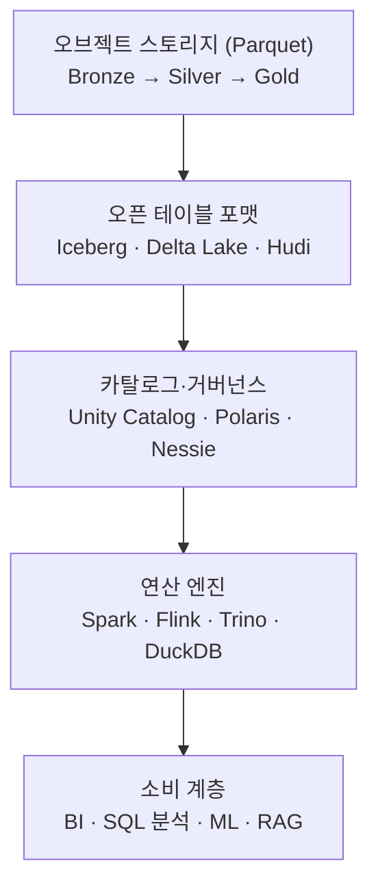

# 데이터 레이크하우스(Data Lakehouse)

---

## I. 레이크 위의 웨어하우스, 데이터 레이크하우스의 개요

### 가. 정의

- 저비용 오브젝트 스토리지(데이터 레이크) 위에 **오픈 테이블 포맷과 메타데이터 계층을 얹어 DW 수준의 ACID [[트랜잭션]]·거버넌스·SQL 성능과 AI/ML 워크로드를 하나의 저장소에서 지원하는 아키텍처**

### 나. 등장 배경 및 특징

| 구분 | 내용 |
| --- | --- |
| 2계층 구조 한계 | 레이크 적재 후 DW로 다시 ETL → 지연, 중복 저장, 거버넌스 불일치 |
| 워크로드 통합 | BI·[[OLAP]]과 데이터 과학·ML을 같은 데이터로 수행 |
| 개방성 | Parquet·Iceberg 등 오픈 포맷으로 다중 엔진 공유, 벤더 종속 완화 |
| 분리 구조 | 스토리지와 컴퓨팅을 독립적으로 확장 |

---

## II. 아키텍처 및 구성요소

### 가. 계층 구조

- 오브젝트 스토리지의 Parquet 파일을 테이블 포맷이 트랜잭션 로그·스냅샷으로 관리하고, 카탈로그를 통해 여러 엔진이 같은 테이블을 읽고 씀

### 나. 구성요소

| 구분 | 요소 | 설명 |
| --- | --- | --- |
| 저장 | 오브젝트 스토리지 | S3, ADLS, GCS 기반 저비용 무제한 확장 |
| | 컬럼형 파일 | Parquet·ORC, 압축과 컬럼 단위 읽기 |
| 테이블 포맷 | Apache Iceberg | 스냅샷·매니페스트 트리 메타데이터, 다중 엔진 표준 |
| | Delta Lake | `_delta_log` 트랜잭션 로그, UniForm으로 Iceberg 호환 |
| | Apache Hudi | 레코드 단위 Upsert·증분 처리에 강점 |
| 기능 | ACID·스냅샷 격리 | 원자적 커밋으로 동시 읽기·쓰기 일관성 |
| | 스키마 강제·진화 | 적재 시 검증, 컬럼 추가·변경 지원 ([[스키마]]) |
| | Time Travel | 과거 스냅샷 조회·롤백·감사 |
| | Merge-on-Read·삭제 벡터 | 파일 재작성 없이 행 단위 변경, CDC 반영 |
| 운영 | 메달리온 아키텍처 | Bronze(원천) → Silver(정제) → Gold(집계) 단계별 품질 관리 |
| | 카탈로그 | Iceberg REST Catalog로 메타데이터·권한 중앙 관리 |

---

## III. 비교 및 동향

### 가. DW vs 데이터 레이크 vs 레이크하우스

| 비교 항목 | 데이터 웨어하우스 | 데이터 레이크 | 레이크하우스 |
| --- | --- | --- | --- |
| 데이터 | 정형 | 정형·반정형·비정형 | 정형·반정형·비정형 |
| 저장 비용 | 높음 | 낮음 | 낮음 |
| 스키마 | Schema-on-Write | Schema-on-Read | Schema-on-Write + 스키마 진화 |
| 트랜잭션 | ACID | 없음 | 테이블 단위 ACID |
| 엔진 | 전용 엔진 | 다양한 오픈 엔진 | 다양한 엔진이 같은 테이블 공유 |
| 주 용도 | BI·리포팅 | 탐색·ML | BI·스트리밍·ML 통합 |

### 나. 동향

- **Iceberg 수렴과 카탈로그 표준화**: Snowflake·Databricks·AWS 등이 Iceberg를 지원, Apache Polaris·Unity Catalog 오픈소스화
- **AI 워크로드 확장**: Lance 등 멀티모달 포맷, 레이크하우스 내 벡터 검색으로 RAG 파이프라인 단순화
- **테이블 유지 관리 자동화**: 소형 파일 병합(Compaction), Z-Order·Liquid Clustering, 파티션 진화 자동화 ([[파티셔닝]])

---

### 🔗 연관 토픽

- **소속 도메인**: [[00_데이터베이스_MOC|🗄️ 데이터베이스]]
- **세부 분류**: `2. 트랜잭션 & 동시성 제어 (Concurrency)`
- **핵심 연관 토픽**:
  - [[EDW]]
  - [[OLAP]]
  - [[HDFS]]
  - [[데이터 거버넌스]]
  - [[파티셔닝|파티션]]
