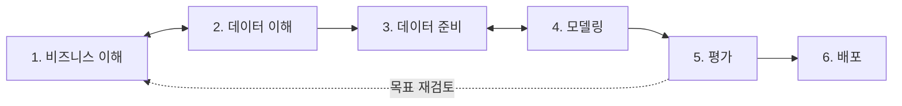

# 데이터 마이닝 방법론

---

## I. 지식 발견의 표준 절차, 데이터 마이닝 방법론의 개요

### 가. 정의

- 대용량 데이터에서 유용한 패턴·규칙을 찾기 위해 **목표 정의부터 데이터 준비, 모델링, 평가, 배포까지의 분석 절차를 표준화한 프로세스 모델** (KDD, SEMMA, CRISP-DM)

### 나. 특징

| 구분 | 내용 |
| --- | --- |
| 반복·순환성 | 평가 결과에 따라 이전 단계로 되돌아가 재수행 |
| 비즈니스 정렬 | 모델 정확도를 조직 KPI·ROI와 연계 |
| 재사용성 | 산출물·절차 표준화로 프로젝트 실패 위험 감소 |
| 데이터 준비 비중 | 전체 공수의 상당 부분(통상 50% 이상)이 데이터 이해·준비 |

---

## II. 표준 프로세스 및 구성요소

### 가. CRISP-DM 6단계

- 비즈니스 이해–데이터 이해, 데이터 준비–모델링은 양방향 반복, 평가에서 목표 미달 시 처음으로 회귀

### 나. 단계별 요소

| 구분 | 요소 | 설명 |
| --- | --- | --- |
| 기획 | 비즈니스 목표 정의 | 문제를 마이닝 목표와 성공 기준(예: 이탈률 감소)으로 변환 |
| 이해 | 탐색적 분석 ([[EDA]]) | 분포·상관·품질 문제 파악 |
| 준비 | 정제·변환 | [[결측치]]·[[이상치]] 처리, 인코딩, 정규화, 특성 공학 ([[데이터 전처리]]) |
| 모델링 | [[지도학습]] | 분류·회귀 (의사결정나무, 랜덤 포레스트, XGBoost) |
| | 비지도학습 | 군집([[DBSCAN(밀도 기반 클러스터링)\|DBSCAN]], K-Means), 연관규칙([[Apriori 알고리즘\|Apriori]]) |
| 평가 | 검증 기법 | 교차 검증, 혼동 행렬, F1, AUC ([[분석 모델 평가 방법]]) |
| 배포 | 운영 연계 | 모델 서빙, 드리프트 모니터링 ([[MLOps]]) |

---

## III. 비교 및 동향

### 가. KDD vs SEMMA vs CRISP-DM

| 비교 항목 | KDD | SEMMA | [[CRISP-DM]] |
| --- | --- | --- | --- |
| 제안 | Fayyad 등 (1996) | SAS Institute | DaimlerChrysler·SPSS·NCR·OHRA 컨소시엄 (EU 지원, 1999~2000) |
| 단계 | 5단계: 선택–전처리–변환–마이닝–해석·평가 | 5단계: Sample–Explore–Modify–Model–Assess | 6단계: 비즈니스 이해–데이터 이해–준비–모델링–평가–배포 |
| 관점 | 학술적, 데이터 중심 | 도구(SAS) 중심 | 비즈니스 중심 |
| 배포 단계 | 없음 | 없음 | 포함 |
| 활용 | 연구 | SAS 기반 프로젝트 | 산업계 사실상 표준 |

### 나. 동향

- **CRISP-ML(Q)**: 머신러닝 수명주기에 품질 보증·위험 관리를 결합한 확장 모델
- **[[AutoML (Automated Machine Learning)|AutoML]]**: 특성 공학·모델 선택·하이퍼파라미터 탐색 자동화
- **Data-Centric AI**: 모델 튜닝보다 학습 데이터 품질 개선을 우선하는 접근

---

### 🔗 연관 토픽

- **소속 도메인**: [[00_데이터베이스_MOC|🗄️ 데이터베이스]]
- **세부 분류**: `1. 데이터 모델링 & 관계형 DB 설계`
- **핵심 연관 토픽**:
  - [[CRISP-DM]]
  - [[데이터 전처리]]
  - [[빅데이터 분석 기법]]
  - [[분석 모델 평가 방법]]
  - [[AutoML (Automated Machine Learning)]]
