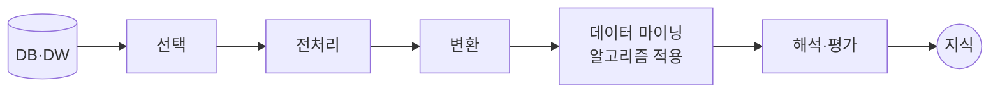

# 데이터 마이닝 (Data Mining)

---

## I. 대량 데이터에서 패턴을 찾는, 데이터 마이닝의 개요

### 가. 정의

- 대용량 데이터에서 **유효하고 유용한 패턴·규칙·관계를 알고리즘으로 찾아내** 의사결정에 활용하는 기술로, KDD(Knowledge Discovery in Databases) 과정의 핵심 단계 (U. Fayyad 외, 1996)

### 나. 특징

| 구분 | 내용 |
| --- | --- |
| 데이터 주도 | 가설 없이 데이터에서 패턴 탐색 (탐색적) |
| 과업 유형 | 분류, 예측, 군집, 연관, 이상 탐지 |
| 학제 융합 | 통계학, 기계학습, 데이터베이스 기술 결합 |
| 활용 | 고객 세분화, 이탈 예측, 장바구니 분석, 부정 탐지 |

---

## II. KDD 과정 및 구성요소

### 가. KDD 과정

- 대상 데이터를 선택·정제·변환한 뒤 알고리즘으로 패턴을 추출하고, 해석·평가를 거쳐 지식으로 활용 (실무 방법론: CRISP-DM)

### 나. 주요 기법

| 구분 | 요소 | 설명 |
| --- | --- | --- |
| 지도 학습 | 분류 | 범주 예측 ([[의사결정나무]], [[서포트 벡터 머신\|SVM]], KNN) |
| | 회귀 | 연속값 예측 (선형 회귀), 확률 기반 분류 (로지스틱 회귀) |
| [[비지도 학습]] | 군집 | 유사한 객체끼리 그룹화 (K-Means, [[DBSCAN(밀도 기반 클러스터링)\|DBSCAN]]) |
| | 연관 규칙 | 함께 발생하는 항목 규칙 (Apriori, FP-Growth / 지지도·신뢰도·향상도) |
| | 순차 패턴 | 시간 순서상 연속 사건 패턴 (GSP) |
| 이상 탐지 | [[이상치]] 탐지 | 정상 패턴에서 벗어난 사례 식별 (Isolation Forest) |
| 전처리 | [[차원 축소]] | [[PCA(Principal Component Analysis)\|PCA]] 등으로 변수 축소 |
| 평가 | 혼동 행렬 | 정확도·정밀도·재현율·F1 |

---

## III. 통계 분석 비교 및 동향

### 가. 통계 분석 vs 데이터 마이닝

| 구분 | 통계 분석 | 데이터 마이닝 |
| --- | --- | --- |
| 접근 | 가설 설정 후 검증 (확증적) | 데이터에서 패턴 탐색 (탐색적) |
| 데이터 | 표본 중심 | 대용량 전체 데이터 |
| 목적 | 모수 추정, 관계 검정 | 예측 모델, 패턴 발견 |
| 기법 | [[ANOVA(Analysis of variance)\|ANOVA]], [[t-검정 (t-test)\|t-검정]], 회귀 | 의사결정나무, 연관 규칙, 앙상블, [[딥러닝]] |

### 나. 동향

- **비정형 데이터 마이닝**: 텍스트·이미지·로그를 딥러닝·임베딩으로 분석하는 범위로 확대
- **[[AutoML (Automated Machine Learning)|AutoML]]**: 알고리즘 선택·하이퍼파라미터 튜닝 자동화로 현업 분석가 활용 확대
- **프라이버시 보호 마이닝**: 가명처리·차분 프라이버시 등으로 개인정보 규제 내 데이터 활용

---

### 🔗 연관 토픽

- **소속 도메인**: [[00_경영전략_MOC|📈 경영전략]]
- **세부 분류**: `3. 비즈니스 프로세스 혁신 & 디지털 전환 (DX)`
- **핵심 연관 토픽**:
  - [[CRM]]
  - [[신경망분석]]
  - [[이상치]]
  - [[PCA(Principal Component Analysis)]]
  - [[데이터 전처리]]
